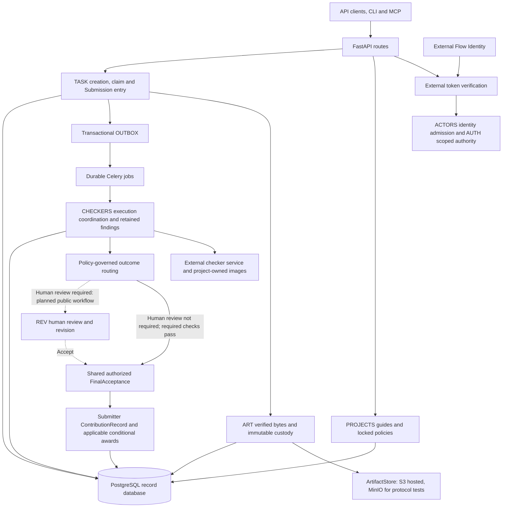

# Workstream backend components

Workstream runs a FastAPI modular monolith with durable workers and a separate
external-checker execution service. This view shows ownership and the primary
contribution path; it is not a deployment inventory or proof that a particular
host is configured. The [capability ledger](../roadmap_status.md) separates
implemented behavior, exposed APIs and remaining release work.

PRE checks govern intake before immutable Submission creation. POST evaluation
uses the exact retained artifact and locked policy. Checker findings are evidence;
AUTH and lifecycle guards govern final acceptance. Automatic acceptance creates
no Review or reviewer contribution. External payment fulfillment remains a
separate boundary; it must not be inferred from an accepted contribution.

## Module responsibilities

| Boundary | Responsibility |
| --- | --- |
| Routes | Parse HTTP contracts and invoke authorized owner operations. |
| AUTH | Decide current, exact-resource authority and retain authorization evidence. |
| Services | Apply lifecycle rules and preserve caller-owned atomic transactions. |
| Repositories | Persist and recover owner facts through SQLAlchemy/PostgreSQL. |
| Adapters | Implement typed external-service ports without moving project evaluation into core. |
| Audit | Retain immutable operational and authorization evidence. |

Project setup assistance is explicitly requested and optional. It receives guide
documents and task examples, plus feedback only for an explicit correction.
It proposes source-cited PRE/POST specifications. Humans select and approve
registered project images/configuration; the shared PRE default remains separate.

The human-review branch remains the default policy and preserves its guards.
Its public workflow is not implied by this diagram; see the
[review contract](../spec_review_lifecycle.md). Future reputation consumes
contribution evidence and does not control lifecycle truth.
