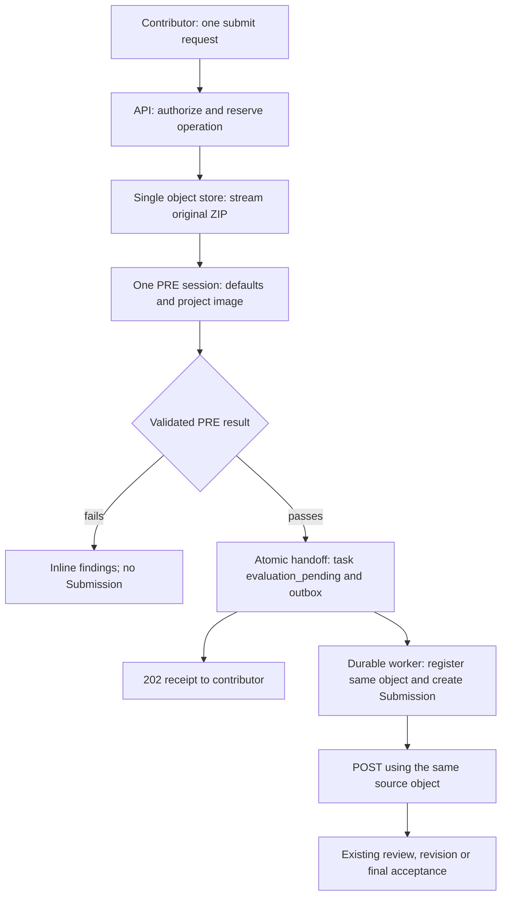

# Workstream submission and execution specification

**Version: v0.1**  
**Design:** one submission request, one object store, inline PRE, durable continuation  
**Prepared:** 11 November 2026  
**Repository baseline:** [Flow-Research/workstream at 01299e36a486c948be6f05f4e122dea39b993a04](https://github.com/Flow-Research/workstream/tree/01299e36a486c948be6f05f4e122dea39b993a04)  
**Status:** implementation specification for the user-approved architecture. This document does not claim the changes are implemented.

## Reading and implementation guide

Read sections 1–4 first for the complete design. Sections 5–18 define the contracts and failure behavior. Sections 19–23 define scale, migration, implementation order and acceptance evidence. Section 24 identifies deployment values that must be supplied rather than guessed.

The terms **MUST**, **MUST NOT**, **SHOULD** and **MAY** distinguish requirements, prohibited behavior, recommendations with a documented reason for deviation, and explicitly permitted implementation freedom. Unless a section says “current baseline,” it describes the required target behavior.

An implementation agent MUST read this entire specification and the repository's current owner contracts before changing code. It MUST implement the selected behavior, trace affected callers, and preserve unrelated behavior. If a needed product decision is absent, source evidence contradicts a required invariant, or a deployment value cannot be resolved from an approved profile, the agent MUST ask a focused follow-up question using section 24. It MUST NOT silently select another architecture, invent a business rule, weaken a guard, or claim a guessed value was approved.

Internal class and private function names may follow existing repository conventions. Public fields, state meanings, transaction boundaries, identity guarantees, and error semantics specified here are contractual. Mechanical naming choices do not require a product decision.

### Contents

1. [Purpose and fixed decisions](#1-purpose-and-fixed-decisions)
2. [Scope and ownership](#2-scope-and-ownership)
3. [Terminology](#3-terminology)
4. [Complete submission journey](#4-complete-submission-journey)
5. [The single contributor API](#5-the-single-contributor-api)
6. [Idempotency and concurrent requests](#6-idempotency-and-concurrent-requests)
7. [Operation and task states](#7-operation-and-task-states)
8. [Durable data and constraints](#8-durable-data-and-constraints)
9. [Transaction boundaries and authority](#9-transaction-boundaries-and-authority)
10. [Streaming into the existing object store](#10-streaming-into-the-existing-object-store)
11. [Input identity and platform defaults](#11-input-identity-and-platform-defaults)
12. [One PRE execution session](#12-one-pre-execution-session)
13. [The execution adapter contract](#13-the-execution-adapter-contract)
14. [Durable finalization and POST dispatch](#14-durable-finalization-and-post-dispatch)
15. [POST, review, revision and acceptance](#15-post-review-revision-and-acceptance)
16. [Failure and recovery rules](#16-failure-and-recovery-rules)
17. [Object and runtime cleanup](#17-object-and-runtime-cleanup)
18. [Limits, quotas and timing](#18-limits-quotas-and-timing)
19. [Scaling and operations](#19-scaling-and-operations)
20. [Migration and cutover](#20-migration-and-cutover)
21. [Repository change map](#21-repository-change-map)
22. [Implementation sequence](#22-implementation-sequence)
23. [Acceptance evidence and completion gate](#23-acceptance-evidence-and-completion-gate)
24. [Unresolved values and follow-up protocol](#24-unresolved-values-and-follow-up-protocol)
25. [Sources and design rationale](#25-sources-and-design-rationale)

## 1. Purpose and fixed decisions

Workstream accepts a contributor's ZIP only after its platform checks and the project's PRE quality checker pass. The contributor receives that initial result in the same request. Workstream then durably creates the retained Submission and runs POST before any required human review or final acceptance.

The design keeps bytes in one durable location and gives each component a clear job. The API handles the current upload and PRE interaction. The object store holds the original ZIP. The execution provider runs isolated checks. Durable workers complete accepted work after the foreground handoff. PostgreSQL determines ownership and lifecycle truth.

### 1.1 Decision ledger

| ID | Required decision |
| --- | --- |
| D01 | Keep this design and implementation within unreleased **v0.1**. |
| D02 | Expose one contributor submission mutation, used by the CLI and adapters. Upload, PRE feedback and the accepted handoff occur in that one request. |
| D03 | Stream the raw ZIP through the Workstream API into the **existing single artifact bucket/provider namespace** using bounded buffers. Do not retain a complete ZIP in API scratch or memory. |
| D04 | Allocate one unique, immutable object key per intake operation. PRE, registration, POST and retained evidence refer to that same object and generation. No second bucket, copy, rename, promotion or re-upload is part of this flow. |
| D05 | Create a small durable operation record before bytes are written. A completed upload may have an operation record without a retained artifact or Submission record. |
| D06 | Start PRE after the upload is complete. A slow contributor upload must not occupy a live PRE sandbox. |
| D07 | Run the Workstream default checks and exactly one selected project PRE image in **one PRE session**. The platform supplies its trusted code separately from the project image. |
| D08 | Every approved project policy requires exactly one PRE image and exactly one POST image, pinned to approved immutable identities. One image can implement many project requirements. |
| D09 | PRE failure returns actionable findings inline. It creates no Submission, changes no eligible task into evaluation, and consumes no revision round. |
| D10 | On PRE pass, the API commits the accepted operation, task `evaluation_pending` transition and finalization outbox event in **one short database transaction before returning success**. |
| D11 | Durable workers handle the remainder: register the existing object, create the formal Submission, reserve POST and dispatch it. They do not repeat PRE or upload the ZIP again. |
| D12 | A task already awaiting finalization/evaluation does not accept a new submission. Exact idempotent replay observes the existing operation. |
| D13 | Preserve existing POST execution, governed revision, review, final acceptance and contribution-record behavior. Adapt source custody where required; do not redesign POST internals. |
| D14 | Smol is an execution adapter. Core contracts must support a qualified managed provider without requiring access to its host. Qualification is required; a generic create/delete API alone is not enough. |
| D15 | Cleanup runs initially every **12 hours**, considers only eligible objects at least **2 hours** old, and checks durable ownership before deletion. Passed, pending, retrying, stalled and retained inputs remain protected regardless of age. |
| D16 | Keep the approximately **60-second PRE experience target** separate from contributor upload and later durable work. All actual execution and request lifetimes still have explicit finite limits. |
| D17 | Keep raw ZIP SHA-256, exact raw byte count and canonical semantic manifest identity distinct. These bind checks and records to the contributor's exact input. |
| D18 | Prefer existing owners, typed ports, PostgreSQL, outbox and Celery. Add only the contracts and state needed for this flow. |

### 1.2 Non-negotiable invariants

- **I01 — one source:** an accepted operation's original ZIP key, provider generation, raw SHA and byte count never change.
- **I02 — accepted means durable:** no accepted response is emitted unless the PRE-pass transaction has committed.
- **I03 — acceptance closes intake:** that transaction makes the task `evaluation_pending` and prevents another new contributor submission.
- **I04 — no premature Submission:** no retained submission artifact, formal Submission or POST dispatch exists because an upload merely completed or a checker printed “pass.”
- **I05 — one logical continuation:** one accepted operation produces at most one formal Submission and one logical initial POST dispatch.
- **I06 — no deletion of accepted work:** a missing formal artifact row, old age or expired Celery worker lease is never sufficient deletion authority.
- **I07 — trusted identity:** project code cannot assert or replace trusted input identity, platform-default results, image identity or acceptance authority.
- **I08 — exact locked context:** a Celery worker finishes the command accepted under its recorded assignment, predecessor and rules. It does not silently rebase it.
- **I09 — failure separation:** QC rejection, infrastructure failure, and governed POST/review outcomes remain different facts.
- **I10 — bounded work:** upload buffers, admission queues, sandboxes, output, retries and cleanup batches have finite bounds.
- **I11 — provider independence:** the core never requires a provider host path, a Smol binary, a host Unix socket or guest transport as universal execution facts.
- **I12 — durable truth:** database ownership and fenced results determine progress; message delivery and object existence do not.

## 2. Scope and ownership

### 2.1 Included changes

This specification replaces the current contributor preparation-then-submit path, API-local submission ZIP custody, separate PRE intake/export/project execution handoff, post-PRE object upload, and SHA-derived-key assumption for new submission source objects.

It introduces the early intake operation, bounded streaming object receipt, one-session PRE, atomic accepted handoff, owner-qualified finalization, operation-aware cleanup, truthful physical-object accounting, and updated clients/read models.

It also tightens project policy cardinality and removes provider-host assumptions from the common execution boundary.

### 2.2 Preserved behavior

Preserve:

- Flow Identity authentication and Workstream's own authorization decisions.
- Task assignments, locked guides and policy lineage, exact predecessor and revision acknowledgement rules.
- Canonical manifest representation and existing Workstream default-check semantics.
- Existing ART ownership, namespace/readiness checks and verification for other artifact producers.
- Existing CHECKERS terminal-result ownership, policy evaluation and governed lifecycle routing.
- Existing POST model, trial/build and forge capabilities where selected and supported.
- Human review required by default, and the existing shared final-acceptance operation when review is not required.
- Atomic final-acceptance/contribution-record/award behavior.
- Retained historical data and audit evidence.

Shared scratch services used by guide documents, task imports, checker outputs or other flows remain unless a separately traced change removes their last consumer. Removing submission API scratch does not authorize deleting the shared subsystem.

### 2.3 Component responsibilities

| Component | Owns | Must not acquire |
| --- | --- | --- |
| Contributor CLI/client | ZIP, packet, assignment/revision selectors, idempotency key, display of outcomes | Storage coordinates, trusted checksums, lifecycle authority |
| API command/composition boundary | Current request orchestration, authorization, bounded streaming, synchronous PRE, accepted handoff | Long-lived ZIP scratch, background continuation of failed foreground PRE |
| ART module | Object custody, raw/manifest binding, physical reservations, registration and cleanup authority | Task acceptance or project QC verdict ownership |
| TASK module | Submission eligibility, active operation ownership on the task, accepted task transition, formal Submission and dispatch lineage | Storage-provider mechanics |
| CHECKERS module | Selected image/policy validation, execution leases, validated terminal evidence, POST routing inputs | Arbitrary changes to task acceptance policy |
| Execution adapter/runtime | Qualified isolation, trusted input loading/default execution, project execution, bounded results, runtime cleanup | Object retention decisions or contributor authority |
| Object store | Durable original object bytes under exact references | Product eligibility or database lifecycle truth |
| Celery workers/outbox | Delivery and invocation of existing owner commands after accepted handoff | Independent product state machines or direct bypasses of owner checks |
| PostgreSQL | Durable ownership, state, unique identities, fences, outbox and immutable evidence | Hosting the ZIP body |
| Redis/broker | Transport of work notifications | Sole custody of accepted work |

The API, Celery workers and runtime may share today's server. Moving runtime execution to dedicated servers changes placement and configuration within the adapter, not this ownership model.

## 3. Terminology

| Term | Meaning |
| --- | --- |
| Intake operation | Durable metadata for one submission request and its object. It exists before upload and may end without a Submission. |
| Accepted handoff | The committed PRE-pass transaction that sets the task to `evaluation_pending` and schedules durable finalization. |
| Formal Submission | The immutable product record created by the Celery worker after accepted handoff and exact object registration. |
| Source object | The original uploaded ZIP at one generated object key and immutable provider generation. |
| Provider generation | Opaque storage identity that pins an exact object version. In the current AWS profile this is S3 `VersionId`. |
| Retained artifact | ART records and binding establishing that an exact source object is retained evidence for a formal Submission. |
| Raw identity | SHA-256 over the exact ZIP bytes, plus their exact count. |
| Semantic identity | Existing canonical manifest identity over normalized paths, types, file contents, sizes and executable bits. |
| PRE | Fast initial quality gate before an accepted submission handoff. Passing PRE is not final acceptance. |
| POST | Evaluation of a formal submitted task before review/acceptance, using the selected POST policy. |
| Platform bootstrap / supervisor | Workstream-controlled code inside the execution session that loads and verifies input, runs protected defaults, isolates the project process and reports trusted facts. It is not a second VM or another public service. |
| Lease and fence | Time-bounded ownership plus a monotonically changing generation. An expired or replaced owner cannot publish a current result. |
| Finalization | Durable registration of the existing object and creation of Submission plus POST dispatch. It contains no source-object copy. |
| Operational stall | An accepted operation that needs intervention after its permitted automatic retries. Its task/input remain protected and pending. |

“Claimed” in ordinary conversation means assigned work. The current initial submission-eligible persisted task status is `in_progress` with the active assignment; this design does not add a literal `claimed` status. Governed revisions use `needs_revision`.

## 4. Complete submission journey

### 4.1 Successful request and continuation

1. The contributor calls the single submit endpoint with the ZIP body, current assignment, packet, revision selectors when applicable, and an idempotency key.
2. Workstream checks authentication, task/assignment authority, current eligibility, packet validity, locked images/configuration and upload admission.
3. A short transaction creates the intake operation, reserves physical capacity, records its generated object key and installs the task's active-operation guard.
4. The API streams the original ZIP to the existing object store, hashes and counts it, and applies backpressure. The execution provider has not started a PRE sandbox yet.
5. At EOF, Workstream records completion intent, completes the immutable object and records its exact provider generation.
6. Workstream admits one PRE session with the immutable source descriptor, approved resource profile, platform defaults, project PRE image and locked context.
7. The trusted loader reads that object, verifies raw SHA/count, safely extracts it, and builds the canonical manifest. The platform defaults run; then the selected project image runs if defaults permit it.
8. CHECKERS validates the bounded response against the recorded request and current fence. The original ZIP and verified input remain read-only to project code.
9. On pass, the API revalidates the task/context and atomically records the accepted operation, `evaluation_pending` and finalization outbox event.
10. The API returns `202 Accepted` with the durable operation receipt and PRE findings. The contributor has completed the submission interaction.
11. A durable worker registers the same object, creates the formal Submission, reserves POST and writes the POST outbox event in one composed database transaction.
12. POST obtains the same original object through the execution adapter and follows existing evaluation, review/revision and acceptance rules.

The PRE runtime session can be destroyed after its result is safely captured. Neither Celery worker finalization nor POST depends on that VM remaining alive.

### 4.2 Flow diagram



The arrow from storage to PRE represents an input read. The arrow to POST also requires an input read by the provider/runtime. Giving a sandbox a source reference does not eliminate transfer of the bytes it must inspect. It eliminates a Celery worker downloading, re-uploading or copying the source to make it available.

### 4.3 Observable meaning at each point

| Point | Task | Intake operation | Formal Submission / retained artifact |
| --- | --- | --- | --- |
| Before request | `in_progress` or eligible `needs_revision` | None | Prior history may exist |
| Receiving ZIP / running PRE | Same eligible status, guarded by active operation | Active | No new records |
| PRE rejected / pre-handoff infrastructure failure | Same eligible status once operation terminalizes | Rejected/failed/abandoned | No new records |
| Accepted response | `evaluation_pending` | `finalization_pending` | May not exist yet |
| Celery Worker commits finalization | `evaluation_pending` | `finalized` | Both exist and are exactly bound |
| POST/review advances | Existing governed lifecycle | Finalized history | Immutable retained records |

The task's pending-operation projection explains the gap between accepted receipt and formal Submission. A client must not infer failure or readiness to submit again from an empty Submission list.


## 5. The single contributor API

### 5.1 Mutation

Replace the current JSON admission-consuming mutation with:

```http
POST /api/v1/tasks/{task_id}/submissions
Content-Type: application/zip
Idempotency-Key: <caller-generated UUID>
X-Task-Assignment-Id: <UUID>
Authorization: <existing authenticated scheme>

<original ZIP bytes>
```

Keep action identity `submission.create`. This endpoint is the only contributor mutation for uploading and submitting a bundle.

The old public `POST /tasks/{task_id}/submission-bundle-preparations` and the public “prepare, receive admission ID, submit admission” contract are removed from the active v0.1 API, CLI and MCP surfaces together. Do not leave a compatibility alias or a second supported submission path. Internal ART admission/registration concepts may remain where they protect owner invariants.

### 5.2 Request contract

| Input | Required semantics |
| --- | --- |
| `task_id` | Valid UUID and an authorized task; preserve non-disclosing authorization behavior. |
| `Idempotency-Key` | Exactly one valid UUID header. Scope: authenticated actor plus key; a key cannot select a different task or packet later. |
| `X-Task-Assignment-Id` | Exactly one valid UUID header; must identify the currently authorized assignment for a new operation. |
| `Content-Type` | `application/zip`. Reject other media types. |
| `Content-Encoding` | Absent or `identity`. Do not transparently transform/compress/decompress the submitted body. |
| `Content-Length` | If supplied, valid and within the permitted raw limit; verify actual EOF count equals it. If absent, reserve the permitted maximum and enforce the count while streaming. Reject ambiguous or contradictory framing at the HTTP edge. |
| `X-Submission-Summary` | Optional; omitted means empty string. Preserve current printable-ASCII header semantics, at most 64 KiB, without leading/trailing header whitespace. |
| `X-Contributor-Attestation` | Same encoding/size rules as summary. Omission preserves existing warning behavior. |
| `X-Predecessor-Submission-Id` | Exactly the current predecessor when submitting a governed revision; absent for the initial submission. No client-selected replacement of the predecessor. |
| `X-Revision-Preparation-Id` and `X-Revision-Preparation-Sha256` | Both present or both absent. Required and validated where the existing governed revision contract requires acknowledgement. |
| Body | Nonempty original ZIP; actual bytes are authoritative. No multipart/form-data parser or base64 transformation at the backend submit boundary. |

Reject duplicate occurrences of every selector/packet header rather than accepting one framework-selected value. Treat text exactly as validated; do not trim, normalize or rewrite a packet while hashing it. Clients and edge/header limits must support the published packet limits consistently. A larger Unicode/multipart packet redesign is not part of this change.

The client need not supply an authoritative checksum or make a separate preparation call. An optional client-side source-change check in the CLI is local protection; it does not replace server hashing.

Authentication and metadata/known-capacity rejection happen before body consumption where the HTTP stack permits it. Backpressure and early connection termination must be verified through the actual proxy/server stack; an early API decision does not itself prove the upstream proxy avoided buffering.

### 5.3 Accepted response

Return `202` only after transaction T4 in section 9 commits:

```json
{
  "operation_id": "019a0000-0000-7000-8000-000000000001",
  "task_id": "019a0000-0000-7000-8000-000000000002",
  "assignment_id": "019a0000-0000-7000-8000-000000000003",
  "status": "accepted",
  "accepted_at": "2026-11-11T10:00:00Z",
  "task_status_at_acceptance": "evaluation_pending",
  "processing_stage_at_acceptance": "finalization_pending",
  "replayed": false,
  "pre_submission_results": []
}
```

The IDs and timestamp above are examples, not prescribed values. The receipt records the acceptance snapshot. A replay later may occur after POST, review or acceptance; it must not claim the task is currently still pending. The accepted payload is stable apart from `replayed` and ordinary response correlation metadata.

The initial receipt deliberately does not fabricate a Submission ID, version or evaluation request ID. Those exist after Celery worker finalization and are available from the authorized read projection. The API may not wait for finalization merely to fill those fields.

Preserve nonblocking PRE warnings and findings using the existing bounded public projection. A displayed message should say the submission passed initial checks and is awaiting/undergoing evaluation, not that the task has been finally accepted.

### 5.4 Failure envelope and status codes

Use the existing structured error envelope, correlation/request IDs, sanitization and authorization-concealment conventions. The fields in this table are domain codes, not an alternative error transport.

| HTTP | Code/category | Meaning and required behavior |
| --- | --- | --- |
| 404 | `submission_unavailable` | Task/assignment/operation not available to this actor. Do not reveal cross-actor state. |
| 409 | `submission_state_conflict` | A new request targets a task that is no longer submission-eligible. |
| 409 | `submission_operation_in_progress` | Another active operation owns this task, or this exact key is still in an unfinished foreground phase. Return its ID only if authorized. |
| 409 | `submission_idempotency_conflict` | Same actor/key with different metadata or a verified different raw body. |
| 409 | `submission_operation_terminal` | A pre-seal operation ended without a complete input identity; it cannot be resumed or reused. A new key is required once its task guard is released. |
| 409 | Existing revision/context codes | Preserve revision limit/deadline, predecessor, acknowledgement-context and locked-rule conflict semantics. |
| 413 | `submission_archive_limit_exceeded` | Declared or actual raw ZIP exceeds the permitted ceiling. Stop upload; retain cleanup ownership. |
| 415 | `submission_media_type_unsupported` | Unsupported content type or content encoding. |
| 422 | `submission_packet_invalid` | Invalid selectors, packet or revision acknowledgement syntax; preserve more specific existing revision codes. |
| 422 | `pre_submission_checker_failed` | Validated platform/project QC rejection. Include bounded actionable PRE results; `eligible_to_submit=false`; no new Submission. |
| 408 | `submission_upload_timeout` | The client upload breached its explicit idle/total upload limit before handoff. No accepted work is implied. |
| 429 | `submission_capacity_exceeded` | Admission or quota/rate bound prevents this request from proceeding. Include a finite retry hint where one is known. |
| 503 | `submission_infrastructure_unavailable` | Storage/runtime/DB/protocol failure before accepted handoff; not a QC verdict. |
| 503 | `submission_outcome_unknown` | The API cannot determine whether its acceptance commit succeeded. Client must observe/replay the same key; it must not blindly create new work. |

A platform-safe-archive rejection is QC feedback. A transport object mismatch, untrusted runtime response, unavailable provider, Celery worker failure or expired execution deadline is infrastructure failure unless an existing approved checker contract explicitly identifies a completed deterministic QC result.

For an operation that reached a complete raw identity, persist the original terminal response classification and bounded findings for exact replay. Do not persist secrets or raw attacker-controlled logs in public error details.

### 5.5 Read-only progress

Add the owner-backed read:

```http
GET /api/v1/tasks/{task_id}/submission-operations?operation_id=<UUID>
GET /api/v1/tasks/{task_id}/submission-operations?idempotency_key=<UUID>
```

These are two selectors for the same read route; exactly one is required. They are not additional submission actions. A key lookup is actor-scoped. Read access follows the existing contributor/management authorization model; it never grants access merely because an ID is known.

Return one closed JSON object with the following fields; fields listed as nullable remain present with JSON null rather than being omitted:

| Field | Type and meaning |
| --- | --- |
| `operation_id`, `task_id`, `assignment_id` | UUID strings identifying this operation and its original task/assignment |
| `idempotency_key` | Original caller UUID, revealed only under the authorized read contract |
| `operation_state` | One of the eight lifecycle values in section 7.1 |
| `processing_stage` | Closed stage value defined below, derived from this operation's own evidence |
| `accepted_at` | UTC RFC 3339 timestamp or null |
| `task_status_at_acceptance` | `evaluation_pending` or null |
| `current_task_status` | Current existing TASK status enum or null when current-task visibility is not authorized; contextual information, not this historical operation's outcome |
| `submission_id` | UUID string or null before T5 |
| `submission_version` | Positive integer or null before T5, using the existing Submission version representation |
| `evaluation_request_id` | UUID string or null before T5 |
| `pre_submission_results` | Bounded array using the existing public PRE result projection; empty until results are available |
| `failure_code` | Stable sanitized owner error code or null; no raw provider exception |
| `operationally_stalled` | Boolean; true only when the relevant finalization/evaluation owner records a stall |
| `next_action` | One of `wait`, `correct_and_submit_new_key`, `retry_new_key_after_terminal`, `inspect_governed_outcome` |

Do not expose provider keys, signed URLs, credentials or host coordinates.

Use these processing stages: `receiving`, `pre_checking`, `finalization_pending`, `evaluation_pending`, `evaluation_running`, `review_pending`, `needs_revision`, `accepted`, `rejected`, `failed`, `abandoned`, `cancelled` and `operationally_stalled` where supported by their actual owner facts. Do not infer “evaluation_running” from the task status alone.

Derive `processing_stage` from this operation's own PRE, Submission, evaluation and governed outcome associations. Never derive a historical operation's stage from the task's latest Submission or current status; the task may have advanced to a newer revision.

| Operation/evidence | `processing_stage` | `next_action` |
| --- | --- | --- |
| `receiving` / `pre_checking` | Matching state | `wait` |
| `finalization_pending` without stall | `finalization_pending` | `wait` |
| Relevant finalization/evaluation owner explicitly stalled | `operationally_stalled` | `wait` |
| Finalized; its evaluation queued/retrying or actively running | `evaluation_pending` / `evaluation_running` from the actual evaluation owner | `wait` |
| Finalized; its governed review/revision/acceptance/rejection outcome exists | Matching `review_pending`, `needs_revision`, `accepted` or `rejected` | `inspect_governed_outcome` |
| Terminal PRE `rejected` | `rejected` | `correct_and_submit_new_key` only when TASK currently permits new intake; otherwise `inspect_governed_outcome` |
| Terminal pre-handoff `failed` / `abandoned` | Matching state | `retry_new_key_after_terminal` only when TASK currently permits new intake; otherwise `inspect_governed_outcome` |
| Explicitly `cancelled` | `cancelled` | `inspect_governed_outcome` |

For a terminal operation, “TASK currently permits new intake” means this reader has current contributor submit authority for this operation's task and original still-active assignment, with compatible current predecessor/revision context and no active-operation guard. Management-only readers and contributors whose assignments have closed receive `inspect_governed_outcome`. Do not recommend a submission merely because the task is eligible for somebody else.

No next-action value bypasses current revision acknowledgement or authorization. Derive it through the TASK read owner, not client guesswork. Preserve existing historical-read concealment: permission to read an old operation does not reveal the reassigned task's current status. A missing/corrupt finalized association is an operational integrity error, not permission to infer progress from another Submission.

Extend existing task/work-context reads with its active/pending operation and stage. While a new revision awaits finalization, show the predecessor as historical and the new operation as pending; do not present the previous Submission as the newly submitted work.

## 6. Idempotency and concurrent requests

### 6.1 Exact identity

The idempotency namespace is `(actor_profile_id, idempotency_key)`. Store the original identity-link provenance and packet. Token strings and expiry timestamps are not request identity.

Metadata identity includes task, assignment, predecessor, summary, attestation, and revision acknowledgement. Raw identity adds server-observed ZIP SHA-256 and byte count. Canonical hashing uses existing Workstream encoding/domain-separation conventions; there is one explicit schema for this request body, covered by fixtures.

The operation's accepted context is separately pinned. A later replay uses that original context and result; it must not reinterpret the same key using newly selected project rules.

### 6.2 New key

In T1, lock the task, check status/assignment/revision, and claim its active-operation guard under database uniqueness. At most one operation may actively receive, run PRE or await finalization for a task. Do not rely on a process-local semaphore or check-then-insert without a database constraint.

Different keys racing on one task cannot both enter PRE or both produce accepted work. The loser receives the appropriate conflict before creating another live source write.

### 6.3 Existing key

Resolve an existing key under fresh current read authority before applying ordinary new-submission status eligibility. This permits an authorized exact replay after the task has advanced, without allowing a new submission.

1. Compare immutable request metadata first. Any mismatch is `submission_idempotency_conflict`.
2. If the original has not sealed a complete raw identity and is active, return `submission_operation_in_progress`. Do not claim byte equality and do not start a second upload.
3. If the original ended without a complete identity, return `submission_operation_terminal`. It is not resumable; a new request requires a new key after the original is conclusively terminal.
4. If the original has a complete raw identity, consume the retry body through bounded hash/count into a discard sink. Enforce the same raw/framing limits. Do not create another object or invoke PRE.
5. Different SHA/count is `submission_idempotency_conflict`. Equal bytes return the stored terminal result, or in-progress status for any active `receiving`/`pre_checking` phase. This includes EOF recorded while provider completion is still unresolved. No replay request takes over that phase.
6. An accepted operation replays its accepted receipt. A rejected operation replays its rejection and findings. A completed pre-handoff infrastructure failure replays that recorded failure; it does not rerun PRE.

Using an operation GET avoids retransmitting a ZIP merely to observe progress. A client disconnect during replay cannot cancel or modify the original operation.

### 6.4 No resumable intake in this change

An interrupted pre-acceptance operation is fenced and terminalized under section 16. No Celery worker resumes its request body, quietly completes PRE, or changes its object key into a new attempt. A contributor may submit a new request/key when eligibility is restored.

Internal retry of a failed object part is permitted only within the same live foreground operation, with bounded retained part buffers, the same immutable identity, and the current lease. It is not a new submission or an unbounded request retry.

## 7. Operation and task states

### 7.1 Operation state machine

Use one ART-owned intake-operation lifecycle:

| State | Meaning | Allowed forward transitions |
| --- | --- | --- |
| `receiving` | Ownership/reservation committed; upload or bounded completion resolution in progress | `pre_checking`, `failed`, `abandoned`, `cancelled` |
| `pre_checking` | Complete immutable object known; inline PRE admission/execution/validation in progress | `finalization_pending`, `rejected`, `failed`, `abandoned`, `cancelled` |
| `finalization_pending` | PRE-pass handoff committed; task is `evaluation_pending` | `finalized`, or explicitly authorized cancellation under the existing lifecycle contract |
| `finalized` | Formal Submission, retained binding and POST dispatch committed | Terminal intake state; POST owns later evaluation |
| `rejected` | Platform/project PRE returned a validated QC rejection | Terminal |
| `failed` | Foreground infrastructure or context failure conclusively prevented accepted handoff | Terminal |
| `abandoned` | Foreground owner ended/expired without accepted handoff | Terminal |
| `cancelled` | Explicit cancellation with authority/provenance | Terminal |

Upload sealing is recorded by immutable source fields/timestamps while `receiving`; a separate “uploaded” product state is unnecessary. `finalization_pending` remains the state during Celery worker retries. `stalled_at` and a stable operational reason mark exhausted retries without converting the operation into QC failure.

Cleanup state is orthogonal: `not_claimed`, `claimed`, `deleted`. It records a deletion obligation without erasing the original rejected/failed result needed for replay. It is prohibited on active, accepted or retained work unless a separately authorized retention/cancellation operation has explicitly made deletion eligible.

### 7.2 Task relationship

- T1 installs `active_submission_operation_id` under the TASK owner. The task remains `in_progress` or eligible `needs_revision` during upload/PRE.
- Terminal pre-handoff failure clears that active pointer in the same task/operation transaction, provided the pointer still belongs to that operation.
- T4 keeps the pointer, records accepted ownership, and changes task status directly to `evaluation_pending` through the new authorized handoff operation.
- T5 creates the actual Submission/dispatch and clears the active-operation pointer atomically. The task stays `evaluation_pending`.
- No intermediate task transition back to `submitted` or `in_progress` is permitted during Celery worker finalization.
- Existing historical `submitted` records may remain valid; the new path does not need to persist that intermediate state.
- Assignment release/replacement/readiness operations must respect the active/pending operation guard. Absence of a Submission is not evidence that an accepted assignment may be recycled.

No new contributor claim-expiry feature is introduced. Existing assignment/lifecycle operations must simply reject incompatible mutations while an operation owns the task.

## 8. Durable data and constraints

### 8.1 Intake operation

Extend the ART owner with one cohesive `SubmissionIntakeOperation` record. Reuse existing owner types and audits; do not create an unrelated upload service/database.

| Group | Required durable fields/facts |
| --- | --- |
| Identity | Workstream-generated UUIDv7 operation ID; task/project/assignment/actor/identity-link; caller idempotency key; request/correlation IDs |
| Original command | Exact packet and metadata digest; predecessor; revision acknowledgement; original eligible task status; locked guide/rules/PRE/POST/default identities and resource profile |
| Ownership | State; task active pointer relationship; foreground lease ID, generation, expiry; absolute deadlines; created/updated/terminal timestamps |
| Source | Provider/namespace identity; generated object key; upload maximum/reservation; provider upload handle where used; immutable completion intent; raw SHA/count at EOF; sealed provider generation; completion/observation times |
| PRE | Selected run ID; immutable execution-request digest; validated terminal digest; platform input/manifest/default evidence; selected project result and bounded public projection |
| Accepted command | Acceptance authority decision ID; accepted context digest; accepted_at; stable acceptance receipt; unique finalization event identity |
| Continuation | Celery Worker lease/generation; retry count/next retry/error/stalled_at; finalized_at; actual Submission/retained replica/evaluation IDs after T5 |
| Cleanup | Eligibility/last relevant storage activity timestamps; cleanup state/generation; exact deletion targets/obligation; confirmed absence/deletion and quota-release evidence |

Credentials, signed URLs, bearer tokens, ZIP bytes, process-local readers and guest filesystem paths MUST NOT be the durable source/continuation payload.

### 8.2 Constraints

Database constraints and owner checks together enforce:

- Unique `(actor_profile_id, idempotency_key)`.
- At most one active operation per task across `receiving`, `pre_checking` and `finalization_pending`.
- Exact task/project/assignment/actor foreign-key consistency.
- A task active pointer can only reference its own operation.
- The generated object key belongs to exactly one operation; namespace and generation are bound to that operation.
- Sealed raw SHA/count and provider generation cannot be changed by replay or finalization.
- `finalization_pending` requires complete passing evidence, accepted authority, accepted timestamp and durable handoff identity.
- `finalized` requires exactly one actual Submission, exact retained replica/binding and POST dispatch.
- A unique operation-to-Submission association and unique task/submission-version association.
- Finalization-event uniqueness by operation; existing POST request/dispatch uniqueness remains.
- Cleanup `claimed` excludes any active/accepted/retained ownership.
- Charges/reservations are released at most once, after their release condition is proved.

A normal operation record is committed before a storage write, so normal in-flight work is never a genuine “object with no owner.”

### 8.3 Existing CHECKERS row evolution

Extend the existing `SelectedPreSubmitRun` owner and its lease/terminal-evidence machinery. Replace the process-local `prepared_generation_id` custody dependency with the durable intake operation and sealed source identity.

The immutable request is known after upload. The new input's semantic manifest is not known until the trusted PRE loader inspects it. Therefore:

- Request JSON/digest includes known raw identity, source identity, operation/run/fence, locked context, selected images/configuration, predecessor/default policy and limits.
- The new manifest and derived default-input digest are result evidence, nullable until verified input processing produces them.
- A terminal malformed/unsafe archive rejection may legitimately have no manifest and no project invocation.
- `eligible=true` requires complete verified raw/manifest/default/project evidence.
- Once produced, evidence is immutable and bound to the recorded request.
- Do not mutate request JSON to add later outputs or fabricate a manifest before inspection.

Update all affected typed facts, canonical digest definitions, SQL constraints, fixtures and comparisons together. This is an intentional replacement of the old PRE custody contract, not permission to weaken final passing-evidence requirements.

### 8.4 Logical content and physical object records

`ArtifactContent` may retain logical deduplication by raw SHA/count. Each operation source remains a distinct physical replica/generation with its own custody and physical charge. Finalization binds the exact accepted replica, even if an equal-content row already exists.

Two identical uploaded ZIPs can therefore share a logical content identity while using two stored objects. Do not substitute another operation's replica, claim only one object exists, or add a copy-based deduplication pipeline.

## 9. Transaction boundaries and authority

All external I/O occurs outside SQL transactions holding task/operation locks. Use short owner-composed transactions and the established module ports. Celery Workers and routes must not become alternative writers of TASK, ART or CHECKERS tables.

Use a consistent lock order: task, operation, selected PRE run when needed, retained-artifact/dispatch rows, then quota-scope rows in stable scope order. Cleanup first selects candidates without holding a conflicting long lock, then obtains the same task/operation ownership order. Reconcile this order with existing owner locking in implementation; never introduce an inverted cross-owner acquisition.

### T1 — reserve foreground intake

Within one short transaction:

1. Resolve fresh authorization and lock the task.
2. Resolve idempotency or validate new-operation eligibility.
3. Validate active assignment, predecessor/revision acknowledgement, locked policy cardinality and configured provider/profile readiness.
4. Reserve upload capacity under existing required quota scopes.
5. Create the operation, generated object key, lease/fence, deadlines and immutable command/context snapshot.
6. Install the task's active-operation pointer.
7. Commit before reading/writing the body.

No provider sandbox is created here. On rollback, there must be no new source write.

### T2 — record EOF and seal source

After bounded streaming reaches valid EOF, commit trusted raw SHA/count and the bounded multipart completion intent/receipts needed to finish or reconcile the exact upload. Only the current foreground owner may do this.

Complete the object outside the transaction using create-only semantics. Record the exact immutable provider generation and complete source receipt in a second short fenced update. The operation stays protected while acknowledgement is uncertain. Move to `pre_checking` only when exact complete-source custody is established.

This separation is necessary because PostgreSQL and S3 do not share one transaction. No “atomic S3 plus DB commit” claim is allowed.

### T3 — reserve and execute selected PRE

Reserve the existing CHECKERS run using the sealed source and immutable execution request. Record provider invocation identity before any uncertain creation call.

Execute inline outside database locks. Current leases/fences must cover the operation and CHECKERS run. The runtime may not emit a trusted pass on behalf of an expired/replaced owner.

Validate the result, canonical outputs and request binding through CHECKERS. Failed/invalid outcomes follow section 16. A validated pass proceeds to T4 in the same foreground command; no PRE Celery worker is scheduled.

### T4 — accept the handoff

Within one composed short transaction:

1. Lock task, operation and selected PRE run; verify active-operation pointer and current fences.
2. Revalidate current contributor authority, eligible task/assignment, exact predecessor/revision and locked context.
3. Validate and persist the exact passing CHECKERS terminal evidence and ART source/manifest binding. If terminal facts were already safely captured, consume the exact unconsumed facts; do not accept a detached/forged “pass.”
4. Consume an **operation-scoped submission acceptance authorization** and retain its decision/provenance.
5. Change operation to `finalization_pending`, record accepted_at and stable receipt, keep the pending owner pointer.
6. Change task to `evaluation_pending`.
7. Insert the unique finalization outbox event.
8. Commit.

Only after this commit may the API return its accepted receipt. Failure before commit cannot produce a success response or durable POST request. A lost commit acknowledgement is resolved by reading the same operation; until resolved it is an unknown outcome, not a known failure.

T4 does **not** create a placeholder Submission, a retained submission artifact binding, or POST dispatch.

### T5 — finalize accepted work

First recognize a `finalized` operation under authorized internal replay: validate its immutable operation → Submission → ART binding/replica → evaluation/dispatch association and acknowledge. Do this before requiring a pending pointer, task `evaluation_pending`, or a new Celery worker lease; POST may already have advanced the task.

For an unfinalized accepted operation, the Celery worker claims it using a short lease/fence transaction. Necessary metadata observations occur outside task locks. Then a single owner-composed transaction:

1. Locks task and operation and proves it is this Celery worker's current accepted continuation.
2. Checks task `evaluation_pending`, the matching pending pointer, immutable accepted context/evidence, and absence of cancellation/deletion ownership.
3. Consumes the accepted-operation authority through the narrow internal finalization port.
4. Registers the exact already stored object and trusted verification evidence in ART, reusing logical content only where identity matches.
5. Allocates the actual Submission UUIDv7 and next version under the task lock; creates its immutable packet/context and exact artifact binding.
6. Creates the existing evaluation request/dispatch and reserves the selected POST run under the accepted locked policy.
7. Writes the POST outbox event, marks operation finalized, records actual result IDs and clears the active-operation pointer.
8. Commits all those database effects together.

A rollback leaves the accepted operation pending and protected. A retry finds the existing finalized association and returns it rather than allocating another version, binding, dispatch or event.

Global `Submission.version` is not the assignment's revision round. Preserve existing assignment-level revision accounting and coverage-return exemptions. PRE failure, exact replay and finalization retries do not increment a revision round. The accepted pending guard prevents another submission reservation while its formal row is still absent.

### 9.1 Accepted authority survives the original request

The Celery worker uses recorded operation-scoped acceptance plus authorized internal finalization, not the contributor's expired bearer token. It must not call the ordinary contributor create operation with a broad “allow evaluation_pending” exception.

The revision deadline, cap, assignment and permissions were enforced at T4. A Celery worker delayed beyond that time finishes the already accepted command. It does not invalidate it because the contributor's token expired or the original submission window later closed.

A later administrative revocation must follow an explicit existing governed cancellation/invalidation contract if it is intended to stop accepted work. Do not silently delete, reopen or reassign the task. If no such contract exists for the requested administrative action, ask before adding one.

Keep the original eligible creation status (`in_progress` or `needs_revision`) as historical dispatch/context evidence. It differs legitimately from the live task status `evaluation_pending` during T5. Update effective deferred SQL guards to validate that distinction.

### 9.2 Outbox payloads and delivery

The finalization event contains operation ID, event/schema identity and accepted-evidence digest, plus ordinary correlation metadata. It does not contain the ZIP, a signed URL, a live Python capability or a client-supplied object locator.

The Celery worker loads authoritative state through owner ports. Immediate publication after commit is an optimization. Existing outbox scanning recovers a committed event if the process or broker fails before publication.

Message delivery is at least once. Logical uniqueness is enforced by database keys, owner validation and fenced idempotent commands; it is not a claim that a broker or provider can execute a side effect exactly once.


## 10. Streaming into the existing object store

### 10.1 Object layout and access

Use the already configured artifact provider, bucket and namespace claim. Generate the new source reference in a dedicated managed key namespace:

```text
submission-source/v1/<operation_uuid>/bundle.zip
```

The physical adapter may prepend its already configured namespace prefix. No contributor value controls a bucket, key, path or endpoint. The operation UUID is generated by `new_record_id()`, not derived from the idempotency key or content hash.

This prefix distinguishes operation-owned source objects from existing SHA-addressed artifacts; it is not another bucket or another upload stage. A successful object remains at that key for its retained lifetime. Database registration changes its ownership classification, not its bytes or address.

Preserve the current bucket's access protection, encryption and namespace readiness checks. “One existing bucket” does not mean public readability. Every read must be authorized for its owner and exact object. Project code receives no write/delete capability.

### 10.2 Required typed storage capabilities

Extend the existing ART capability/adapter composition. The following operations describe the required semantics; they are not new public HTTP routes:

| Capability | Required input/output and guarantee |
| --- | --- |
| Begin bounded receipt | Current operation/fence, exact generated key/namespace, maximum bytes, known declared size if any and deadline. Returns an opaque upload handle that can be durably associated before parts are sent. |
| Receive bytes | Backpressured bounded stream; trusted ingress counts/hashes original bytes. Adapter buffers/part retries are explicitly bounded. |
| Prepare completion | EOF raw SHA/count plus bounded part/completion metadata. These facts are committed before external final completion. |
| Complete immutable object | Create-only finalization at the operation's key. Returns exact immutable generation and size, or a typed uncertain/conflict/failure outcome. |
| Observe exact source | Resolve existence/generation/size for this recorded operation only. Observation is not trusted raw-hash proof by itself. |
| Authorize/read source | Read the exact immutable source for the current authorized execution/retained use. Refreshable short-lived delivery authority is separate from durable identity. |
| Abort unfinished upload | Abort a recorded upload, or discover/reconcile uncertain handles only in the controlled namespace/key. |
| Delete exact eligible source | Consume ART cleanup authority for exact namespace/key/generation. Return confirmed deletion/absence or typed uncertainty. |

Keep generic sealed-source `put` and full verification behavior for other ART consumers. Do not turn these submission-specific capabilities into a general “trust any caller's URL/hash and adopt it” route.

A source descriptor contains provider profile, namespace identity, object ref, opaque generation, raw SHA/count, media type, operation ID and sealed-upload fence. Descriptors are immutable values, not expiring URLs or host filesystem paths.

### 10.3 Real bounded streaming

The FastAPI route uses an incremental body stream. Do not call whole-body `read()`, store the ZIP in `BytesIO`, use an upload parser that spools the whole file, or recreate the current full scratch ZIP.

The S3-compatible adapter must use bounded multipart/streaming mechanics that work with the selected provider and SDK. It may retain the small number of parts necessary for bounded retries, not the entire archive.

Calculate and measure the per-request buffer bound as:

```text
maximum buffered part bytes
+ in-flight part/retry buffers
+ API read buffers
+ bounded HTTP/TLS/SDK overhead
```

An API chunk size of 1 MiB is not a claim that total request memory is 1 MiB. Set a finite part size and in-flight count compatible with provider part limits and the deployment memory budget. Backpressure must stop reading from the client when downstream buffers are full.

If Content-Length exceeds the policy bound, reject before body receipt. If absent or dishonest, actual byte counting enforces the bound. At overflow, stop appending, abort safely, and retain cleanup ownership. A mismatching/truncated declared length cannot reach PRE.

Configure the deployed reverse proxy and application server to stream this route without whole-request temporary-file buffering. Verify chunked and fixed-length requests separately. NGINX request buffering is enabled by default, so merely using `request.stream()` is insufficient evidence. [P1](#p1)

### 10.4 Upload uncertainty and immutable completion

- Record operation/key ownership before starting a provider upload.
- Record a received multipart upload handle before sending parts.
- If initiation acknowledgement is lost, a scoped reconciliation path must discover and abort/reconcile handles for that already owned key. Do not create untraceable multipart uploads.
- Persist EOF identity and completion intent before complete.
- Use conditional creation. Never retry with an unconditional overwrite.
- Treat a conflicting object as a custody conflict unless observation proves it is exactly this operation's already completed immutable generation.
- Parse the full completion outcome; an HTTP success status alone is not sufficient for protocols that can report embedded completion errors. [P2](#p2)
- If completion is uncertain, preserve ownership/reservation and reconcile the exact key. Do not start PRE on a partial or unidentified object.
- The foreground request may resolve uncertainty only within its deadline. If it cannot, it returns infrastructure/unknown outcome as applicable. A maintenance Celery worker may reconcile storage custody and cleanup; it cannot take over PRE or invent accepted work.

A stale request may finish an already in-flight provider call after losing its fence. Its response cannot restore eligibility. The operation tombstone and reconciler account for any late object/parts and remove them when eligible.

### 10.5 AWS versioning and exact deletion

The current AWS profile requires bucket versioning. Preserve it. Persist the completion `VersionId` as the provider's opaque generation, pin input reads to it, and delete that exact version only when ART authorizes cleanup.

A key-only DELETE on a versioned bucket can create a delete marker while retaining the bytes. It must not be reported as physical reclamation or used to release the physical charge. [P3](#p3)

Update provider/readiness/live-proof contracts for exact-version reads and narrowly scoped `DeleteObjectVersion`/multipart cleanup in the new submission namespace. Existing protections on unrelated retained SHA-addressed objects remain.

For that submission prefix, enforce create-only conditions on final object creation (`PutObject` and `CompleteMultipartUpload`). Qualify `s3:ObjectCreationOperation` in the conditional-write policy so multipart initiation and part upload remain permitted without conditional headers. The current missing-header-only deny cannot be carried forward unchanged. Do not remove final-object overwrite protection to make multipart work, and do not enable copy operations. Readiness/live tests must prove ordinary multipart receipt succeeds while unconditional final creation and overwrites are denied. [P6](#p6)

A future nonversioned provider must qualify equivalent immutable create-only references and exact cleanup semantics. Do not add a fictitious VersionId to its contract or assume S3 compatibility proves identical behavior.

## 11. Input identity and platform defaults

### 11.1 Why identities remain required

The raw SHA/count binds what the API received to what PRE read, what the Celery worker registered and what POST evaluates. It also detects incorrect object selection, truncation, substitution and conflicting replay. This is application evidence, not an assertion that S3 or another store is generally untrustworthy.

The semantic manifest supports file-level identity and unchanged-resubmission policy even when a ZIP is repacked with different archive metadata. It does not replace the original raw ZIP identity.

Use trusted server observation and the existing canonical representation. Do not treat ETag, a client header, object metadata set by a caller or project stdout as a raw SHA proof. Multipart composite checksums can differ from a whole-file digest. Provider transport checksums are useful additional checks, not interchangeable identities. [P4](#p4)

### 11.2 Verification without an extra Celery worker download

1. API ingress hashes/counts the original stream while uploading.
2. The trusted PRE loader reads the exact completed source and independently hashes/counts that necessary input read.
3. It checks expected versus observed identity before permitting project eligibility.
4. It validates/extracts the archive within configured bounds and computes the existing canonical semantic manifest.
5. CHECKERS/ART validate and persist that trusted evidence bound to the exact request/source.
6. Finalization registers that object/evidence. It does not download the ZIP again just to repeat the same raw verification.

A metadata existence/size check before registration is permitted for availability checks but cannot establish input integrity. Preserve full verification for other artifact producer paths that lack this proof.

### 11.3 Four Workstream defaults

Keep `workstream.default`, its versioned behavior identity and the following check IDs/meanings:

| Check ID | Required behavior |
| --- | --- |
| `archive_safe` | Supported, structurally valid, unencrypted ZIP; safe canonical paths/types; bounded expansion; no traversal, conflicting paths or unsafe entries. |
| `received_identity_exact` | Exact trusted ingress raw SHA/count matches the loaded object; canonical manifest describes the verified extracted tree. |
| `high_confidence_secrets_absent` | Preserve existing approved signature/decision behavior. Public findings expose bounded categories/counts, not detected secret values. |
| `submission_changed_for_current_rules` | Under unchanged canonical rules, reject the same raw archive or semantic manifest as the actual predecessor. Preserve the existing changed-rules exception. |

Preserve current summary/attestation warning semantics. Do not silently turn omissions into blocking requirements or alter secret detection as part of moving execution.

Canonical predecessor/rules facts come from Workstream owners, not the uploaded ZIP. The trusted session receives their frozen, authenticated request snapshot. T4 revalidates that snapshot against live task truth before accepting the result.

Preserve the existing manifest schema, path normalization, ordering, encoding, executable-bit treatment and canonical hash function. Update behavior identity deliberately only where a contract change actually requires it, with fixtures proving preserved semantics.

### 11.4 Archive handling requirements

Retain existing rejection semantics for malformed/encrypted archives, unsafe links or special files, traversal/absolute paths, collisions after normalization, unsupported features, invalid CRC/size records, central-directory bounds and expansion limits.

Write extracted files only into the session's protected bounded workspace. Never follow contributor-controlled links, use archive paths as host paths, or execute a file merely to inspect it. Bind the project read-only view to the verified manifest; writable project scratch is separate and output is untrusted.

Distinguish an invalid contributor archive from a storage transport mismatch. A valid uploaded archive whose stored bytes do not match the ingress identity is an infrastructure/integrity incident, not proof the contributor failed project QC.

## 12. One PRE execution session

### 12.1 Required sequence inside one session

The runtime creates one qualified PRE session after complete source receipt:

1. Boot the approved platform kernel/runtime and Workstream bootstrap.
2. Deliver/read the exact source under a narrowly scoped read capability.
3. Verify raw identity and inspect/extract into the protected workspace.
4. Construct canonical manifest/default input from verified files and locked request facts.
5. Run the platform default checks.
6. If blocking defaults fail, return bounded default findings without starting the project checker.
7. Otherwise run exactly the selected project PRE image/configuration with the verified input mounted read-only.
8. Validate its output schema/limits and produce a trusted combined response.
9. Stop the workload and destroy/reap the session under the recorded cleanup obligation.

There is no separate trusted-intake VM, exported host tree, second project PRE VM, or transfer of ZIP custody back to the API.

### 12.2 Trusted and project-controlled code

The qualified provider/runtime, platform kernel, bootstrap, default-checker code and authenticated control channel are trusted. The project image and contributor input are not authority for platform facts.

Platform code is provisioned by Workstream/the qualified runtime, independently of the project OCI contents. A project author supplies its PRE and POST images; it does not have to bundle or maintain Workstream's default checker.

Within the single session, enforce:

- Separate project user/process/mount/resource boundaries from the trusted supervisor.
- Read-only original/verified input and image layers; a bounded independent writable workspace.
- No privilege to signal, ptrace, mount over, impersonate or write the supervisor/control channel.
- Bounded memory, CPU, processes, temporary disk, output and wall-clock limits. A workload memory limit must not make the supervisor part of the same killable untrusted process group.
- No storage write/delete credentials, long-lived cloud credentials, database credentials or broad model credentials in project environment.
- Trusted result/control framing separate from stdout/stderr. Project output cannot forge source identity, a platform check, an execution fence or lifecycle action.
- Current PRE network/capability restrictions preserved. Do not grant general egress or add trial/model/build privileges merely to accommodate a provider.

The chosen trust model is a protected supervisor and project workload in one qualified guest. A second guest is not part of the implementation.

### 12.3 Single call and evidence construction

The core invokes one typed `execute_pre` operation. Its request contains the sealed source and locked facts; it does not require a pre-existing API-extracted manifest.

The trusted runtime derives the manifest and the nested project-checker request after inspection. CHECKERS reconstructs the expected derived request digest from recorded locked facts plus the validated trusted manifest, then validates the project's registered result against it. Do not accept a pair of mutually matching echoed digests as sufficient proof.

An unsafe archive may produce a completed default rejection with no manifest. A pass requires the complete input receipt, canonical manifest, default result and selected-project result. The runtime cannot use “project passed” to skip any platform default.

### 12.4 Concrete Smol input path

For the initial Smol adapter:

- ART authorizes an exact immutable object read.
- The trusted runtime adapter opens that source and forwards it with bounded buffers over the existing trusted host-to-guest transport.
- The guest's Workstream loader verifies raw SHA/count and performs bounded inspection.
- The project runs in that same PRE guest after defaults pass.

No whole-file host/API spool is required, and guest-wide network access need not be enabled. This is the Smol adapter's private input-delivery implementation. A managed adapter can use its trusted loader or qualified file-injection API without host access. Neither transport appears as a required core host-path contract.

### 12.5 Cleanup is independent after evidence capture

Record a discoverable provider invocation/session identity and cleanup obligation before an uncertain create. Validate result evidence before T4. T4 persists it or references already persisted immutable evidence atomically with accepted ownership, task status and outbox. No Celery worker continuation or accepted receipt is authorized before T4 commits. Cleanup may proceed after safe result delivery; evidence lost before T4 is a pre-acceptance failure.

Attempt prompt destruction after terminal PRE work. A valid captured result may proceed through T4 while an independently recorded cleanup obligation is retried. Destroy uncertainty does not become a QC failure and does not require the VM to remain available for finalization.

Keep unsettled runtime capacity charged or quarantine the affected node until termination is proved. A reaper/provider maximum lifetime must recover sessions after API/runtime death. “Destroy requested” is not the same as “capacity free.”

## 13. The execution adapter contract

### 13.1 Common request

Use explicit typed ports/factories under ADR 0014. The shared request must include:

| Group | Required facts |
| --- | --- |
| Invocation | Operation/run ID, phase, immutable request digest, lease/fence, correlation |
| Policy | Exact approved registry entry, resolved OCI platform-manifest digest, configuration/digest, platform/default identity |
| Source | Exact immutable object descriptor and expected raw SHA/count; permitted media type |
| Context | Task/assignment, packet, predecessor/revision and locked rule digests needed by this phase |
| Resource policy | Profile identity, explicit CPU/RAM/disk/process/output limits, aggregate deadline and permitted capabilities |
| Delivery | Current narrow read capability supplied separately from durable request identity |

Mutable tags are not execution identities. A multi-architecture image must resolve to the approved architecture-specific manifest and retain that observed identity. No project/client input chooses a different provider image or bypasses registry policy.

Expiring URLs are delivery credentials. Mint them shortly before authorized use, keep them out of project code/logs, and refresh only for the same authorized invocation. Their token bytes do not participate in immutable request digests.

### 13.2 Common response

The response includes:

- Operation/run/phase/request/fence and provider invocation identity.
- Closed outcome: completed checks, infrastructure failure, cancellation or deadline exhaustion.
- Trusted observed source identity and exact provider generation.
- Canonical manifest/default-input evidence when produced; mandatory for eligibility.
- Exact selected registry/image/configuration identities and bounded schema-valid project result.
- Qualified runtime/profile identity and typed conformance evidence.
- Bounded stage timing, sanitized infrastructure reason where applicable, and cleanup obligation/disposition.

Expected request/source/selected-image identities are always bound. Observed input/manifest evidence and project results are present only when those stages completed. A blocking default result records project status as `not_run` with no fabricated project result. PRE eligibility requires exactly one completed matching project result plus all required default/input evidence.

The shared envelope is invocation/phase/request/source/image/profile/fence identity. Platform-default and derived default-input fields are PRE-specific; they do not introduce a new POST checking stage. POST retains its existing normalized result and selected capability evidence with exact retained-source binding.

Reject mismatched operation, phase, source, image, configuration, defaults, request digest, profile or fence. An expired invocation cannot create an accepted handoff even if its checker later reports pass.

Provider-specific evidence may contain Smol cgroups, local UID/GID, cache facts or Unix transport facts. The common response must not require those values from every provider.

### 13.3 Provider qualification

A provider is selectable only when the adapter proves:

1. Approved image identity/architecture and Workstream-controlled trusted bootstrap.
2. The one-session PRE trust boundary, verified input and read-only project view.
3. The required finite resource, network, process/output and execution controls.
4. Authenticated, bounded, correctly bound result delivery.
5. Discoverable/reconcilable invocation creation, fenced results, cancellation and eventual cleanup after caller failure.
6. Every model/trial/forge/evaluation capability selected by the actual POST policy, with equivalent authorization, metering and evidence.
7. Source read/version behavior and credential containment appropriate to the selected object-store provider.

Fail readiness/admission when a selected capability is unsupported. Do not silently omit it, weaken isolation or fall back to another unapproved runtime.

This change requires the Smol implementation and a provider-substitution contract test using a managed-style adapter without host access. A production integration with a particular paid provider remains separate until that provider is selected and qualified. Do not claim arbitrary managed services already work.

### 13.4 Exactly one image per phase

At policy approval/locking, require one executable PRE selection and one executable POST selection. Enforce this in backend compiler/validation, project approval commands, CLI, MCP schemas and fixtures.

A project may describe many requirements and the selected image may run many internal checks. That does not authorize multiple independently selected images for a phase. Do not auto-select a fallback image, auto-merge old selections or let setup-agent text choose executables; preserve authorized human selection of registered images/configuration.

Freeze both selections/configurations with the task context and revalidate them at T4. Later project edits do not silently change an accepted operation.

Current POST may invoke its one selected image for a forge locator and evaluation, and its approved trial capability may create child executions. Preserve those internals. “One selected POST image” is not a promise that existing approved POST behavior uses exactly one physical VM.


## 14. Durable finalization and POST dispatch

### 14.1 Celery Worker responsibility

A finalization Celery worker receives an operation notification, obtains owner-qualified authority and performs T5. It does not accept contributor ZIP bytes, run PRE, keep a VM alive, upload the source, copy an object or choose a policy.

Keep Celery worker entrypoints thin. The existing TASK/ART/CHECKERS composition owns database changes and audits. Preserve authorization, namespace identity, exact raw/manifest binding, accepted context, predecessor and dispatch guards.

The artifact registration evidence must identify this exact accepted operation, exact sealed replica/generation and trusted PRE input receipt. It must not be synthesized from a generic HEAD, caller-provided checksum or another equal-content object's ready state.

### 14.2 Retry and recovery

- Recognize `finalized` replay and validate its immutable associations first, before checking current pending task status/pointer or acquiring a new Celery worker lease.
- Claim only unfinalized `finalization_pending` work with a current Celery worker lease/fence.
- A duplicate notification for currently owned work does not start a competing finalizer.
- Transient DB/provider/dispatch-composition failures retain pending state and schedule bounded backoff using the existing durable retry owner.
- Missing/corrupt input or conflicting evidence blocks finalization and raises an operational integrity issue; it does not become PRE QC failure or reopen contributor intake.
- Expired Celery worker ownership is reclaimable. It does not invalidate accepted evidence.
- Exhausted automatic retries set visible operational-stall facts and alert. The object remains protected and the task remains pending.
- An authorized retry of stalled work uses the same operation/evidence and does not consume a contributor revision.
- If the broker is down, the outbox remains authoritative. If the Celery worker commits then crashes before acknowledgement, replay observes the same formal Submission/dispatch.

No permanently pending operation may be hidden from reads/monitoring. Every accepted operation must be finalized, visibly retrying/stalled, or affected by an explicit authorized cancellation.

### 14.3 Dispatch barrier

POST starts only after the formal Submission, exact retained artifact binding, evaluation request/reservation and POST outbox record exist. A consumer must validate those facts through the existing owners.

Task status `evaluation_pending` alone cannot dispatch POST: before T5, it also represents accepted work awaiting registration. The pending-operation projection distinguishes those phases.

## 15. POST, review, revision and acceptance

POST uses the original accepted source object and immutable generation. The adapter/runtime reads it as required; the finalization Celery worker does not download and re-upload it.

Preserve current POST execution organization, selected model/trial/forge capabilities, result schemas, policy thresholds, infrastructure retry rules and evidence. Adapt material/source selection to accept the new exact operation-owned replica instead of requiring a SHA-derived object address.

POST outcomes continue through existing rules:

| Outcome | Required behavior |
| --- | --- |
| Required checks pass; human review required | Enter the existing review-pending path. A passing checker cannot bypass required human review. |
| Required checks pass; human review not required | Invoke the existing authorized shared final-acceptance operation. |
| Governed fixable failure | Follow existing needs-revision policy, findings, rebase/acknowledgement and attempt-limit behavior. |
| Governed rejection / exhausted attempts | Follow the existing terminal outcome policy. |
| Runtime/provider/infrastructure failure | Retry/hold under existing infrastructure rules; do not consume a contributor revision as though QC failed. |

Final acceptance, task accepted state, submitter ContributionRecord and applicable awards remain one governed atomic operation. Do not fabricate a human Review or reviewer contribution for automatic acceptance. No payment/reputation redesign is included.

PRE failure remains outside this POST/revision accounting. A contributor can correct and submit a new key while the task remains eligible, subject to upload/rate limits and existing unchanged-input policy.

## 16. Failure and recovery rules

The API must know whether T4 committed before describing a submission as accepted or conclusively failed. If its connection to the database fails during commit, it must resolve by operation identity or report unknown outcome.

| Failure point | Contributor result | Durable state and recovery |
| --- | --- | --- |
| Invalid authority/metadata before T1 | Existing concealed denial or validation error | No new operation/object/VM. |
| Concurrent new submission | Conflict | Winning operation alone owns task; loser creates no live upload/PRE. |
| Upload size/framing violation | 413/validation error | No PRE. Terminalize operation when outcome is known; abort/clean owned partial bytes. |
| Slow upload / disconnect | Timeout or no response | Cancel foreground, fence it, abandon after safe outcome resolution. Do not run PRE in a Celery worker. |
| Storage unavailable while receiving | Infrastructure error | Keep owned partial/uncertain storage accounted for; reconcile/clean. No accepted handoff. |
| EOF recorded; completion acknowledgement lost | Infrastructure/unknown result if unresolved by deadline | Exact key/generation reconciled; no new source or background PRE. |
| API dies after upload, before PRE | Client may see unknown transport outcome | Expired foreground is fenced/abandoned; cleanup owns source. New request/key required after terminalization. |
| PRE capacity exhausted | Bounded capacity response | No indefinite wait or unbounded VM queue. Uploaded object remains owned for terminal cleanup. |
| Malformed ZIP/default QC failure | Inline PRE findings | Rejected operation; no new Submission/evaluation; no round consumed. |
| Project PRE valid QC failure | Inline findings | Same rejected semantics. |
| Guest crash/OOM/timeout/bad protocol/output | Infrastructure error | No QC decision or accepted work; cleanup/reaper owns session and object. |
| Task/assignment/rules changed before T4 | Context conflict | Passing evidence cannot accept stale context. Terminalize without new Submission; preserve audit. |
| API cancelled before T4 begins | No accepted receipt | Stop/terminalize foreground; no Celery worker continuation of PRE. |
| Cancellation/disconnect while T4 commits | Receipt may be lost | Resolve commit. If committed, accepted work continues; otherwise terminalize. Never infer rollback solely from disconnect. |
| T4 commits; response/broker publish lost | Read/replay same key obtains accepted receipt | Task already pending, outbox recovers continuation, source protected. |
| PRE destroy acknowledgement lost after valid result | Accepted handoff may continue | Independently recorded cleanup obligation; capacity not falsely freed. |
| Finalization Celery worker crashes before commit | Existing accepted receipt remains valid | Lease/retry recovers; no partial formal Submission/dispatch commit. |
| Finalization commits; message redelivered | Same finalized result | No second Submission/version/binding/POST reservation. |
| Accepted Celery worker backlog lasts beyond cleanup age | Progress reads show finalization pending/stall | Object is protected regardless of age. |
| POST fails or retries | Existing evaluation/revision result | Preserve current POST rules; accepted source remains retained. |
| Object delete response is uncertain | No product outcome change | Keep cleanup obligation and conservative charge; reconcile exact generation. |

### 16.1 Lease expiry is not proof of rollback

When an owner expires, a recovery command locks the operation and examines committed state. It may abandon a pre-handoff operation only after fencing it and proving there is no accepted handoff. It must not abandon `finalization_pending` because a Celery worker lease expired.

A late PRE result or late storage completion cannot revive an abandoned operation. It is retained as bounded operational/audit information where useful and reconciled for cleanup.

### 16.2 Runtime create uncertainty

Give each provider invocation a stable recorded identity before create. On a lost create acknowledgement, locate/reconcile that invocation or fail closed within the foreground deadline. Do not blindly launch a second PRE session on another host while the first may still be alive.

This protects capacity and evidence. It does not require promising that a provider can execute user code exactly once under every failure.

## 17. Object and runtime cleanup

### 17.1 Age and schedule

The initial object cleanup sweep interval is **12 hours**. Minimum eligible age is **2 hours**. These are cleanup policy defaults, not a promise that failed ZIPs disappear instantly.

For an owned terminal operation, compute age from the latest of its terminal timestamp and relevant source-write/completion activity. A newly observed late completion resets the source's minimum-age protection. Ordinary status reads and failed cleanup retries do not reset source age.

Apply the age rule **and** ownership rules. Never use either “no artifact row” or “older than two hours” alone.

### 17.2 Protected objects

Do not delete:

- A live receiving or PRE-checking operation's input.
- An unresolved write with a valid current owner.
- Any `finalization_pending` operation, including retrying or operationally stalled work.
- Any exact generation referenced by retained artifact/Submission evidence.
- An object with an unresolved ownership conflict.
- A recently created or recently completed object younger than the minimum eligible age.

An accepted operation stays protected even if no formal Submission/artifact row exists yet. Cleanup must query the intake owner and retained-reference owner.

### 17.3 Eligible objects and deletion protocol

Terminal rejected, failed, abandoned or cancelled pre-handoff operations may become eligible after age and ownership checks. An explicit cancellation of already accepted work requires its own authorized lifecycle/retention outcome; this cleaner does not invent one.

For each candidate:

1. **Claim in a short transaction.** Lock the same task/operation custody used by finalization. Recheck terminal state, exact source, minimum age, absence of accepted/retained references, live ownership and write obligations. Set cleanup `claimed` with a new generation and bounded deletion targets.
2. **Exclude revival.** A cleanup-claimed operation cannot become active, accepted or retained. T4/T5 reject that ownership.
3. **Act outside the transaction.** Abort scoped multipart handles and delete only the exact eligible object generation through the cleanup capability.
4. **Resolve uncertainty.** A timeout is not proof of deletion. Retry/observe the exact target without broadening its scope.
5. **Confirm in a short transaction.** Record confirmed removal/absence, no unresolved late writer/part obligation, and release the corresponding reservation/charge once.
6. **Retain a tombstone.** Preserve request result and custody history so late callbacks/messages cannot resurrect the key. Do not remove the only record identifying a potentially late write.

An expired API lease fences database updates but does not magically cancel a provider request already in flight. If its storage completion remains uncertain, keep the obligation and conservative capacity reservation until reconciled. A late version/part remains owned by the terminal operation and is cleaned; it can never become a Submission.

A successful `AbortMultipartUpload` response alone is not proof that all part storage has been reclaimed. Stop further writer calls, settle or reconcile outstanding calls, and verify the exact upload has no remaining parts using `ListParts` or authoritative `NoSuchUpload`; repeat scoped abort/observation when needed. Resolve any possibly completed object generation separately. A client timeout, expired lease, single HEAD absence or lone abort acknowledgement cannot release the reservation while a write outcome remains unresolved. Retain the tombstone and conservative charge until the adapter proves complete cleanup. [P7](#p7)

### 17.4 Genuine orphans

Use indexed operation candidates as the ordinary cleanup source. A bounded inventory/reconciliation job may inspect only the managed submission prefix to find objects/parts whose operation record is genuinely absent.

For each such object, verify age and exact generation, recheck both operation ownership and retained references against authoritative current data, and create a deletion claim/tombstone before deletion. A stale LIST/inventory entry is not deletion authority. If the database is unavailable or ownership is ambiguous, skip and alert/retry.

Do not scan/delete unrelated artifact namespaces. Do not create a global age-based lifecycle expiration rule over this mixed unretained/retained prefix: passing objects stay at those same keys. Any provider-side multipart-abort policy must be separately qualified against the maximum valid upload lifetime.

### 17.5 Permissions and retention barrier

The upload role can create sources conditionally; execution gets exact read authority; cleanup gets scoped deletion/abort authority. Project code gets none of those broad roles.

Because failed and retained sources occupy the same prefix, IAM prefix scope alone cannot distinguish them. The trusted ART cleanup gate and durable ownership check are the retention barrier for this design. Preserve that gate in tests and operational tooling; do not add a general unguarded “delete by key” administrative path.

### 17.6 Runtime cleanup

Runtime cleanup is prompt and independently retried; it does not wait for the 12-hour object sweep. Record provider resources, deadlines, ownership and cleanup progress. Reap expired sessions and reconcile host restarts/drains under the adapter's qualified maximum-lifetime policy.

Do not release runtime slot/RAM/disk charges on a mere destroy request. Confirm termination or quarantine capacity. Neither source retention nor durable finalization depends on a PRE sandbox surviving.

## 18. Limits, quotas and timing

### 18.1 Initial archive limits

Preserve the current source-verified baseline; projects may impose tighter approved limits.

| Limit | Initial value |
| --- | ---: |
| Compressed ZIP | 500 MiB = 524,288,000 bytes |
| Total expanded content | 512 MiB = 536,870,912 bytes |
| One expanded file | 128 MiB = 134,217,728 bytes |
| Archive entries | 2,000 |
| Normalized path bytes | 1,024 |
| Path depth | 32 |
| Central-directory bytes | 8 MiB = 8,388,608 bytes |
| Compression ratio | 100 |
| API read chunk ceiling | Existing 1 MiB setting; additional adapter buffers counted separately |
| Object cleanup interval | 12 hours |
| Minimum cleanup age | 2 hours |

These are archive/input limits, not a 1 GB VM size. Effective limits are the minimum of applicable platform, approved project, provider and deployment limits. Validate combinations before admitting uploads.

### 18.2 Physical storage reservations

Reserve before bytes are written. If a valid declared size is present, reserve that bounded amount and require exact EOF equality; otherwise reserve the operation's maximum raw allowance.

Enforce each enabled task/producer/project/deployment quota under consistent owner locking. Concurrent operations cannot spend the same remaining capacity. After complete sealing, convert the reservation to exact physical bytes and release only unused allowance.

Retain charges for failed objects, partial multipart bytes and uncertain writes until actual cleanup is confirmed. Registration changes retention ownership, not the amount physically stored. Exact replay adds no physical charge.

The current content-deduplicated charge table cannot be used unchanged to claim physical per-operation usage. Add/extend owner accounting for exact object generations. Keep logical content accounting separate where existing business contracts require it.

### 18.3 Time intervals

Measure separate intervals:

| Interval | Start → finish |
| --- | --- |
| Upload | First body receipt → complete immutable object confirmed |
| PRE after upload | Complete immutable source confirmed → validated terminal result |
| PRE queue | Admission request → reserved execution capacity |
| PRE readiness/input | Session creation → verified input/default preparation |
| Project PRE | Selected checker start → bounded result |
| Accepted handoff | Validated pass → T4 commit |
| Finalization wait/work | T4 commit → T5 commit |
| POST queue/execution | Existing dispatch/lease stages |

The approximately 60-second intent calibrates what belongs in PRE and what should move to POST. Contributor transfer speed is excluded. Internal queueing, boot/image readiness, object read, extraction and defaults still affect the experience and must be visible; do not report only checker process duration as total PRE latency.

A deployment supplies one finite **aggregate PRE deadline**, initialized when complete immutable source receipt is confirmed. Reservation work, admission queueing, startup, input loading, defaults and project execution all consume the same remaining budget. Stage deadlines can shorten it but cannot restart or extend it. No unmeasured delay between sealing and admission is excluded.

The exact hard deadline is not implicitly 60 seconds merely because the performance target is about one minute. Nor may the old independent 300-second archive inspection and 3,400-second preparation deadlines be inherited into this flow. Section 24 defines the required profile decision.

### 18.4 Resource and request bounds

Approved profiles must define CPU, RAM, temporary disk, process count, output/log limits, runtime lifetime and required capabilities. Disk sizing covers raw ZIP plus permitted extracted tree, image/workspace needs and bounded outputs; it is not derived from compressed size alone.

Deployment configuration must also provide finite upload idle/total limits, storage-call/retry limits, foreground lease/heartbeat settings, PRE queue limits, finalization retry policy and cleanup/reaper limits. Registry ranges alone are not measured safe profiles.

Heartbeat intervals must leave a safe renewal margin before lease expiry. Use a monotonic clock for local elapsed deadlines and authoritative UTC/database timestamps for durable leases/audits. Do not reset an absolute deadline after each reconnect or retry.

HTTP proxy/client timeouts must support the approved upload plus PRE/handoff envelope. They must not cause routine valid PRE requests to be cut off earlier than the published contract.

## 19. Scaling and operations

### 19.1 Independent capacity controls

| Resource | Scaling/control requirement |
| --- | --- |
| API upload connections and buffers | Explicit concurrent request/buffer/bandwidth limits; backpressure; per-actor/project admission; no local whole-file storage dependency |
| Object storage | Exact physical reservations/charges, bounded parts and request pools, cleanup backlog visibility |
| PRE | Interactive capacity separate from long POST work; bounded queue/admission wait and early overload result |
| Finalization | Short owner transactions on Celery worker capacity that long-running POST jobs cannot occupy indefinitely |
| POST | Existing longer-running execution capacity and approved child/trial peak accounting |
| Cleanup/reconciliation | Bounded batches and own concurrency so maintenance cannot exhaust interactive DB/store/runtime capacity |

A cheap capacity check before upload can reject known overload. It is not a future PRE slot guarantee. Actual PRE capacity is reserved after upload. Do not reserve a live VM throughout contributor transfer.

Use existing Celery routing/concurrency to keep finalization and POST from blocking each other. Separate capacity does not require inventing a new workflow engine, broker, scheduler database or service decomposition. Celery delivery/acknowledgement settings must be tested with idempotent owner commands; configuration alone is not a recovery proof. [P5](#p5)

### 19.2 One server and later runtime fleet

On one server, API/Celery worker/runtime processes can coexist with explicit resource reservations. Storage and PostgreSQL retain the same ownership contracts.

For a self-hosted fleet, the runtime placement implementation selects a healthy qualified node/profile. The destination node atomically reserves authoritative slots, RAM and disk before creation. A node epoch/generation fences pre-restart reservations. Reconcile surviving processes/resources before advertising recovered capacity.

Two API replicas must not each promise the same slot. Avoid process-local-only quota decisions for shared capacities. Delayed heartbeats are not permission to launch a duplicate potentially live invocation elsewhere. Drain nodes by refusing new work and finishing/cancelling existing bounded sessions under recorded ownership.

A managed provider uses its qualified placement/control APIs behind the same execution port. Task states, source identity, accepted handoff and Celery worker finalization remain unchanged.

### 19.3 Evidence-based capacity planning

Measure representative input/profile workloads before setting deployment concurrency. Useful planning relationships are:

- Concurrent live uploads approximately equal arrival rate × average upload duration.
- PRE slots required approximately equal admitted PRE rate × average PRE occupancy, with measured headroom for the chosen tail-latency target.
- API memory must cover admitted uploads × proved per-upload buffers plus process overhead.
- A self-hosted node must reserve each session's declared peak RAM/disk, including selected POST child peaks.
- Cleanup/storage headroom must cover retained data plus expected rejected/abandoned data between sweeps and during outages.

These are sizing relationships, not promised throughput figures. Do not claim a particular requests-per-second or p95/p99 result from VM boot time alone.

### 19.4 Required observability

Correlate request, operation, selected PRE run, provider invocation, accepted event, formal Submission and evaluation IDs. Do not log ZIP contents, detected secrets, signed URLs or credentials.

Track:

- Admitted/rejected upload counts, active upload buffers/connections, throughput and physical reservations.
- Stage latency and PRE after-upload latency; QC versus infrastructure failures.
- PRE queue/slot usage, profile resource high-water marks and overload responses.
- Accepted operation age, finalization retry/stall count, outbox age and POST queue/run latency.
- Runtime cleanup obligations, oldest unsettled session, quarantined capacity and node epoch/health.
- Object cleanup/orphan/multipart backlog, oldest eligible object and bytes awaiting confirmed reclamation.

Alert thresholds must be explicit deployment values. Provide an operator view for pending/stalled accepted work and a narrowly authorized, audited retry path for the same operation. Do not use monitoring remediation to rewrite a contributor packet, change locked policy or create a fresh submission.

### 19.5 Graceful shutdown

Stop admitting new requests when draining. Permit bounded active requests to finish when possible; otherwise fence/terminalize pre-handoff operations and preserve storage/runtime cleanup ownership.

Already committed T4 work remains in PostgreSQL/outbox and proceeds after Celery workers recover. In-memory queues, process-local capabilities or a particular API replica are never required to recover it.


## 20. Migration and cutover

### 20.1 Inventory before changing the running path

Record the deployed version, actual database head and effective current constraints. This specification was grounded in merged main at the commit listed above; an implementing agent must compare later changes and report material conflicts.

Inventory:

- In-flight old preparations, scratch-backed put attempts and ready unconsumed admissions.
- Existing formal Submissions, retained replicas, dispatches and evaluations.
- Current approved/locked project policies with zero, one or multiple phase selections.
- Object-store namespace/versioning/IAM/readiness configuration and active provider profile.
- CLI/MCP consumers and deployed proxy/request limits.

Do not treat an old ready admission as a new accepted operation. In the old public flow the contributor had not necessarily performed the separate submit action.

### 20.2 Coordinated replacement

Use a controlled cutover:

1. Stop admitting old preparation/submission mutations and drain their foreground executions.
2. Resolve or explicitly mark old unsubmitted operations/admissions stale through their current owners. Preserve evidence and retained data. Do not bulk-delete old SHA objects or silently auto-submit them.
3. Apply operation/source-generation/accounting/owner-pointer schema changes and update effective deferred custody/dispatch guards.
4. Validate future project policy selections through the authorized owner. Policies missing either image or selecting multiple images must not become valid by inventing a default or picking the first. Create approved replacement selections for future use; never edit locked or historical policy bodies.
5. Deploy the new API/CLI/MCP contracts, Celery workers/outbox handlers, execution/runtime protocol and storage permissions/readiness as one compatible release.
6. Run the required integrated proofs and readiness checks before enabling new submission admission.
7. Enable only the single new public submit flow. Observe pending-operation, storage and runtime cleanup metrics.

New endpoints and client behavior must not be enabled against Celery workers/runtimes unable to consume their accepted contracts.

The new cardinality rule must not be applied retroactively to invalidate retained evaluations or reinterpret their evidence. Finish/drain already accepted executions under their original locked contracts before retiring any execution support they require. Historical read/review evidence remains valid. A task already locked to an incompatible policy requires an existing governed rebase/re-release before a new submission, or remains blocked pending an owner decision; it is never silently relocked.

### 20.3 Historical data and reference formats

Historical retained SHA-addressed objects remain readable and immutable. Other ART producers may still legitimately use that namespace and their existing sealed-source workflows.

Source-reference validation must distinguish the current content-addressed form from the new operation-source form, with strict parsing and owner validation for each. This is retained-data/producer support, not parallel old/new contributor submission APIs.

Do not move, rename, copy or re-upload historical retained objects merely to normalize their keys. New submission-source objects use their own exact operation-based refs.

Existing `evaluation_pending` tasks with a formal Submission remain valid without a new pending-operation pointer. New T4 work may have a pointer without a new formal Submission. Effective database guards and reads must understand these two legitimate custody situations without weakening lineage.

### 20.4 Migration failure and rollback

Before cutover, migration failure leaves submission admission disabled until corrected; it must not allow partially updated writers to proceed.

After a new accepted operation exists, do not roll back to code incapable of representing its pending custody/source reference. Disable new admission, preserve state and Celery workers capable of recovery, and repair forward unless an explicitly reviewed migration provides a safe rollback.

No rollback may erase accepted operations, retained bindings, object generations, physical charges or their outbox evidence.

## 21. Repository change map

All paths below are relative to the pinned repository. They identify inspected current owners, not proof that the new behavior already exists. Implementers must trace callers and the effective latest schema, not edit only these listed files.

| Area / current source | Required change |
| --- | --- |
| `backend/app/api/routes/artifact_submissions.py`; `backend/app/modules/tasks/router.py`; TASK schemas | Replace public preparation + JSON admission submit with raw-ZIP `submission.create`; accepted receipt, failure envelope and operation reads. |
| `backend/app/modules/artifacts/submission_admission.py`; `selected_pre_submit_admission.py`; `submission_custody.py` | Replace process-local prepared-source authority with early durable operation/sealed source; preserve exact admission evidence guards; integrate T4/T5. |
| `backend/app/modules/artifacts/preparation.py`; `sources.py` | Remove full API scratch requirement from submission intake only; preserve other consumers and their sealed-source protections. |
| `backend/app/interfaces/artifacts.py` | Add typed streaming receipt, exact operation source/generation, read and cleanup capabilities. Keep other artifact contracts. |
| `backend/app/adapters/artifacts/s3_compatible.py`; `local.py` | Implement bounded receive, conditional completion, exact observation/generation/read/abort/delete and strict operation-ref validation. |
| `backend/app/adapters/artifacts/aws_live_proof.py` | Qualify new controlled namespace permissions, version-aware cleanup, multipart conditions and no-overwrite proofs. Preserve unrelated namespace protection. |
| `backend/app/modules/artifacts/models.py`; `service.py` | Early operation, physical per-object reservation/charge, exact registration and cleanup fencing; preserve logical content identity. |
| `backend/app/modules/artifacts/submission_manifest.py` | Reuse canonical representation and change-gate semantics; add exact request/source binding where required. |
| `backend/app/modules/artifacts/submission_materialization.py` | Replace submission PRE intake/export/close/second-runtime handoff with one-session source execution. Do not delete shared POST/other consumers blindly. |
| `backend/app/modules/checkers/models.py`; `selected_pre_submit_coordination.py`; PRE API facts | Replace required pre-extraction manifest/process-local generation with immutable raw source request and nullable derived result evidence; preserve leases/audits. |
| `backend/app/modules/checkers/selected_pre_submit_execution.py` | One platform/default/project PRE invocation; validate derived request/result and terminal evidence. |
| `backend/app/modules/checkers/api/default_checker.py`; `default_checker.py` | Relocate/reuse four defaults with semantic fixtures; no accidental policy change. |
| `backend/app/interfaces/external_checker_execution.py`; `backend/app/adapters/checkers/__init__.py` | Provider-qualified common source/request/result/health/cleanup contracts; Smol-specific host facts stay inside its adapter. |
| `external_checkers/workstream-checker-service/src/smol.rs`; `smol/io.rs`; `smol/intake.rs`; `smol/admission.rs` | Single PRE creation and bounded object input delivery, qualified reservation, cleanup/reconciliation; no API/host whole-file export requirement. |
| `external_checkers/workstream-checker-guest/src/main.rs` | Combined protected PRE bootstrap/default/project purpose in one guest; bounded evidence and process/control isolation. |
| `backend/app/modules/tasks/submission_composition.py`; `api/submission_command.py` | Operation-scoped acceptance and exact internal finalization authority; actual Submission/POST dispatch T5 under existing owners. |
| `backend/app/modules/tasks/lifecycle.py`; `models.py`; `repository.py`; `submission_context.py` | Active operation guard; direct accepted transition; eligible-state/revision/currentness validation; owner-qualified pending continuation. |
| `backend/app/modules/tasks/assignment_invalidation.py` | Respect active/pending operation custody; never reopen accepted work because the new Submission row is not created yet. |
| `backend/app/modules/tasks/contributor_reads.py` and read API schemas | Single submit next-action; distinguish active upload/PRE, pending finalization, actual POST and historical predecessor. |
| `backend/app/modules/artifacts/post_submit_selection.py` | Replace the SHA-derived-key equality assumption with exact accepted operation/replica/generation selection. |
| `backend/app/modules/artifacts/post_submit_materialization.py`; selected POST execution | Adapt source contract as needed; preserve evaluation/trial/model/forge behavior and guards. |
| `backend/app/Celery workers/artifacts.py`; `outbox.py`; `celery_app.py` and owner composition | Finalization notification/recovery, scoped object cleanup, runtime obligations, queue separation and idempotent retries. No PRE Celery worker. |
| `backend/alembic/versions/` and schema baseline/evidence workflow | Migrate effective constraints/functions/indexes/foreign keys; include dispatch/custody evolution originating in 0025, 0034, 0036 and 0043 plus later definitions. |
| `backend/app/modules/checkers/api/external_policy.py`; project guide approval/compiler | Exactly one approved executable entry per phase, locked together; retain many project requirements inside the selected image/specification. |
| `cli/internal/command/submission.go`; `cli/internal/api/submission.go`; reads/feedback | One `task submit` with file and existing selectors/key; remove separate bundle prepare/admission submit; parse accepted operation receipt and progress safely. |
| `mcp_server/workstream_mcp/tools/task_execution.py`; `http_gateway.py`; schemas/contracts | One submission tool delegates to the same raw-ZIP backend mutation; bounded input transport and updated receipt/read projection. |
| Policy approval CLI/MCP contracts | Tighten phase cardinality consistently; do not leave clients able to publish invalid zero/multiple selections. |
| Proxy/deployment configuration and readiness | Prove true streaming, finite envelopes, provider qualifications, namespace permissions and resource/admission profiles. |

### 21.1 Client details

The CLI's submit action uploads once, waits for inline PRE outcome, prints the durable acceptance receipt or actionable findings, and ends. It does not instruct the user to perform another submit or wait for a ready admission.

Keep local file-source stability checks where needed, safe JSON/terminal output, explicit unknown-outcome recovery and exact input/key replay. Add operation status inspection without implicitly resubmitting or polling an unbounded loop.

Preserve governed **revision preparation/acknowledgement** actions where the existing revision workflow requires them. Removing the old bundle-preparation action does not remove that separate revision rule.

MCP is an adapter to the same backend action. Its current 64 MiB transfer bound and 120-second timeout are narrower than the backend archive ceiling; update documentation and effective timeout validation honestly. Do not silently raise a base64 JSON/tool transport to 500 MiB or create a second backend upload flow. A larger MCP transport redesign needs an explicit scoped decision; it is not necessary to implement the single backend submission contract.

### 21.2 Tests and current documentation

Update the affected outcome/contract tests, including:

- Public submission intake, preparation recovery, exact replay and revision/dispatch concurrency.
- Selected PRE coordination/materialization and current tests expecting a separate intake export/cleanup before project PRE.
- Artifact admission/custody, storage streaming/uncertain completion and cleanup wiring.
- Artifact architecture tests currently forbidding all multipart/list/delete operations: replace obsolete blanket prohibitions with narrow typed-owner/bounded/authorized behavior assertions. Copy remains unnecessary.
- AWS live proof and exact retained-data protections.
- External policy tests and project fixtures currently permitting empty/multiple phase selections.
- CLI/MCP request/receipt/feedback/progress schemas.
- Existing POST, review, revision and contribution-record regression proofs.

Update current entry-point documentation, architecture/checker framework docs, guide-checker specification, checker policy template, ADR 0014 integration assumptions, external-checker README, MCP README and capability ledger as warranted by delivered evidence. Do not claim the entire design shipped merely because a schema or isolated unit test landed.

## 22. Implementation sequence

Use a bounded sequence with explicit completion evidence:

1. **Owner contracts and schema.** Add intake operation, exact source/generation, accepted authority, task pointer, derived PRE evidence and constraints. Establish migration compatibility with retained data.
2. **Streaming custody and cleanup.** Implement bounded receipt, EOF/completion recording, physical accounting, exact version reads/deletion and uncertain multipart recovery. Prove limits and cleanup fences independently.
3. **One-session PRE.** Implement trusted input/default/project flow, exact result binding, finite profiles and provider-neutral contract; prove the Smol path and managed-style substitution.
4. **Atomic accepted handoff.** Compose T1–T4 with eligibility/revision/authority, fenced evidence and outbox. Prove request failure/commit ambiguity and no premature receipt.
5. **Durable finalization.** Implement T5 through existing owners; prove replay, Celery worker crash and no copy/reupload. Gate POST on formal committed dispatch.
6. **Clients and progress.** Replace the public split flow across API/CLI/MCP; add truthful pending-operation reads and bounded errors/findings.
7. **Policy/cutover/deployment proof.** Enforce one image per phase, update SQL guards/fixtures/docs/readiness, execute the integrated failure/load/retention matrix.

These are implementation increments, not separate product versions or a reason to expose an incomplete alternative path. The final enabled flow must satisfy all invariants.

## 23. Acceptance evidence and completion gate

Tests must prove real boundaries. Mocking a method name does not prove bounded memory, object immutability, cross-process fencing or runtime isolation. Use focused owner tests, real PostgreSQL concurrency/rollback proofs, qualified local S3/MinIO integration, actual Smol execution and targeted provider/live proof where required.

### 23.1 Mandatory outcome matrix

| ID | Scenario | Observable pass condition |
| --- | --- | --- |
| A01 | Successful initial submission through public API/CLI | One body upload, one source key/generation, one PRE session; T4 pending+outbox before 202; T5 exact formal Submission; POST follows. |
| A02 | Default QC failure before project execution | Inline bounded default findings; project marked not run; no new Submission/retained binding/POST/revision count. |
| A03 | Project PRE QC failure | Inline project findings; task remains eligible; cleanup owns failed object. |
| A04 | Same actor/key, changed metadata | 409 before new object/PRE work. |
| A05 | Same sealed key/body replay and changed-body replay | Bounded discard hash; original result or conflict respectively; no storage write/PRE rerun. |
| A06 | Concurrent different keys on same task | One active owner; loser cannot allocate a competing source or PRE session. |
| A07 | Interrupted pre-seal operation | Fenced terminal outcome; same key cannot resume unknown input; no PRE Celery worker fallback. |
| A08 | Lost response/unknown commit around T4 | Read/replay resolves one durable outcome; no duplicate accepted operation or premature task reopening. |
| A09 | Celery Worker crash before/during/after T5 and redelivery | One version, Submission, exact binding and logical initial POST dispatch; rollback leaves pending custody. |
| A10 | Broker unavailable after T4 or T5 | Database outbox repairs delivery; source/task remain protected. |
| A11 | Celery Worker delayed past token/revision deadline | Accepted command completes under recorded authority; no new eligibility check rejects elapsed time alone. |
| A12 | Authority/assignment/predecessor/rules change before T4 | Stale pass cannot accept; failure has no contributor revision penalty. |
| A13 | New revision pending with older Submission present | Reads identify the new operation; old Submission is history; no accidental old POST dispatch. |
| A14 | Cleanup races T4/T5 | Same custody lock/fence allows only valid ownership outcome; accepted input is never deleted. |
| A15 | Celery Worker unavailable through multiple cleanup sweeps | Pending/retrying/stalled object survives regardless of age. |
| A16 | AWS versioned failed-object cleanup | Exact eligible VersionId removed; retained versions unaffected; actual charge released once. |
| A17 | Lost multipart begin/complete/delete acknowledgement and late part writes | Scoped reconciliation owns every handle/version; no false deletion/quota release or accepted late result. |
| A18 | Equal content uploaded in separate operations | Logical content may share identity; each exact physical object/generation is counted and correctly bound. |
| A19 | Maximum/slow upload and stalled provider | Proved bounded API/SDK memory and part concurrency; no proxy/framework/API whole-file spool; deadline enforced. |
| A20 | Over-limit, truncated, dishonest length and malformed framing | No PRE handoff; exact terminal/cleanup ownership; no unbounded buffering. |
| A21 | ZIP bombs, traversal, collisions, encryption, unsafe entries | Existing safe-archive behavior and limits preserved; protected filesystem untouched. |
| A22 | Repacked identical files under unchanged rules; changed-rule exception | Existing raw/semantic unchanged-input policy preserved with canonical fixtures. |
| A23 | Secret detection and malicious output | Bounded safe findings, no secret/credential/signed-URL leakage; no control-frame forgery. |
| A24 | Object/raw/count/manifest/image/config/request/fence substitution | No accepted handoff or retained registration; integrity/protocol failure distinguished from QC. |
| A25 | PRE stage timeout, guest OOM/crash or oversized output | Infrastructure result, no revision penalty, recorded runtime/object cleanup. |
| A26 | PRE result valid, destroy uncertain | Accepted work can continue; cleanup obligation remains; capacity not falsely free. |
| A27 | Malicious project tries to alter input/supervisor/credentials | Isolation and exact source proof hold in one guest. |
| A28 | Two API replicas and multiple self-hosted nodes | Shared admission/owner uniqueness and authoritative node reservations survive races/restart/drain. |
| A29 | POST saturation and PRE/finalization admission | Bounded independently reserved capacity; no unbounded queues or starvation by long POST jobs. |
| A30 | Managed-style adapter without host path/Unix/Smol facts | Core lifecycle/source/result/cleanup code works through the same typed contract; unsupported capabilities reject. |
| A31 | Existing POST model/trial/forge and review/revision paths | Behavior/authority preserved; one selected image; required review cannot be bypassed. |
| A32 | Automatic acceptance and human acceptance | Existing atomic FinalAcceptance/ContributionRecord/award facts; no fabricated Review. |
| A33 | Migration with retained SHA artifacts and old admissions | Historical evidence remains readable; unsubmitted ready admissions not auto-submitted; no bulk object rewrite/delete. |
| A34 | Policy cardinality and setup selection | Missing/multiple PRE or POST selection rejected everywhere; only authorized approved exact images used. |
| A35 | Foreground/client edge and API schema convergence | One mutation across CLI/MCP/backend; removed bundle-preparation path absent from active contract; revision acknowledgement preserved. |

### 23.2 Performance and provider evidence

For measured PRE latency and limits, record actual provider/host hardware, resource profile, input sizes/expansion, image/default digests, image-cache conditions, concurrency, sample size, stage durations and percentiles. Include representative permitted maxima and cold/uncached conditions.

Demonstrate the chosen finite aggregate deadline and request buffering behavior through the deployed edge. Separate observed benchmark results from a target or configured limit.

A fake managed adapter proves decoupling, not production qualification of a paid service. A local MinIO proof does not by itself prove AWS version/IAM behavior. State exactly which provider tests ran.

### 23.3 Definition of implementation complete

The implementation is complete only when:

- All D01–D18 decisions and I01–I12 invariants are implemented.
- T1–T5 and database guards are proved under failure/concurrency, not just happy-path unit tests.
- The same object/generation can be traced from ingress through PRE, registration and POST.
- Existing relevant POST/review/revision/record behavior remains proved.
- All required deployment profiles/limits are resolved and readiness rejects unsupported configurations.
- The single API/CLI/MCP contract and current docs match delivered behavior.
- Superseded submission code/tests are removed within traced scope; shared consumers and retained data remain intact.
- The implementation report lists evidence for every acceptance scenario, any deliberately deferred live-provider proof, and remaining limitations without declaring untested support.

This document itself was reviewed as a design. It is not test execution evidence for a future implementation.

## 24. Unresolved values and follow-up protocol

The architecture, storage location, Celery worker boundary, image cardinality, replay semantics and cleanup policy are selected above. No architectural menu remains.

Some numerical deployment settings cannot be responsibly inferred from this conversation or the inspected code. They are configuration inputs to the selected design, not permission to choose another design. An implementing agent may use an existing approved value only when its scope/meaning matches this new flow and its source is recorded.

### 24.1 Required configuration register

| ID | Required value/profile | Current authority | Required action if absent |
| --- | --- | --- | --- |
| C01 | Finite aggregate PRE hard deadline; PRE admission bound; related HTTP envelope | Approximately 60-second experience target is approved; a precise aggregate hard cutoff is not | Ask for the approved hard envelope, presenting measured representative results. Never inherit the old 300s/3400s timers or silently turn the target into a cutoff. |
| C02 | Approved default PRE/POST CPU, RAM, disk, process and output profiles; selected capability limits | Existing registry/profile values and phase restrictions where applicable; no universal 1 GB selection | Reuse qualified profiles that satisfy the full request; ask for approval of missing measured values. Do not assume resource ranges are tested defaults. |
| C03 | Upload idle/total limits, multipart part size/in-flight count, SDK buffer/retry bounds, request/header envelope | Existing matching transport limits where valid; archive maxima fixed in section 18 | Supply and verify a finite deployment profile. Ask where a change affects supported contributor input/wait behavior. |
| C04 | API/PRE/POST/finalization admission/concurrency limits and enabled physical quota scopes | Existing authorized deployment capacities/policy where valid | Measure and record initial values before enabling admission. Do not translate scratch-file counts into upload capacity by name alone. |
| C05 | Celery Worker retry/backoff/lease/heartbeat/stall thresholds and operator retry authority | Existing durable owner conventions where semantics match | Specify finite values and the existing authorized operator mechanism; ask before inventing a new business/admin capability. |
| C06 | Runtime maximum lifetime/reaper/destroy envelope; storage cleanup batch/retry settings and metadata/tombstone retention | Prompt runtime cleanup required; object sweep12h/minimum age2h fixed; historical evidence governed by existing retention | Supply bounded operational settings. Do not remove tombstones while stale outcomes can still arrive or alter retained-evidence policy. |
| C07 | Any selected managed provider and its full capability qualification | No specific paid provider was selected; initial implementation remains qualified Smol | Do not choose a vendor or claim production support. Implement the common contract and substitution proof; ask when a live provider is actually required. |

Implementation of the owner contracts, data model, finite-setting validation and test fixtures may proceed while deployment-specific values are gathered. Production/default values must not be fabricated. Mark test-only resource/time settings as fixtures, not approved deployment defaults.

Readiness/startup validation must reject missing, nonfinite, contradictory or unsupported required settings. Configuration failure must not quietly enable unbounded work or weaken checks.

### 24.2 Follow-up format for an implementation agent

When blocked, report:

1. **Requirement:** the exact section/decision/invariant affected.
2. **Evidence:** current code/schema/profile location and observed conflict.
3. **Missing decision:** one precise question, including the concrete value or behavior needed.
4. **Impact:** what cannot be safely implemented/enabled until answered.
5. **Completed work:** authorized unaffected work already finished and its evidence.

Do not ask the user to reapprove choices already fixed here. Do not resolve a conflict by introducing a second bucket, API scratch custody, two PRE guests, multiple selected project images, a second public submit action, Celery worker-run PRE, direct client-to-store upload, object copying, or a provider-host requirement.

If later repository behavior conflicts materially with the pinned baseline, report it before deleting shared code or changing retained-data/authorization semantics. Adapt routine implementation details within existing owners without treating every private function name as a product question.

## 25. Sources and design rationale

### 25.1 How to interpret sources

The following links establish the inspected current implementation and external provider mechanics. The target design choices in this document come from the user's approved decisions and the explicit contracts above; they are not claims that current main already implements them.

All repository links are pinned to the reviewed commit so a later main change cannot silently alter this document's evidence.

### 25.2 Current repository evidence

- **R1 — current split public submission path:** [preparation route](https://github.com/Flow-Research/workstream/blob/01299e36a486c948be6f05f4e122dea39b993a04/backend/app/api/routes/artifact_submissions.py), [formal submit route](https://github.com/Flow-Research/workstream/blob/01299e36a486c948be6f05f4e122dea39b993a04/backend/app/modules/tasks/router.py), [CLI contract](https://github.com/Flow-Research/workstream/blob/01299e36a486c948be6f05f4e122dea39b993a04/cli/internal/api/submission.go).
- **R2 — existing submission custody and admission:** [submission_admission.py](https://github.com/Flow-Research/workstream/blob/01299e36a486c948be6f05f4e122dea39b993a04/backend/app/modules/artifacts/submission_admission.py), [preparation.py](https://github.com/Flow-Research/workstream/blob/01299e36a486c948be6f05f4e122dea39b993a04/backend/app/modules/artifacts/preparation.py), [submission_materialization.py](https://github.com/Flow-Research/workstream/blob/01299e36a486c948be6f05f4e122dea39b993a04/backend/app/modules/artifacts/submission_materialization.py).
- **R3 — storage references, S3 implementation and AWS proof:** [storage interface](https://github.com/Flow-Research/workstream/blob/01299e36a486c948be6f05f4e122dea39b993a04/backend/app/interfaces/artifacts.py), [S3-compatible adapter](https://github.com/Flow-Research/workstream/blob/01299e36a486c948be6f05f4e122dea39b993a04/backend/app/adapters/artifacts/s3_compatible.py), [AWS live proof](https://github.com/Flow-Research/workstream/blob/01299e36a486c948be6f05f4e122dea39b993a04/backend/app/adapters/artifacts/aws_live_proof.py), [POST source selection](https://github.com/Flow-Research/workstream/blob/01299e36a486c948be6f05f4e122dea39b993a04/backend/app/modules/artifacts/post_submit_selection.py).
- **R4 — task creation, authority and reads:** [submission composition](https://github.com/Flow-Research/workstream/blob/01299e36a486c948be6f05f4e122dea39b993a04/backend/app/modules/tasks/submission_composition.py), [typed command/authority](https://github.com/Flow-Research/workstream/blob/01299e36a486c948be6f05f4e122dea39b993a04/backend/app/modules/tasks/api/submission_command.py), [lifecycle](https://github.com/Flow-Research/workstream/blob/01299e36a486c948be6f05f4e122dea39b993a04/backend/app/modules/tasks/lifecycle.py), [contributor reads](https://github.com/Flow-Research/workstream/blob/01299e36a486c948be6f05f4e122dea39b993a04/backend/app/modules/tasks/contributor_reads.py).
- **R5 — canonical defaults, manifest and limits:** [default contracts](https://github.com/Flow-Research/workstream/blob/01299e36a486c948be6f05f4e122dea39b993a04/backend/app/modules/checkers/api/default_checker.py), [default execution semantics](https://github.com/Flow-Research/workstream/blob/01299e36a486c948be6f05f4e122dea39b993a04/backend/app/modules/checkers/default_checker.py), [manifest](https://github.com/Flow-Research/workstream/blob/01299e36a486c948be6f05f4e122dea39b993a04/backend/app/modules/artifacts/submission_manifest.py), [archive limits](https://github.com/Flow-Research/workstream/blob/01299e36a486c948be6f05f4e122dea39b993a04/backend/app/modules/artifacts/api/submission_archive.py), [deployment settings](https://github.com/Flow-Research/workstream/blob/01299e36a486c948be6f05f4e122dea39b993a04/backend/app/core/config.py).
- **R6 — selected execution and provider coupling:** [execution interface](https://github.com/Flow-Research/workstream/blob/01299e36a486c948be6f05f4e122dea39b993a04/backend/app/interfaces/external_checker_execution.py), [PRE coordination](https://github.com/Flow-Research/workstream/blob/01299e36a486c948be6f05f4e122dea39b993a04/backend/app/modules/checkers/selected_pre_submit_coordination.py), [PRE execution](https://github.com/Flow-Research/workstream/blob/01299e36a486c948be6f05f4e122dea39b993a04/backend/app/modules/checkers/selected_pre_submit_execution.py), [POST execution](https://github.com/Flow-Research/workstream/blob/01299e36a486c948be6f05f4e122dea39b993a04/backend/app/modules/checkers/selected_post_submit_execution.py), [Smol runtime](https://github.com/Flow-Research/workstream/blob/01299e36a486c948be6f05f4e122dea39b993a04/external_checkers/workstream-checker-service/src/smol.rs).
- **R7 — ownership and implementation conventions:** [AGENTS.md](https://github.com/Flow-Research/workstream/blob/01299e36a486c948be6f05f4e122dea39b993a04/AGENTS.md), [ADR 0014](https://github.com/Flow-Research/workstream/blob/01299e36a486c948be6f05f4e122dea39b993a04/docs/decision_0014_external_service_adapter_convention.md), [MCP transport documentation](https://github.com/Flow-Research/workstream/blob/01299e36a486c948be6f05f4e122dea39b993a04/mcp_server/README.md).

### 25.3 Primary provider references

<a id="p1"></a>
**P1 — request streaming:** [NGINX proxy_request_buffering](https://nginx.org/en/docs/http/ngx_http_proxy_module.html#proxy_request_buffering). Supports the requirement to verify actual edge streaming rather than assuming an application iterator proves it.

<a id="p2"></a>
**P2 — object completion:** [S3 CompleteMultipartUpload](https://docs.aws.amazon.com/AmazonS3/latest/API/API_CompleteMultipartUpload.html). Supports conditional completion, immutable-generation receipt and full response parsing.

<a id="p3"></a>
**P3 — exact version deletion:** [Deleting object versions](https://docs.aws.amazon.com/AmazonS3/latest/userguide/DeletingObjectVersions.html). Supports distinguishing delete markers from removal of the bytes of a specific version.

<a id="p4"></a>
**P4 — checksum semantics:** [Checking object integrity for uploads](https://docs.aws.amazon.com/AmazonS3/latest/userguide/checking-object-integrity-upload.html). Supports keeping whole-file SHA, multipart/provider checksums and ETag semantics distinct.

<a id="p5"></a>
**P5 — Celery worker delivery:** [Celery tasks](https://docs.celeryq.dev/en/stable/userguide/tasks.html). Supports idempotent handlers, explicit timeouts and verification of acknowledgement/recovery behavior.

<a id="p6"></a>
**P6 — multipart conditional policy:** [Enforce conditional writes](https://docs.aws.amazon.com/AmazonS3/latest/userguide/conditional-writes-enforce.html). Supports permitting multipart setup/parts while enforcing create-only conditions at final object creation.

<a id="p7"></a>
**P7 — multipart abort:** [S3 AbortMultipartUpload](https://docs.aws.amazon.com/AmazonS3/latest/API/API_AbortMultipartUpload.html). Supports confirming part cleanup and resolving in-flight uploads rather than releasing charges after one abort response.

External documentation was checked while drafting. An implementer must verify the selected provider/SDK versions during qualification; a reference URL is not a substitute for the required integration proof.


