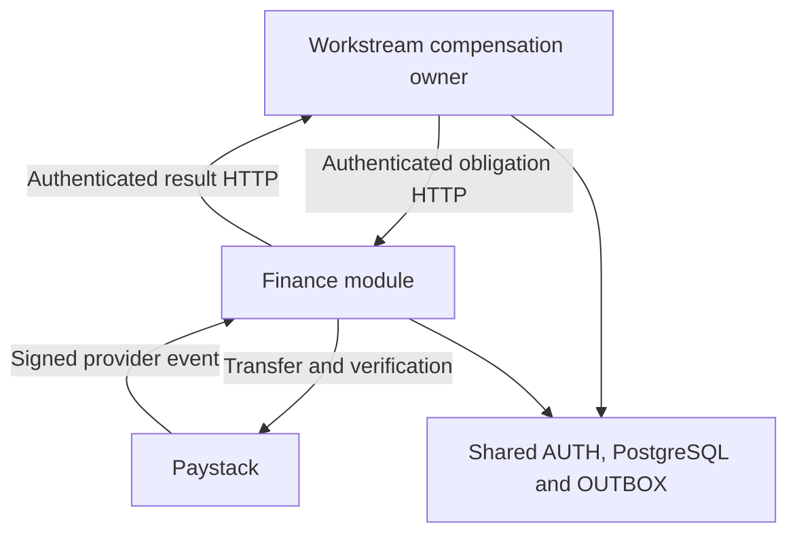
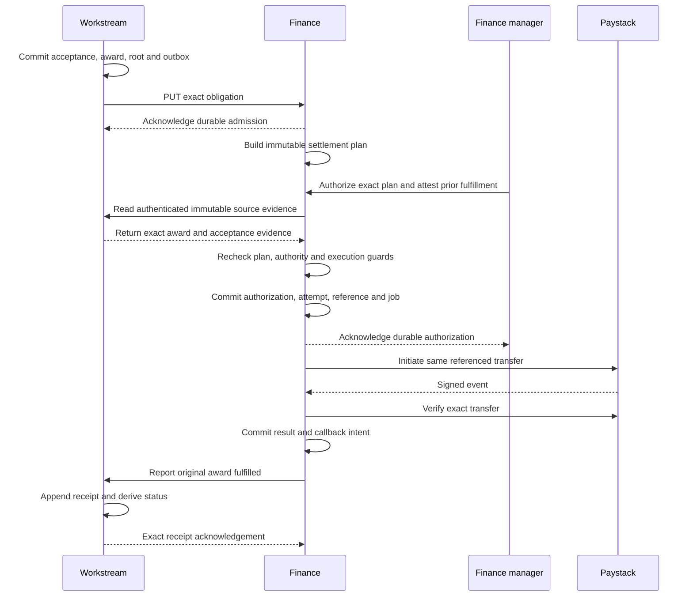

# Workstream task rewards and dedicated Finance module

## Implementation specification

**Status:** Consolidated implementation contract reflecting the approved product and module architecture. It specifies the code to implement and the evidence required to call it complete. Production payments, deployment and merge retain the repository’s existing authorization requirements.

**Prepared:** 12 November 2026, Africa/Lagos. **Architecture revision:** Finance is a dedicated Workstream module using existing AUTH/ACTORS, PostgreSQL, migrations, Celery/Redis and OUTBOX. Authenticated HTTP admission and callback remain mandatory. This version supersedes the earlier separate-application, separate-database and Finance-local-human-grants design.

**Repository baseline:** [Flow-Research/workstream at 94334ccf4085c26c7bfaa054465fc05cfbdad1fc](https://github.com/Flow-Research/workstream/commit/94334ccf4085c26c7bfaa054465fc05cfbdad1fc). Remote main and the open-PR list were refreshed on 12 November 2026 for this architecture revision; main remains at the pinned commit. No open non-draft PRs were returned. All draft PRs are excluded from this specification’s implementation baseline.

**Deliverable:** Size-based contribution awards plus a dedicated Finance module at `backend/app/modules/finance/`, serving only Workstream. Finance shares Workstream’s platform but owns its domain records and operations. Workstream-to-Finance admission and Finance-to-Workstream reports use actual authenticated HTTP after local commit. The module has an explicit extraction inventory and replaceable host adapters; extraction later is a controlled runtime/data migration, not a copy-folder standalone guarantee.

**Interpretation:** MUST and MUST NOT are requirements. Defaults below are explicit implementation choices, not claims that the feature already exists. The coding agent must implement these choices consistently. If a newer merged owner conflicts with a requirement, report the concrete conflict and proposed amendment; do not silently substitute a different product rule.

## Contents

1. [Decisions and scope](#1-decisions-and-scope)
2. [Ownership and repository layout](#2-ownership-and-repository-layout)
3. [Common values and contract conventions](#3-common-values-and-contract-conventions)
4. [Contribution policy and task size](#4-contribution-policy-and-task-size)
5. [Task lifecycle and revisions](#5-task-lifecycle-and-revisions)
6. [Acceptance and award creation](#6-acceptance-and-award-creation)
7. [Workstream fulfillment storage and lifecycle](#7-workstream-fulfillment-storage-and-lifecycle)
8. [Authentication and authorization](#8-authentication-and-authorization)
9. [Workstream to Finance API](#9-workstream-to-finance-api)
10. [Finance to Workstream API](#10-finance-to-workstream-api)
11. [Finance configuration and administration](#11-finance-configuration-and-administration)
12. [Finance authorization and execution](#12-finance-authorization-and-execution)
13. [Paystack adapter](#13-paystack-adapter)
14. [Receipts, exceptions and reconciliation](#14-receipts-exceptions-and-reconciliation)
15. [Equivalent values and contributor presentation](#15-equivalent-values-and-contributor-presentation)
16. [API, CLI, MCP and imports](#16-api-cli-mcp-and-imports)
17. [Retained data and migration](#17-retained-data-and-migration)
18. [Deployment, operation and extraction](#18-deployment-operation-and-extraction)
19. [Implementation sequence and file ownership](#19-implementation-sequence-and-file-ownership)
20. [Acceptance tests and completion](#20-acceptance-tests-and-completion)
21. [Fixtures and worked examples](#21-fixtures-and-worked-examples)
22. [Source references and documentation reconciliation](#22-source-references-and-documentation-reconciliation)

## 1. Decisions and scope

### 1.1 Settled product rules

| ID | Requirement |
| --- | --- |
| D01 | All compensated terms in a newly published project contribution-policy version use one instrument and one unit: money OR project points. |
| D02 | A compensated accepted-submission rule has exactly three quantity alternatives: small, medium and large. Small itself is the baseline; there is no separate baseline amount. |
| D03 | Omitted task_size at creation means small. Explicit null, unknown values and case variants are invalid. |
| D04 | A task selects a size, never a manually entered amount. The policy supplies the amount. Difficulty and estimated time remain separate existing task attributes. |
| D05 | An authorized PM or FM configures project policy. For a complete usable lifecycle, the implementation grants both roles project-scoped read/list/create/update/publish/retire actions. Unit and adapter-binding administration remains Finance-authorized. |
| D06 | Preserve existing policy publication, guide adoption, first-submission context and governed revision rebasing. A revision may adopt higher or lower terms. Each immutable submission retains its own recorded context. |
| D07 | A compensated contribution created under the new model has exactly one immutable award. An unpaid contribution has zero awards. |
| D08 | Workstream owns acceptance, contribution records and earned award facts. Finance owns payee records, fulfillment arrangements, conversion, bank-transfer authorization and execution. |
| D09 | Finance reports fulfillment of the original award, including when a points obligation is fulfilled through a bank transfer. No second money award is created in Workstream for that conversion. |
| D10 | Workstream appends authenticated fulfillment evidence and derives status. A callback cannot create eligibility, acceptance, a contribution or an award. |
| D11 | A monetary equivalent of points is Finance-authored information, separate from the earned award and fulfillment receipt. |
| D12 | Finance is a dedicated Workstream module in the existing backend and serves only Workstream. Reuse external identity, AUTH/ACTORS, the single PostgreSQL database and Alembic chain, Celery/Redis, OUTBOX and the backend image. Finance owns its records and business behavior. No private cross-owner imports, queries, ORM mutation or direct fulfillment writes; the two financial handoff directions remain authenticated HTTP. |

Throughout this specification, PM means Workstream’s existing `project_manager` administrative role and FM means its existing `finance_authority` role. A Finance human operation requires an active system-scoped or matching-project `finance_authority` grant, with the resource still bound to its actual project. No new Finance human roles or grant store exist. One eligible Finance human can configure and authorize the bank transfer; a second person is not required.

The existing unpaid branch is retained. When both contribution rules are unpaid, instrument_type, unit_code and adapter_binding_id are all null and there are no award definitions. No financial-unit setup is required for wholly unpaid work.

### 1.2 Explicit implementation defaults

These close details that were not separately selected in the product conversation.

| ID | Default adopted by this specification | Basis |
| --- | --- | --- |
| I01 | Reviewer compensation remains a separate fixed quantity in the same instrument/unit, or explicitly unpaid. It does not inherit the task's size amount. | Preserve the existing distinct completed_review rule. |
| I02 | Use the existing backend’s pinned Python/FastAPI/Pydantic/SQLAlchemy/HTTPX stack and dependency lock. Reuse its DB/session, Alembic, API controls, typed AUTH/ACTORS/AUDIT/OUTBOX ports and Celery/Redis. Add an explicit Finance worker profile and queue. | Reuses the existing modular-monolith platform while retaining Finance ownership and effect isolation. |
| I03 | The first bank-transfer adapter supports Paystack NGN transfers. Other money units may remain valid Workstream award facts, but this Finance adapter cannot execute them. Unsupported currency is a visible block, never implicit FX. | Earlier payment example selected Paystack; first bank-transfer qualification uses NGN. |
| I04 | Points arrangements support points_credit or points_to_ngn. The real arrangement and rate must be explicitly configured in Finance; neither is inferred from an award or quote. | Covers the two fulfillment meanings discussed without putting conversion in Workstream. |
| I05 | One eligible finance_authority explicitly authorizes each initial or replacement bank-transfer attempt. The service verifies source evidence and plan eligibility within that operation, then durably stages execution. New points_credit follows its configured arrangement; historical points_credit requires the same manager's prior-fulfillment attestation through the authorization operation. | The user's later clarification supersedes the earlier separate-person default taken from Julian's roadmap. Additional approval policies belong within Finance and are deferred. |
| I06 | Full-award fulfillment only. Finance may perform its internal steps, but Workstream receives a success only for complete fulfillment of the original obligation. | Reuses the planned receipt boundary. |
| I07 | A verified post-success provider reversal creates a separate immutable fulfillment exception and an attention flag. It never automatically causes another payout. | Required to represent a concrete provider outcome without rewriting an earned award or fulfilled receipt. |
| I08 | Retained historical awards are not automatically sent to Finance on upgrade. An authorized, explicit per-award enrollment is required. | Prevents accidental payment of historical work whose payment history has not been established. |

I05 defines the baseline: one eligible Finance manager authorizes execution, and the service performs the technical checks. Admission or planning alone must not initiate a money transfer. A future Finance-only policy may require additional approvals before execution, but this implementation does not add that policy, extra approver roles or intermediate approval states. Such an enhancement must preserve the Workstream award handoff, source-evidence and fulfillment callback contract; Workstream does not enforce Finance's internal approval policy.

### 1.3 Scope limits

Deliver all new policy, task selection, award, HTTP integration, Finance, identity support, API/CLI/MCP, migration, operational and test behavior described here.

Preserve the current PRE, POST, automatic-acceptance and revision flows. Complete native human Review is not added by this work. Its policy rule remains valid and its unsupported runtime must stay honestly marked unavailable. Automatic acceptance must never fabricate a human Review or reviewer award.

Do not add contributor withdrawal, a wallet, transferable points, redemption-on-demand, a general exchange, escrow, blockchain settlement, invoicing, payroll, a second Workstream lifecycle controller or Workstream-owned login. Existing published terms and historical economic evidence must not be rewritten.

Actual project quantities, real conversion rates, accounts, signing credentials and funds are deployment/configuration inputs. They are not placeholders in the software contract. Test fixtures in section 21 are nonproduction examples only.

### 1.4 Meaning of end-to-end completion

The primary required journey is:

Project policy and guide activation → sized task → claim → existing upload/PRE/Submission/POST path → governed FinalAcceptance → one contribution and award → durable Finance handoff → independently authenticated Finance obligation → configured points credit or approved Paystack transfer → authenticated result → Workstream receipt and contributor status.

It must work through public interfaces and durable workers, with real PostgreSQL and a controlled external HTTP boundary. Passing isolated unit tests or writing an OpenAPI file is insufficient.

## 2. Ownership and repository layout

### 2.1 Module and platform ownership

Finance is a dedicated business module in Workstream’s existing modular backend. It serves this Workstream deployment only. The host provides identity, authority, database/session infrastructure, audit, delivery custody, broker, process startup and observability; Finance provides financial behavior through typed public interfaces [R27–R35].

| Fact or operation | Sole owner |
| --- | --- |
| Project award schedule and publication | Existing CON, authorized through AUTH |
| Task size, assignment and immutable submission context | Existing TASK/ART public owner operations |
| Acceptance, contribution provenance and earned award | Existing REV/TASK/CON/compensation transaction participants |
| Fulfillment root, receipt, exception and contributor projection | Compensation; Finance cannot write these records |
| Payee, destination, rule, arrangement and conversion | Finance |
| Settlement plan, financial authorization, transfer/credit and provider observations | Finance |
| Normalized Finance fulfillment events and callback acknowledgement facts | Finance; delivery custody belongs to shared OUTBOX |
| External human login and token issuance | Existing Rust identity issuer, extended only for the required machine clients |
| Human/service profiles, links, role grants and revocations | Existing ACTORS/AUTH, including the existing `finance_authority` role |
| Prepared authorization and bounded audit evidence | Existing AUTH/AUDIT, consumed in exact owner transactions |
| Queue delivery leases, attempts, retries, due time and recovery | Existing OUTBOX and existing Celery/Redis infrastructure |
| Database/session, metadata, migrations, settings and backend image | Existing Workstream host infrastructure |

Sharing infrastructure does not confer another owner’s authority. Cross-module runtime imports target `app.modules.<owner>.api` only. Public APIs expose immutable values, commands/results, stable errors and opaque capability protocols, never ORM models, repositories, sessions, concrete services or registries. Only the exact same-owner adapter root `backend/app/adapters/<owner>/__init__.py` constructs that owner’s private implementations. Preserve the repository’s whole-application boundary scanning and frozen-debt rules; add no private-edge exception [R27].

### 2.2 Required Finance owner and host integration

Use these explicit paths and responsibilities. Cohesive internal subdivision is allowed; responsibilities and wire behavior are fixed.

| Path | Responsibility |
| --- | --- |
| `backend/app/modules/finance/api/` | Public schemas, commands/results, errors, Finance application/recovery ports, provider/source/callback protocols and closed event constants |
| `backend/app/modules/finance/models.py`, `repository.py`, focused owner services | Finance-only persistence and financial rules, including obligations, plans, authorizations, intents, provider observations, reports and current projections |
| `backend/app/modules/finance/handlers.py` | Finance effect handlers using typed AUTH/OUTBOX/AUDIT and external capabilities; no inline provider construction |
| `backend/app/modules/finance/contracts/` | Versioned HTTP schemas, positive/negative fixtures and contract README; generated OpenAPI extraction comes from the existing app |
| `backend/app/modules/finance/README.md` and `extraction-manifest.md` | Owned data/code, exact host dependencies, setup/recovery and controlled future extraction inventory |
| `backend/app/adapters/finance/__init__.py` | Same-owner composition root constructing Finance public capabilities and receiving other owners’ public ports |
| `backend/app/adapters/finance/paystack.py`, `workstream.py` | Concrete bounded HTTP transport implementing Finance public protocols; no financial policy or private SQL |
| `backend/app/api/routes/finance.py`, `deps/finance.py` | Delivery and dependency wiring through public module APIs; mounted in the existing FastAPI app |
| `backend/app/workers/finance.py`, `finance_topology.py` | Thin Finance task entries and actual worker-profile validation, consuming public Finance/OUTBOX capabilities |
| `backend/tests/finance/` | Finance unit, PostgreSQL, API, worker and failure-boundary tests in the existing backend test system |

Register Finance in `.ci/module-boundaries/registry.v1.json`. Model discovery adds declarations through `backend/app/db/models.py` only; discovery does not grant runtime access. Use the existing SQLAlchemy Base, engine/session factory, `backend/pyproject.toml` and `backend/uv.lock`. Use new revisions in the single existing `backend/alembic/versions/` chain and the current supported-head preflight. Do not create another application, dependency lock, Dockerfile, migration environment, database, Redis instance or scheduler for Finance.

Finance tables live in the existing PostgreSQL `public` schema with the mandatory `finance_` prefix. This is an ownership convention enforced by APIs, import checks, constraints and tests, not a claim that a shared database credential physically prevents all SQL access. Finance’s private repositories may query only Finance tables. References to project, contributor, source award/root, binding and AUTH records are opaque IDs checked through owner capabilities. No cross-owner ORM relationships, private joins or cascading writes are added. Within Finance, exact composite foreign keys enforce its own source/project/payee/plan/attempt chains.

Reuse existing core IDs, canonical hashing, API errors, cursor signing, request context, settings and observability through declared host adapters. Wire normalization still needs explicit contract fixtures; calling a shared hash helper does not prove the normalized objects match. Reuse the existing external-adapter factory convention, while locating every new domain capability under its owner’s public API [R35].

### 2.3 Real HTTP boundaries in the shared deployment

The API serves both route families. Their semantics remain independent local transactions: sender commits its durable intent, closes the transaction, calls the configured HTTP origin, and records the response in a fresh authorized transaction. The receiver validates token, actor, action, resource and digest and commits through its own owner. No in-process ASGI transport, direct Finance command invocation or direct compensation receipt mutation can replace the specified handoff/callback in the production composition or end-to-end proof.

Source evidence also uses authenticated HTTP. The subsequent shared-transaction public currentness check in §8.5 closes races; it is a read/locking capability, not an alternate financial delivery path. All external HTTP runs without an open local DB transaction. No callback runs recursively inside acceptance, provider-outcome or Finance authorization commits.

No handoff contains a callback URL, account number, email, password, provider key, raw artifact or task ZIP. The single Workstream source and fixed endpoint origins come from deployment configuration and existing service identities, never arbitrary request data. Future extraction changes declared host adapters, state placement and deployment wiring while preserving these HTTP contracts; §18.6 defines that controlled work.

## 3. Common values and contract conventions

### 3.1 IDs and identities

- Workstream record IDs continue to use app.core.identifiers.new_record_id(), UUIDv7.
- Finance generates UUIDv7 record IDs with the existing `app.core.identifiers.new_record_id()` helper behind its declared host identifier capability. Never derive a record ID from an idempotency key.
- source_instance_id is a deployment-generated UUIDv7, created once and retained with that Workstream deployment. Development, test and production use different values.
- contributor_id is the immutable Workstream actor profile UUID. Finance keys a payee mapping by (source_instance_id, contributor_id). It is not an issuer subject, email or bank account.
- Issuer identities are exact (iss, sub) pairs resolved by existing ACTORS. Human role decisions use the canonical actor profile and current existing AUTH grants; Finance owns no parallel identity or permission registry.
- Preserve route_key and adapter_binding_id exactly. Changing a hostname or credential does not change the original award, route identity or source instance.
- Resource ownership must be checked on the server; a caller-supplied project_id never grants access.

### 3.2 Quantities

Workstream retains its current exact numeric envelope [R03]:

- JSON quantities are strings matching ^(?:0|[1-9][0-9]{0,19})(?:\.[0-9]{1,18})?$ and must be strictly greater than zero.
- Reject floats, signs, whitespace, exponent notation, NaN, infinity, excessive precision and values greater than or equal to 10^20.
- project_points requires a whole-number string. "10.0" is invalid for points.
- Parse with Decimal; store unrounded PostgreSQL NUMERIC without a rounding typemod, with explicit positivity, magnitude and scale checks.
- Canonical output is fixed point without redundant trailing fractional zeroes or a trailing decimal point.
- Workstream does not round a money award to match a payment provider.
- Finance permits Paystack NGN execution only when the original money quantity is exactly representable as integer kobo. Points conversion rounding is specified in section 12.

The instrument enum remains money | project_points. Money unit codes use the existing enabled ISO currency registry. Points unit codes retain their exact project-scoped identity and current syntax. FLOW in two projects is not automatically one shared balance.

### 3.3 Canonical serialization and digests

Use the existing Workstream canonical JSON algorithm for the HTTP boundary contract: UTF-8 JSON, sorted object keys, compact separators, ensure_ascii=false, allow_nan=false. All quantities are canonical strings; UUIDs are lowercase hyphenated strings; contract timestamps use UTC with exactly six fractional digits and Z. Arrays have the explicit semantic order specified for that field.

Reject duplicate JSON member names, unknown members, invalid UTF-8 and non-object envelopes. Never hash a reserialized unvalidated provider body into Workstream evidence.

Digest representation is sha256: followed by 64 lowercase hexadecimal characters.

source_award_digest hashes an object containing exactly these keys:

~~~text
award_id
project_id
contribution_record_id
contributor_id
contribution_policy_version_id
award_definition_id
adapter_binding_id
instrument_type
unit_code
quantity
awarded_at
correlation_id
~~~

obligation_digest hashes the complete validated obligation envelope in section 9, excluding obligation_digest itself. It includes the source instance, root, route and immutable contribution context.

plan_hash hashes the exact Finance settlement-plan object specified in section 12. Agreement evidence is then bound by the Finance authorization to that plan hash.

Timestamps normalize before digest comparison; producers emit the canonical form. Financial strings on the HTTP boundary wire must already be canonical. Reject noncanonical strings there instead of accepting two digest representations.

### 3.4 HTTP behavior

- Production and hosted traffic requires HTTPS with hostname verification, configured origins and no redirects.
- Local HTTP is allowed only in the isolated test/development Compose network with an explicit development setting that production refuses.
- JSON body limit: 64 KiB for service and Finance admin APIs. Paystack webhook limit: 1 MiB before parsing. Issuer token/login limits are specified in section 8.
- Integration timeout: 3 seconds connect and 10 seconds total. A timeout is an unknown outcome when an effect might have begun.
- Idempotency-Key is required on all mutating Finance admin operations and Workstream enrollment/reconciliation requests. It is a UUID value chosen once per logical operation.
- Finance obligation PUT uses the award UUID as Idempotency-Key. A retry changes neither path nor body.
- Fulfillment-report deduplication uses the persisted external_event_id, with an identical Idempotency-Key header. Exception deduplication instead uses exception_event_id, with an identical Idempotency-Key header. Both event identifiers are Finance-generated UUIDv7 strings.
- Finance admin replay identity is (verified human principal, action, resource, idempotency key); retain request digest and original response. Changed payload with the same key returns 409.
- All routes use the existing `app.core.api_controls.ApiErrorResponse`, `StructuredHTTPException`, request/correlation IDs, handlers and authorization/concealment conventions. The canonical `error` object has `code`, `message`, `details`, `correlation_id` and `retryable`; the existing optional top-level `detail` compatibility member remains supported. Finance supplies bounded domain error codes through those handlers and adds no competing global middleware or second error envelope. No stack traces, bank data or provider payloads appear in errors.
- HTTP 401 means missing/invalid credentials. Unauthorized resources are concealed with 404. HTTP 409 means an exact state/idempotency conflict; 422 means invalid input; 429/503 are retryable without changing business identity. A successful HTTP response must still pass its response schema and identity/digest checks.
- 2xx is acknowledgement of the operation described by that route, never generic proof that a bank payment succeeded.

### 3.5 Durable retries

Both owners persist their own domain intents in the shared PostgreSQL database and append delivery custody through the existing OUTBOX public port. Shared OUTBOX owns leases, attempts, retries and recovery; Finance does not add a generic job engine, callback outbox table or scheduler. Queue publication is not the source of truth.

Retry timestamps and not_before are earliest eligibility times; the scanner repairs publication gaps and does not promise exact wall-clock delivery at those times. The default retry schedule for these authenticated HTTP deliveries is 5 seconds, 30 seconds, 2 minutes, 10 minutes, then hourly, with bounded 0–20% jitter. After 32 attempts or 24 elapsed hours of unsuccessful obligation/report/exception delivery, whichever occurs first, retain the row in an operator-visible attention queue. Do not delete it or declare the award unpaid. Automatic retry uses the same shared event within its bounded cycle. After terminal exhaustion, a fresh authorized owner recovery creates a linked delivery operation with its own explicit bounded recovery cycle, preserving the original financial/external event ID, body, digest and provider reference. It never resets/deletes the old terminal OUTBOX row or invents payment authority.

Retain the general scanner’s existing cadence; existing Beat schedules the Finance registry scan and Finance recovery scan every 60 seconds, with at most 100 candidates per page and bounded passes. Use the current bounded cursor and authorized claim/invoke/finalize protocol. New feature handlers use 300-second leases and retain the existing claim-generation fence; §18.2 fixes handler/process limits and per-handler retry budgets. Registry membership gates pending/retryable candidates, expired claims, recovery and finalization as required in §18.2. If an external call may have started, recovery first reconciles that exact external identity; lease expiry does not authorize a new payment.

The current shared OUTBOX outcome calculator supports exponential backoff only. Extend its owner-defined per-key retry policy and exact recomputation contract for these three HTTP delivery kinds; changing max_attempts alone does not implement this schedule. Freeze the HTTP retry delays after failed attempts 1, 2, 3, 4 and 5+ as 5, 30, 120, 600 and 3600 seconds. Deterministic jitter is `int.from_bytes(SHA256(UTF8(str(event_id) + ":" + str(claim_generation)))[:8], "big") % 2001` basis points; multiply the base delay by `(10000+jitter_bps)/10000` using exact microseconds. Recomputing finalization yields exactly the same due time. Existing event policies remain unchanged.

Each automatic delivery cycle has one immutable first-claim timestamp and a 24-hour deadline, retained across automatic continuations. Enforce attempt/deadline eligibility before another HTTP invocation and preserve attention/terminal custody when the budget is exhausted. A fresh authorized recovery may create a new bounded recovery cycle with explicit human provenance and link to the original exhausted event; it preserves the immutable business event and cannot authorize a replacement payment. Do not use a new child row to reset an automatic cycle silently.

These are operational timing defaults. Changing them cannot change financial identity, authority or duplicate prevention.

## 4. Contribution policy and task size

### 4.1 New policy shape

All newly authored graphs are reward_model_version=2. This field is server-owned. Keep the existing draft/update/publication/retirement endpoints and policy aggregate ownership.

The complete replacement draft update is:

~~~json
{
  "instrument_type": "project_points",
  "unit_code": "FLOW",
  "adapter_binding_id": "019a78b0-0000-7000-8000-000000000010",
  "rules": [
    {
      "contribution_type": "accepted_submission",
      "compensation_mode": "compensated",
      "quantities": {
        "small": "10",
        "medium": "20",
        "large": "100"
      }
    },
    {
      "contribution_type": "completed_review",
      "compensation_mode": "unpaid"
    }
  ]
}
~~~

Exactly one rule of each existing contribution type is required. A compensated completed_review rule has quantity, not quantities:

~~~json
{
  "contribution_type": "completed_review",
  "compensation_mode": "compensated",
  "quantity": "3"
}
~~~

An unpaid rule has neither quantity nor quantities. Extra members are rejected. Fully unpaid policy input has all three common header fields explicitly null and both rules unpaid.

All compensated definitions use the common version-level instrument_type, unit_code and adapter_binding_id. There is no per-tier instrument, route or unit override.

Small, medium and large must all be present for a compensated accepted_submission rule. A missing policy row never falls back to Small. Only omission of task_size in task creation has Small semantics.

Positive equal quantities are allowed. No monotonic relationship between the three amounts, cross-version comparison or amount protection is added.

### 4.2 Persistence and publication

Extend ContributionPolicyVersion with the common header and reward_model_version. Retain ContributionRule and ContributionAwardDefinition as the canonical owners.

Each v2 accepted-submission definition has task_size=small|medium|large. Each v2 completed-review definition has task_size=null. Definitions retain exact immutable instrument, unit, quantity and binding facts.

For v2 definitions enforce:

- UNIQUE(contribution_rule_id, task_size) WHERE reward_model_version=2 AND task_size IS NOT NULL.
- UNIQUE(contribution_rule_id) WHERE reward_model_version=2 AND task_size IS NULL.
- Remove the old global UNIQUE(contribution_rule_id, instrument_type), which would prohibit three tiers. Retained v1 definitions instead use a partial UNIQUE(contribution_rule_id, instrument_type) WHERE reward_model_version=1. The definition's reward_model_version is derived from and constrained to its parent version as specified in section 17; callers cannot select a version to bypass the graph guard.
- Deferred exact graph validation checks the rule's type, mode, complete cardinality and equality to the version common header.
- Compensated accepted_submission has exactly three definitions; compensated completed_review exactly one; unpaid has zero.
- No accepted-submission v2 definition may have null task_size and no completed-review definition may have a non-null size.
- Existing project/version/binding/unit foreign keys and immutability protections remain.

The publication graph digest includes reward_model_version, common header and every rule/definition with its size and exact amount. Canonical rule order is accepted_submission, completed_review; tier order is small, medium, large.

Continue current publication locks, enabled-unit checks, binding checks, graph eligibility, authorization consumption and previous-version retirement. Do not add a new publication operation or a second policy store [R02–R05].

### 4.3 Adoption and authoring authority

Publishing a version does not itself alter a guide activation receipt or existing task context. The current guide-activation boundary remains.

Both authorized PM and FM may perform project policy list/read/create/update/publish/retire. Expand all corresponding role filters, action preparation and static authority registrations together. An FM grant in a different project grants nothing here.

Keep supported unit creation and adapter-binding management Finance-only. Enable money in the existing internal unit command rather than inventing a public unit-administration API. The Finance module does not call Workstream contribution-policy mutations; those remain the contribution owner’s operations.

### 4.4 Task authoring

Add task_size to manual creation, canonical imported JSON and CLI CSV conversion. Default small on omission. Store it explicitly in new task rows and retained command/import responses.

Task amount is never an input. Reject unknown fields purporting to override quantity, instrument or unit on a task.

Keep the selected size unchanged after creation in this scope. No new edit/resizing endpoint is added. If an existing draft-authoring owner is later extended to edit size, that requires an explicit specification amendment and must stop before screening. The current implementation is create-time selection only.

Unpaid tasks still have a size. Their displayed compensation mode is unpaid and their amount is null.

## 5. Task lifecycle and revisions

### 5.1 Exact selection facts

Add the following facts alongside existing policy-version stamps:

| Record | Facts |
| --- | --- |
| New WorkstreamTask | task_size; locked_submission_award_definition_id, null before screening or when the exact rule is unpaid |
| New TaskAssignment | submitter_task_size; submitter_award_definition_id; existing submitter_contribution_policy_version_id |
| New immutable Submission | task_size; contribution_award_definition_id; existing contribution-policy version |
| Published definition | Exact immutable size, quantity, instrument, unit and binding |

A selected definition must belong to the task's project, exact policy version and accepted_submission rule, and match its size. A null selected definition is not a deferred lookup: after screening it means that exact applicable rule is unpaid.

Internal RewardSelectionFacts contains policy_version_id, task_size, compensation_mode, award_definition_id, instrument_type, unit_code, quantity and adapter_binding_id. All financial fields are null for an unpaid rule. Contributor reads exclude internal binding and authorization material.

### 5.2 Screening, claim and first submission

1. Creation stores task_size, without selecting a new policy by wall-clock lookup.
2. Screening loads the active guide's exact policy context through the current PROJECTS owner.
3. CON resolves the size under that version. Screening records the selection and existing activation lineage atomically.
4. Release validates the recorded context and makes the task claimable.
5. Claim copies that selection into the assignment.
6. Submission preparation/admission validates equality of task and assignment context.
7. First Submission copies the assignment's exact selection. It never rereads the newest published policy to decide the reward.
8. Replay returns the original recorded command/Submission result, including after a later revision changed the continuing task.

Extend the existing task authority/request digests, operation receipts, import receipts and context validation. Do not let a projection choose a definition that the immutable Submission did not select [R06–R08].

Enforce the selection-copy chain in PostgreSQL as well as through owner code. New v2 task_size is non-null and immutable after task insertion. An assignment insert must copy the task's exact size, policy version and selected definition; a Submission insert must match both its assignment and task at admission. After screening, a null definition is valid if and only if the exact accepted-submission rule is unpaid; the unscreened draft is the sole preselection exception. Every copied RewardSelectionFacts value must equal its exact immutable definition, not merely reference a valid definition UUID. Continuing Task/Assignment changes are permitted only through the existing governed revision operation with matching recorded prior/target selection and current preparation identity. Historical immutable rows and read-only v1 evidence retain the rules in section 17.

### 5.3 Governed revision rebasing

Keep existing target selection, deadline, maximum-round, blocked-context/repair, acknowledgement and application behavior.

For a prepared revision:

- Keep the task's size.
- Select the current active guide context exactly as the existing revision owner does.
- Resolve that same size under its contribution policy.
- Permit a higher amount, lower amount, unpaid/compensated change or supported instrument/unit change when allowed by the adopted policy.
- Rebase the continuing Task and Assignment policy/definition selection atomically.
- Record the next Submission under that revised context.
- Never mutate the preceding Submission, contribution, award or its original context.

TaskPolicyLineage represents guide activation facts. A guide does not choose a task size. Do not insert task-specific selection into that existing lineage structure and weaken activation-receipt equality to make it pass.

Instead add prior_reward_selection and target_reward_selection alongside the prior/target activation snapshots in the new revision preparation packet. Include these exact facts in the canonical preparation hash. Extend the PostgreSQL packet/selection guards accordingly.

The contributor-facing change projection exposes distinct prior_reward_selection and target_reward_selection fields with old/new compensation mode, size, amount, unit and instrument, excluding internal bindings. Keep these separate from the existing bounded lineage changes list; do not add an unrepresentable ninth entry to its current eight-item schema. Upload preparation continues to require the exact current preparation ID and hash. An old acknowledgement is rejected after any change. This acknowledges the prepared revision before the next upload; it is not a new approval before the server's existing rebase.

If the target version cannot provide a valid selection, use the existing blocked-context path. Do not use another size or silently retain the earlier amount [R09–R11].

### 5.4 Read behavior

Ready queues, task details, work context, management reads and batch projections resolve by the exact policy version plus selected definition/size. Cache keys must include the selection, not only the policy version.

Historical submission and contribution evidence reads use the immutable Submission's selection. They do not read the continuing Task's current amount.

The existing revision-expiry process remains. A contributor ceasing work is not a new self-withdraw command.

## 6. Acceptance and award creation

### 6.1 One transaction

For new compensated work, the existing root transaction must atomically commit:

1. Exact authorized FinalAcceptance and TASK accepted effects.
2. The source-unique accepted-submission ContributionRecord.
3. Exactly one CompensationAward for the accepted Submission's selected definition.
4. Exactly one Workstream fulfillment root for that award.
5. Exactly one initial award-handoff outbox event.
6. Existing and new authorization, audit and lifecycle closure evidence.

For unpaid recognition, commit items 1–2 and their required evidence, with zero awards, roots or Finance events.

External network I/O must not occur in this transaction. Finance unavailability cannot roll back already committed recognized work. Failure to persist any required local participant must roll back the complete local acceptance [R12–R14].

### 6.2 Selection and database completeness

The award writer consumes the exact selected definition from the immutable accepted Submission. It must no longer enumerate all three schedule alternatives.

New-write complete-set contracts permit zero or one definition/award. Replay of retained v1 outcomes is separately described in section 17 and is read-only.

Replace completeness rules so PostgreSQL verifies the one selected definition, all exact source facts and cardinality at commit. Protect against:

- Missing, extra or wrong-tier award.
- Wrong project, policy version, contributor, definition, binding, unit or quantity.
- A paid award on an unpaid rule.
- A new v2 contribution with multiple instruments.
- An award without its required root/outbox.
- A root or delivery event without the exact source award.

Use deferred closure checks and existing immutable evidence guards; application checks alone are insufficient. Preserve one canonical shared acceptance path.

### 6.3 Replay

Concurrent duplicate acceptance returns the existing complete immutable result only for an exact, currently authorized replay of the same acceptance operation and source identity. A different FinalAcceptance/source or changed facts must conflict. Exact replay must not allocate another award, root, ordinal or event.

A missing required root on a committed v2 result is an integrity error, not permission for an ordinary acceptance replay to create new financial effects. An explicit owner repair procedure requires a separate reviewed change; do not implement silent repair.

Native human review remains unavailable until its own owner is implemented. Modeling reviewer compensation does not authorize making reviewer records in the automatic branch.

## 7. Workstream fulfillment storage and lifecycle

### 7.1 Required owner records

| Record | Required facts and constraints |
| --- | --- |
| CompensationFulfillmentRoot | UUID; unique award_id; immutable increasing ordinal; admission_generation; source_award_digest; admission_kind=acceptance or historical_enrollment; initial outbox event identity; creation and authority references |
| Delivery intent/history | Exact root, award, binding, route, envelope digest, invocation/attempt and bounded result; use the current outbox's durable custody |
| CompensationFulfillmentReceipt | Existing planned closed receipt fields; immutable; UNIQUE(binding_id, external_event_id); at most one fulfilled receipt per award |
| CompensationFulfillmentException | Immutable exception ID/event, exact root/award/binding, prior fulfilled event/receipt, kind, observed/received times and authority; unique event per binding |
| CompensationStatusProjection | Rebuildable delivery and fulfillment status, latest receipt, last bounded failure, attention flag and latest exception; no eligibility mutation |
| Historical enrollment operation | Exact actor/action/idempotency/request digest, source award digest, bounded attestation reference, authority, root/event and original response |

No fulfillment-status column is added to the immutable CompensationAward.

### 7.2 Lifecycle ownership

Extend the existing REV JointLifecycleReleaseControl and JointLifecycleMutationFence. Do not create a Finance-specific Workstream controller.

The successor reviewed manifest names the actual award/root/outbox/receipt participants and removes fulfillment from the unavailable list only after their tests and deployment qualification. Human review remains unavailable.

All new roots require current live-generation authority. Root ordinals are allocated once under the canonical fence. Retries, status reads and callbacks retain the same root; none allocates a new ordinal.

Workstream external calls have three boundaries: authorize and commit exact dispatch intent; call Finance outside DB transactions/fences; reacquire fresh authority/custody to persist the bounded result.

### 7.3 Drain and late evidence

Use the existing controller transition edges. On live → draining, persist the outgoing live admission generation and maximum root ordinal as a server-derived cutoff.

- No new Workstream acceptance root, historical enrollment root or handoff outside the captured cutoff may be admitted in draining.
- Delivery and reconciliation for a captured root may make its first or repeated identical Finance PUT, only for the outgoing admission generation and ordinals at/below the cutoff, with current binding/actor authority. This can create the corresponding Finance obligation for an already admitted Workstream root. Binding suspension still blocks a first PUT.
- A retry stays on its existing root and original award. Cutoff denial occurs before external I/O.
- The draining-to-disabled observation is taken under the REV fence. It requires every captured initial handoff to be durably acknowledged or reconciled to the exact stored Finance obligation, with no Workstream pending/claimed/in-flight/retryable/unknown handoff or local reconciliation job. Exhausted unresolved handoffs still count.
- This is a Workstream custody gate. It does not inspect Finance’s private provider attempts or Finance-owned events in shared OUTBOX, and does not assert that Finance has settled every obligation. Finance may continue already admitted obligations after Workstream disables.
- Transition to disabled is refused while those Workstream custody counts remain nonzero. A process restart is not proof that the gate passed; retained work resumes when its workers return.

**Late factual evidence is a specific exception to execution admission:** a first verified fulfilled/failed report, an exact report replay or a post-fulfillment exception for an already admitted root may be recorded under a freshly acquired current fence in any phase. It must match the root's original Finance obligation, source, award and binding. It may reference an older admission generation because delivery can be delayed and a provider can report a reversal after a previous drain/restart. This path can only append verified receipt/exception evidence or return exact replay; it cannot create a root, dispatch a payout or reopen fulfillment execution. Update the normative lifecycle specification and phase/action tests to state this distinction explicitly.

Authenticated source-evidence reads, exact stored-event lookups and GET-only reconciliation of existing roots remain available in every phase under fresh authority. This permits Finance authorization of an already admitted obligation after Workstream disables. GET-only reconciliation may append exact verified stored reports/exceptions; it cannot make a PUT in disabled/shadow or dispatch an unadmitted obligation.

This exception prevents dropping financial evidence merely because Workstream execution is paused. It does not introduce another lifecycle controller or permit handoff for a post-cutoff root. Amend the lifecycle specification and tests explicitly: disabled closes Workstream admission and handoff custody; Finance execution pause is a separate operation.

### 7.4 Binding suspension and revocation

Suspension blocks new policy use where current rules require it, new enrollment and new outbound admission. In Finance it also blocks a new credit, first provider dispatch, re-initiation or OTP finalization until eligible again, using the source-currentness predicate in §8.5. It never blocks pure observation or late factual recording for an existing attempt/root and does not redirect an existing award.

In particular, suspension blocks a first Finance PUT even when its Workstream award/root was already committed. Retain that earned award, root and undelivered intent; the drain may remain blocked until an authorized binding resume. Status GET, callback recording and read-only exact enrollment replay remain available for an existing root under its original binding. If Finance admission already succeeded, suspension does not prevent recovery of that known admission; a repeated identical PUT may only confirm the already stored obligation and must not admit an unseen one. Prefer GET to establish existence before this replay.

A callback, exact replay or reconciliation for an already admitted root can use its original suspended binding, provided the reporter's current service actor/link remains valid and matches that exact binding. Otherwise a transfer completed just before suspension could become unrecordable.

Service credential or actor revocation denies the revoked principal immediately. Recovery requires an authorized credential/link repair preserving the same logical adapter identity and binding; never accept an arbitrary substitute reporter.

## 8. Authentication and authorization

### 8.1 One Workstream identity and authority system

Finance is a dedicated backend module in this Workstream deployment. It uses the existing Workstream token verifier, ACTORS profiles and identity links, AUTH grants and prepared authorization, PostgreSQL database, and durable worker infrastructure. It adds no human role tokens, human grant tables, login flow, token audience, database, or verifier. `FM` means the existing `finance_authority` administrative role.

Every request still makes three distinct checks: verify the issuer token; resolve the canonical ACTORS identity and its current status; then authorize the exact action and owner-derived resource through AUTH. A shared audience is coarse API admission, not permission to use another route. Token claims, request bodies and Celery payloads cannot supply authoritative roles or permission decisions.

Human Finance routes require `subject_kind=human`, the existing `workstream:access` scope and a current canonical human actor/link. Service handoff and callback routes require `subject_kind=service`, `workstream:service`, the exact provisioned logical identity in §8.3 and exact resource authority. These route families reject the opposite principal kind before any effect. Reuse `get_authorization_actor` and the existing prepared composition; do not send a workload through `get_canonical_actor` or fall back to a human grant.

Use the configured Workstream issuer/audience/JWKS/algorithm policy and its existing bounded cache, refresh, skew and fail-closed controls. The Rust deployment pins RS256. Issuer-admin and password-change tokens remain outside the application audience and cannot enter either module. Do not accept token-provided key URLs or establish a separate Finance trust policy.

### 8.2 Human role and action mapping

AUTH remains the only grant owner. Existing `access_administrator` operations provision/revoke ACTORS identities and issue/revoke `finance_authority` grants. Holding that administrative role or administering the issuer does not grant transfer authority. No Finance grant API or bootstrap-admin command is added.

For project Finance actions, require a current `finance_authority` grant whose existing AUTH scope covers the exact project: that project or system. A different project's grant grants nothing. Global local-source configuration requires a system-scoped `finance_authority` grant. Preserve existing scope and concealment semantics for Workstream contributor, PM, audit and Operator actions.

| Action family | Required human authority |
| --- | --- |
| Existing contribution policy list/read/create/update/publish/retire | PM or FM covering the project, under the already specified §4.3 expansion |
| Existing compensation-unit and adapter-binding administration | Existing Finance authority; no PM widening |
| `finance.source.read`, `finance.source.configure` | System Finance authority; singleton deployment source only |
| `finance.binding.read`, `finance.binding.configure`, `finance.project.execution.configure` | FM covering the canonical binding/project |
| `finance.payee.create`, `finance.payee.read`, `finance.payee.suspension.configure` | FM covering the exact payee project profile |
| `finance.destination.create`, `finance.destination.activate`, `finance.destination.revoke` | FM covering the exact destination's project profile |
| `finance.rule.create_draft`, `finance.rule.update_draft`, `finance.rule.publish`, `finance.rule.read`, `finance.rule.list` | FM covering the rule's project |
| `finance.arrangement.create` | FM covering the payee project profile and exact instrument/unit |
| `finance.obligation.list`, `finance.obligation.read`, `finance.obligation.plan.request`, `finance.plan.replace`, `finance.fulfillment.authorize`, `finance.reconciliation.request` | FM covering the obligation's immutable project |
| `finance.transfer.otp.submit` | The original authorization's human, with that recorded grant and identity still current for the exact project and attempt |
| `compensation.fulfillment.read` | Existing own-contributor or project PM/FM read authority, with existing concealment |
| `compensation.fulfillment.enroll` | FM covering the original award's project |
| `compensation.fulfillment.reconcile.request`, `compensation.fulfillment.reconcile.read` | FM covering the project or the existing authorized system Operator path; request/read of the exact root-bound reconciliation operation only, no payment authority |
| Existing lifecycle activation/drain transitions | Existing system Operator authority; does not grant Finance transfer authorization |

All `finance.*` and `compensation.fulfillment.*` entries above are new actions, not an assertion that today's catalogue already exposes them. Extend the existing AUTH action/permission catalogue and public typed ports. Group permissions where useful, but register each exact action and its concrete resource evaluator; never use a generic `finance.admin` allow flag. Expose each route's exact action in OpenAPI as the current backend does.

One eligible FM may configure a plan and authorize its bank transfer. That same human may enroll historical work and supply Finance's prior-fulfillment attestation. No second human or extra approval state is required. New points-credit obligations retain their configured automatic behavior. Services cannot receive these human grants or manufacture human authorization records.

### 8.3 Machine identities and action custody

Provision fixed service profiles and exact issuer/subject links through the existing ACTORS/AUTH operation. Enforce the following closed matrix; another service or human cannot substitute for any row.

| Logical ACTORS identity | Status before this implementation | Exact actions added |
| --- | --- | --- |
| `workstream.compensation.fulfillment_executor` | New | `compensation.fulfillment.dispatch`, `compensation.fulfillment.reconcile.execute`; receiving Finance actions `finance.obligation.admit`, `finance.obligation.read`, `finance.capability.read`, `finance.equivalent.read` |
| `workstream.compensation.adapter` | Existing target-only identity; no active service actions | `compensation.fulfillment.source.read`, `compensation.fulfillment.report`, `compensation.fulfillment.exception.report` |
| `workstream.finance.fulfillment_executor` | New trusted internal worker identity | `finance.obligation.plan.execute`, `finance.destination.verify`, `finance.points.credit.execute`, `finance.transfer.dispatch`, `finance.transfer.observe`, `finance.transfer.reconcile.execute`, `finance.callback.dispatch`; internal API-only `finance.provider_event.admit` for the verified Paystack ingress command |

The compensation executor obtains its own bearer token for the actual HTTP request to `/api/v1/finance/workstream/*`. Finance callback/source-evidence HTTP clients obtain the separate compensation-adapter bearer token for `/api/v1/compensation/*`. The internal Finance executor is resolved by the existing fixed-service AUTH composition; it has no public admin route and needs no issuer client. Its provider-ingress action is available only to the narrow trusted Finance API webhook command described in §13.3; all scheduled financial effects remain on the Finance worker. An HTTP token for either directional client does not authorize internal Finance execution actions.

The generic outbox dispatcher retains only its existing dispatch action. An allowlisted handler must acquire the named domain identity and fresh prepared action for its exact phase; an outbox row, queue name or durable payload never confers payment authority. Worker payloads carry identifiers, expected versions/digests and provenance, not AUTH handles, role claims or serialized database objects.

Resource facts bind the source, project, binding, route, award/root or obligation, exact plan/authorization/attempt when applicable, immutable request digest, operation id and current execution fence. Callback actions also bind the original adapter actor and exact event. Reconciliation uses explicit internal provenance and its own executor authority, rather than forging a callback principal. Paystack webhooks use their provider signature/inbox boundary; they do not create an ACTORS human, bypass provider verification or authorize a transfer.

Every new action must be registered and activated with its typed public contract, current actor/link validation, exact service-matrix membership, prepared authorization consumption, audit and database completeness. Update enum/check-constraint parity and the closed catalogue tests together. The existence of `COMPENSATION_ADAPTER`, a service-client token or a Celery handler is not activation evidence.

### 8.4 Minimal Rust issuer extension

Preserve the existing human `/login`, accounts and stable subjects, default Workstream audience, RS256 signer, issuer-admin purpose, password-change flow and first-login password rotation. Do not add a `resource=finance` login option or `DEMO_IDENTITY_FINANCE_AUDIENCE`.

Add a retained SQLite upgrade for `service_clients`: generated immutable client ID, stable service subject, Argon2 secret hash, the existing configured Workstream audience, the single allowed scope `workstream:service`, active/revoked status and timestamps. Add private local maintenance commands:

~~~text
workstream-demo-identity service-client create DATA_DIR --name NAME --secret-out NEW_PRIVATE_FILE
workstream-demo-identity service-client rotate DATA_DIR --client-id ID --secret-out NEW_PRIVATE_FILE [--reactivate]
workstream-demo-identity service-client revoke DATA_DIR --client-id ID
~~~

Follow existing stopped-issuer maintenance custody. Creation and rotation write a 32-random-byte base64url secret once to a new mode-0600 file, refuse an existing output file, store only the Argon2 hash and print only non-secret client ID/subject. Rotation preserves client ID and subject. Without `--reactivate`, rotation refuses a revoked client. An explicit local `rotate --reactivate` changes the secret and restores that same revoked client; it never allocates a new subject. Revocation prevents new tokens; revoke the existing ACTORS identity link when outstanding access must stop immediately. Normal service-key rotation keeps the same client, subject, profile, link and binding.

Add `POST /oauth/token`, form encoded, maximum 8 KiB, with exactly `grant_type=client_credentials`, `client_id`, `client_secret`, and `scope=workstream:service`. There is no resource/audience selector. Reject missing, duplicate or unknown fields, other grant types/scopes, invalid secrets and inactive clients. Reuse the issuer's bounded Argon2 and throttling behavior; OAuth-style errors must not disclose client existence or credentials.

Return `access_token`, `token_type=Bearer`, `expires_in=300` and `scope=workstream:service`. JWT claims are exact existing `iss` and Workstream `aud`, stable service `sub`, `subject_kind=service`, the one coarse scope, `iat`, `nbf`, `exp` and `jti`; sign RS256 with `kid`. Include no human profile, role claims, admin purpose or refresh token.

Create exactly two OAuth clients:

| Issuer client name | ACTORS identity | Audience and scope |
| --- | --- | --- |
| `workstream-finance-delivery` | `workstream.compensation.fulfillment_executor` | Existing Workstream audience; `workstream:service` |
| `finance-workstream-reporter` | `workstream.compensation.adapter` | Existing Workstream audience; `workstream:service` |

Clients obtain tokens at the configured pinned HTTPS endpoint, cache them in memory only until 30 seconds before expiry, and retry one authentication failure after refresh. Keep credential custody separate by client even in the shared deployment. Do not use human/issuer-admin credentials for workers. For emergency recovery, revoke issuer client issuance and the exact ACTORS identity link, replace its secret through explicit `rotate --reactivate`, and keep that ACTORS link revoked until every previously issued token is expired: at least 300 seconds plus the configured Workstream verifier skew after issuer-client revocation, measured with synced clocks. Then an authorized access administrator uses the existing `/api/v1/actor-identity-links/{identity_link_id}/reactivate` operation. Do not reactivate the link earlier: current ACTORS has no per-link token-issued-before cutoff. Preserve the revoked-at timestamp in issuer maintenance audit even after reactivation. Tests/runbooks prove old tokens are unusable during the interval and expired afterwards, while new tokens use the original binding. Do not deactivate the fixed service profile or create a replacement subject as a recovery shortcut; current ACTORS uniqueness and terminal deactivation do not support rebinding that identity. This adds no new AUTH revocation framework.

This extension supplies only machine tokens needed by these HTTP contracts.

### 8.5 Currentness, transaction and secret custody

The Finance module owns its records, while AUTH owns identities/grants and compensation owns awards, bindings, fulfillment roots and callback receipts. Finance receives dependency-free facts/ports through the application composition root. It must never import another module's ORM/repository, join private tables, update compensation receipts directly or replace either mandatory HTTP handoff with a function call.

For a human transfer/historical-credit authorization, perform initial authenticated checks, read an immutable obligation/plan snapshot, and end that database transaction. Fetch §10.3 source evidence through authenticated HTTP with no open database transaction. Then begin one fresh shared-database transaction: lock/revalidate the same human actor/link and exact qualifying grant through AUTH; obtain compensation-owned locked currentness facts through a new public `FulfillmentSourceCurrentnessPort`; lock and validate Finance's source/binding/project execution, exact obligation/current plan and all pinned payee/arrangement/destination/attempt facts; consume the exact prepared action; and commit authorization, execution intent, operation and audit together. A port failure or any mismatch rolls back all effects. The HTTP evidence and final locked facts must identify the same immutable source, award/root, binding/route and digests. Evaluate current fulfillment and the operation-specific lifecycle predicate from the final locked facts; do not require the current Workstream phase/generation to equal the earlier HTTP snapshot.

That new compensation public port is read/currentness custody only. It owns canonical source/binding/root locks and returns immutable facts; Finance does not receive ORM objects or a capability to append source evidence. Its server-selected operation is bound into prepared AUTH facts. Use these distinct predicates:

| Operation | Required current canonical source facts |
| --- | --- |
| First `finance.obligation.admit` | Existing exact earned award/root and envelope digests; original project, binding, instrument, route and configured reporter; active canonical binding; live-generation root or the captured outgoing generation/root ordinal at or below the draining cutoff. No root may be created by Finance admission. |
| `finance.fulfillment.authorize`, `finance.transfer.dispatch` (first dispatch or same-reference re-initiation), `finance.transfer.otp.submit`, or `finance.points.credit.execute` | The corresponding Finance obligation is already durably admitted; its original canonical root/binding/source lineage is unchanged; no fulfilled receipt or fulfillment exception conflicts with a new effect. The current canonical binding must permit new effects. Any Workstream lifecycle phase is allowed for this already admitted obligation; disabled, shadow or draining alone cannot deny its authorization or execution. |
| Committed human admin-command replay, including fulfillment authorization | Same original human actor, current authority for the exact action and stored resource’s project, original operation identity/body digest and immutable result. This branch may return historical results after fulfillment/plan replacement/pause or issuance of another qualifying grant. It creates no authorization, attempt, credit, outbox event or financial effect and cannot revive old execution permission. Fresh AUTH decision evidence only. |
| Status, exact existing-obligation replay, receipt/exception observation and observation-only same-reference recovery | Existing exact identity/lineage and matching event/reference; current service actor/link. The original binding may be suspended and the root may belong to an older admission generation. These paths cannot create a root, previously unseen obligation, new transfer attempt or point credit. |

The admission route takes its principal from the verified request, not from the envelope: AUTH revalidates the exact `workstream.compensation.fulfillment_executor` ACTORS profile/link, the singleton source's registered sender and exact canonical source/binding facts. Under the same transaction, Finance validates the existing local source/binding registration and commits the immutable obligation plus planning intent. Its source/binding/project enabled flags are execution switches, not admission permission: a valid registered earned obligation is retained while those Finance switches are false. A first PUT is still denied for a suspended canonical Workstream binding, an unregistered or crossed binding, a revoked sender/link or an ineligible root. Identical replay can only return the stored original obligation; it cannot admit an unseen one under the suspended-binding replay exception. Workstream's outbound dispatch still follows §7's phase/cutoff limits even when the receiver can confirm an existing record.

Extend the existing owner lock order consistently: AUTH's canonical authority/control and exact actor/link/grant locks; the existing REV fence as required by the operation-specific root predicate; compensation-owned binding/root/receipt currentness; then Finance source/binding/project execution, obligation/plan/attempt and pinned payee configuration. AUTH owns multi-principal lock ordering for the worker plus original authorizer; Finance must not acquire private grant/actor locks itself. Configuration, suspension, revocation and effect commands use the same relevant owner locks. A copied HTTP response, previous decision, saved grant snapshot or unconsumed/expired prepared handle cannot stand in for these current checks.

Record the authorizer's ACTORS profile/link and exact AUTH grant ID in the immutable authorization. Before first dispatch or historical credit, the fixed Finance executor must acquire fresh service authority, call the source-currentness port again, and verify that this recorded human, link and grant remain active and cover that same project, and that the exact source/binding/project execution and plan inputs remain eligible. New automatic points credit omits the human-authorization requirement but uses the same current service/source/binding/execution and owner lock custody. Grant revocation cannot be bypassed by a newly issued grant or by replaying an old authorization: create a fresh authorization through the already specified replacement/cancellation rules. The service checks current authority without impersonating the human or creating a second approval.

The point-credit transaction commits the credit, fulfilled Finance event, callback intent and audit while those currentness locks remain held. The transfer transaction commits `dispatch_started` and the exact provider request/reference/fence while those same relevant locks remain held. These are the effect linearization points: a grant revocation, canonical binding suspension or Finance pause that wins the locks first prevents the new effect; a change that follows the committed dispatch marker cannot promise to cancel a possibly sent transfer. The latter case reconciles that same reference. A Workstream phase transition alone never blocks the already admitted Finance obligation. This rule closes the race after source HTTP without holding a database transaction open across provider I/O.

For external I/O, commit the exact fenced intent/dispatch marker and end the transaction before HTTP. Persist its result in a new authorized transaction. Apply this to award delivery, source-evidence reads, Paystack operations and Finance callbacks. A Finance callback is dispatched only after its event and callback intent commit; its receiving compensation route uses its own transaction. No callback may run while a Finance database transaction remains open.

Disabled Finance execution or revoked human authority blocks a never-dispatched financial effect. Workstream lifecycle disablement has different custody and does not pause Finance's admitted obligations. Neither erases an admitted obligation or already sent attempt. Recovery may observe that same possibly sent provider reference and append factual outcomes under current service authority; it cannot initiate a new transfer. Late evidence and callback delivery retain §7 and §14's rules. Revoked service identity/link access fails immediately on fresh AUTH checks and requires explicit repair preserving the same logical binding.

The OTP route is a narrow transient Finance API invocation. It checks the original human, recorded current grant and exact attempt, then commits one one-time finalize intent under fresh AUTH/currentness custody and ends the transaction. It calls Paystack outside the transaction with the OTP held only in request memory, and persists the normalized outcome in a new authorized transaction. Never put the OTP, an encrypted OTP, or an OTP-derived digest in PostgreSQL, outbox events, Celery/Redis, request-operation payloads, audit or logs. Ambiguous result/crash recovery reconciles the same attempt; replay returns the stored operation state without resending the secret. The Finance API has the narrowly required provider credential for this path. General workers and Beat receive no provider secrets; asynchronous provider work belongs to the dedicated Finance worker profile.

Use mounted secret files for issuer clients, Paystack credentials and encryption keys; expose provider secrets only to Finance adapters/workers. Shared deployment/database ownership does not relax module APIs or data disclosure. Encrypt destination data and retain only masked/opaque fields in ordinary logs/audits. Workstream contribution/compensation projections contain only the normalized contract fields. HTTP targets are fixed deployment configuration, never request-provided URLs; disable redirects and proxy-environment inheritance and retain bounded pools/timeouts/bodies.

## 9. Workstream to Finance API

### 9.1 Durable obligation admission

**Route:** PUT /api/v1/finance/workstream/obligations/{award_id}  
**Caller:** Exact provisioned `workstream.compensation.fulfillment_executor` with `workstream:service`; prepared AUTH action `finance.obligation.admit`.  
**Idempotency-Key:** Exact award_id.

The body is a closed object with every field below present. Nullable fields must be explicit null.

| Field | Type and meaning |
| --- | --- |
| contract_version | Integer 1 |
| source_instance_id | UUID; must equal the authenticated source registration |
| fulfillment_root_id | Workstream root UUID |
| admission_kind | acceptance or historical_enrollment |
| reward_model_version | 1 or 2; version 1 requires historical_enrollment |
| award_id | UUID; equals path and idempotency header |
| project_id | UUID |
| contributor_id | Workstream actor UUID |
| contribution_record_id | UUID |
| contribution_type | accepted_submission or completed_review |
| task_id | UUID of source task |
| submission_id | UUID of source immutable submission |
| final_acceptance_id | UUID for accepted_submission; null for completed_review |
| review_id | UUID for completed_review; null for accepted_submission |
| contribution_policy_version_id | UUID |
| award_definition_id | UUID |
| task_size | small, medium or large for v2 accepted_submission; null for historical v1 or fixed completed_review reward |
| adapter_binding_id | Original Workstream binding UUID |
| route_key | Original non-secret route token matching ^[A-Za-z][A-Za-z0-9._:-]{0,119}$; maximum 120 ASCII characters; substring .. is forbidden. Preserve the existing binding-owner rules. |
| instrument_type | money or project_points |
| unit_code | Exact original enabled unit |
| quantity | Canonical positive award quantity string |
| awarded_at | Canonical UTC timestamp |
| correlation_id | Original award correlation UUID |
| source_award_digest | Exact digest defined in section 3 |
| obligation_digest | Digest of this envelope except this member |

The completed_review shape is defined for the existing policy vocabulary; it may only be emitted by a future genuine implemented reviewer-contribution owner. This feature emits no fabricated review records.

Finance verifies both digests, the configured singleton source and exact sender, registered binding/project/route/instrument equality and closed input shape before storing the obligation. It acquires canonical source/binding/root currentness through the compensation public port and consumes `finance.obligation.admit` in the same local transaction. It does not trust the envelope to register a binding or to invent an award/root. A Finance execution pause retains valid obligations; Workstream lifecycle, cutoff and original binding rules still gate first admission. Replay revalidates current actor and exact immutable identity without reopening first-admission permission.

A first valid request commits one obligation, its immutable source envelope, audit and planning-job intent, then returns HTTP 201:

~~~json
{
  "contract_version": 1,
  "source_instance_id": "019a78b0-0000-7000-8000-000000000040",
  "award_id": "019a78b0-0000-7000-8000-000000000011",
  "obligation_id": "019a78b0-0000-7000-8000-000000000050",
  "obligation_digest": "sha256:0a51b63fa6b459aa449b886b6a6eb27199f9f49106da2c324081a63eccfea943",
  "processing_status": "awaiting_configuration",
  "replay": false
}
~~~

This response corresponds to the complete, independently reproducible envelope in section 21.3. It is a contract fixture, not a production award.

The first response reports the committed state at admission. Planning and payment are asynchronous. Missing payee/rate/arrangement information does not lose or reject an otherwise valid earned obligation; it leaves the obligation awaiting_configuration with a closed reason.

Identical replay returns HTTP 200 with the same obligation ID and digest, current processing_status and replay=true. Changed facts for the same (source_instance_id, award_id) return 409 OBLIGATION_CONFLICT without creating anything. Response loss is resolved by retrying the same PUT or GET; both are safe because admission has database uniqueness and no inline payout.

The unique database key is (source_instance_id, award_id), not an HTTP request ID or outbox attempt ID.

### 9.2 Status and recovery

**Route:** GET /api/v1/finance/workstream/obligations/{award_id}  
**Caller:** Same exact compensation-executor identity and source with `workstream:service`; prepared AUTH action `finance.obligation.read`.

Response fields are contract_version, source_instance_id, award_id, obligation_id, obligation_digest, processing_status, block_reason, latest_report, latest_report_digest, fulfillment_exception, fulfillment_exception_digest and updated_at. Every field is present.

- latest_report is null or the exact persisted section-10 normalized report object.
- fulfillment_exception is null or the exact persisted section-10 exception object.
- Each companion digest is null if and only if its object is null; otherwise it hashes that exact closed object using section 3. Finance must return the same immutable body and digest its callback handler loads from Finance’s own fulfillment-event store for shared OUTBOX delivery. Workstream independently recomputes and validates them before reconciliation.
- No converted transfer amount, bank information, provider payload or Finance admin data is returned here.
- An unseen award under the current source returns 404 OBLIGATION_NOT_FOUND.
- A valid GET is a status observation, not permission to originate another payout.

processing_status is exactly:

~~~text
awaiting_configuration
awaiting_authorization
ready
processing
outcome_unknown
failed
fulfilled
attention_required
~~~

block_reason is null or:

~~~text
SOURCE_DISABLED
PROJECT_PAUSED
RULE_MISSING
ARRANGEMENT_MISSING
PAYEE_UNAVAILABLE
DESTINATION_UNAVAILABLE
UNSUPPORTED_CURRENCY
UNSUPPORTED_PRECISION
AMOUNT_OUT_OF_RANGE
HISTORICAL_PAYMENT_UNRESOLVED
AUTHORITY_REVOKED
PROVIDER_APPROVAL_REQUIRED
~~~

An unknown external result is outcome_unknown, never failed or not found merely because a timeout elapsed. A blocked configuration is awaiting_configuration, never an assertion that earned work was unpaid.

### 9.3 Binding and quote capability

A source binding identifies a Workstream project, original adapter binding, instrument and route. It can accept multiple policy versions, while each obligation and settlement plan retains its exact unit/version.

Finance must expose GET /api/v1/finance/workstream/capabilities, requiring the exact compensation executor and `finance.capability.read` under existing AUTH, returning contract_version=1, supported_money_units=["NGN"], points_credit=true, points_to_ngn=true and receipt_mode="full_award". This is deployment qualification information, not an external dependency inside Workstream acceptance.

GET /api/v1/finance/workstream/equivalents requires the exact compensation executor, `finance.equivalent.read` under existing AUTH and the exact registered project binding. Its full contract is in section 15.

### 9.4 Workstream adapter implementation

Add `FinanceFulfillmentAdapter` as a typed public compensation capability under `app.modules.compensation.api`; operations are `admit_obligation`, `read_obligation`, `read_equivalent` and `read_capabilities`, with closed request/result types. Reuse the existing `ExternalServiceAdapter`/factory convention at the host boundary where needed, but do not add new domain contracts to the legacy `app.interfaces` namespace [R27]. Finance’s public capabilities belong under `app.modules.finance.api`.

Concrete HTTP adapters are wired in the exact owner adapter/application composition roots. Product services consume public ports only. The adapter always uses HTTPX with real serialized HTTP, a service token, exact configured origin and the route prefix in §9; it cannot switch to a direct Finance command, in-process ASGI transport or shared-table shortcut because the destination is colocated. Provider, source-read and callback clients follow the same external-I/O transaction rule.

The compensation handler commits its exact handoff intent and closes the transaction before invoking the adapter. The receiving Finance request begins and commits its own transaction. The caller then begins a fresh authorized transaction to validate and record the acknowledgement. Configure bounded independent DB/HTTP pools; an API-origin self-call cannot retain a DB connection/transaction needed by its receiver.

Register the exact compensation handler in the general OUTBOX registry. It becomes replay-safe only after same-key admission, callback-before-ack, lost responses and unknown-result recovery are proven. A valid service token or a generic dispatcher invocation is insufficient without exact prepared action custody. No unrelated handler receives a blanket retry exemption.

Validate acknowledgements against source, award, obligation digest and closed schema. A mismatched successful body is a protocol conflict and operational attention event, not an acknowledgement. Finance events and delivery attempts remain in the disjoint Finance registry defined in §18.

## 10. Finance to Workstream API

### 10.1 Fulfillment reports

**Route:** POST /api/v1/compensation/awards/{award_id}/fulfillment-reports  
**Caller:** Exact provisioned COMPENSATION_ADAPTER service principal.  
**Action:** compensation.fulfillment.report.

All body fields are required:

| Field | Requirement |
| --- | --- |
| contract_version | Integer 1 |
| source_instance_id | Exact local Workstream instance |
| fulfillment_root_id | Existing root for this award |
| award_id | Equals path |
| project_id | Equals award/root project |
| adapter_binding_id | Equals original award binding |
| route_key | Equals admitted route |
| external_event_id | Finance-generated stable UUIDv7 string; reused on every delivery attempt |
| instrument_type, unit_code | Exact original award facts |
| reported_status | fulfilled or failed |
| fulfilled_quantity | Exact original canonical quantity for fulfilled; null for failed |
| fulfilled_at | Canonical event time for fulfilled; null for failed |
| external_reference | Finance-generated non-secret opaque token for fulfilled; null for failed |
| failure_code | Null for fulfilled; one closed Workstream code for failed |
| reported_at | Persisted time the Finance result event was created |
| correlation_id | Original award correlation UUID |

external_reference follows existing receipt bounds, 1–128 ASCII characters from [A-Za-z0-9._:-]+. Finance emits fin_<its fulfillment UUID without hyphens>. Do not use a bank reference, account detail, transfer narration or URL.

Retain the existing closed failure-code vocabulary:

~~~text
ADAPTER_REJECTED
DESTINATION_UNAVAILABLE
PROVIDER_UNAVAILABLE
PROVIDER_TIMEOUT
UNKNOWN_PROVIDER_FAILURE
~~~

A timeout alone does not authorize a failed report. Finance reports failed only after a conclusive failed attempt or an explicit final refusal supported by its own durable facts. It may later report successful fulfillment with a different event ID under the same original obligation.

For fulfilled, require fulfilled_at no earlier than awarded_at minus 300 seconds and no later than receiver time plus 300 seconds. reported_at cannot be earlier than fulfilled_at minus that same skew. For both fulfilled and failed, apply the reported_at bounds in section 14.4. Store event and receipt times separately. There is no maximum delivery age for otherwise valid retained evidence.

The handler must:

1. Verify service token and resolve the exact active service actor/link.
2. Perform only nonlocking locator reads to identify the exact award/root/binding/resource.
3. Acquire current AUTH actor/link custody, then the REV lifecycle fence and compensation binding/root/receipt locks in the §8.5 order; refresh the owner facts after lock waits and prepare/consume the exact action.
4. Validate every source fact, quantity, status and event identity.
5. Append the immutable receipt, authorization evidence and projection update in one transaction.
6. Return HTTP 201 with receipt_id, award_id, fulfillment_root_id, external_event_id, report_digest and replay=false.

Exact event replay, including after binding suspension, uses fresh authority and returns HTTP 200 with the original IDs/digest and replay=true. A changed payload for the same binding/event returns 409 FULFILLMENT_REPORT_CONFLICT. There is at most one fulfilled receipt per award; another success with a different event ID is rejected, even for the same amount.

Callback-before-delivery-ack is valid: the Workstream award/root already exists before the outbound API call. Recording the callback also establishes that the admitted Finance obligation was observed. A late delivery acknowledgement cannot lower fulfillment state.

### 10.2 Exact event lookup

**Route:** GET /api/v1/compensation/awards/{award_id}/fulfillment-reports/{external_event_id}  
**Action:** compensation.fulfillment.source.read.

Only the original bound service may read this operational receipt identity. Return the exact receipt acknowledgement plus normalized report fields; 404 means that exact event is not recorded. This supports callback-response-loss recovery. Do not expose these provider/event identifiers on contributor/product reads.

### 10.3 Independent source evidence

**Route:** GET /api/v1/compensation/awards/{award_id}/finance-evidence  
**Action:** compensation.fulfillment.source.read.

Require an existing admitted root and the exact original service binding. Return:

- contract_version and source_instance_id.
- The immutable source-award fields used by source_award_digest and that digest.
- contribution_record_id/type, task_id, submission_id, final_acceptance_id or review_id.
- reward_model_version and historical/selected task_size.
- fulfillment_root_id, admission_kind and obligation_digest.
- The current normalized fulfillment status, attention flag, fulfilled external_event_id if recorded, and enrollment attestation for historical_enrollment.

The enrollment attestation contains only the enrolled Workstream actor ID, operation ID, timestamp and non-secret evidence reference. It does not assert that external payment was impossible.

Finance uses this authenticated HTTP evidence during its authorization operation, with no open DB transaction, and compares it with its admitted envelope. The final local authorization transaction also acquires the compensation-owned `FulfillmentSourceCurrentnessPort` described in §8.5; this typed read/locking port closes races and never replaces the HTTP evidence, admission or callback. The service performs this verification; it is not a second human approval or another Workstream acceptance. It never uses a mutable task amount, email, PR description or caller-supplied bank record as acceptance evidence.

This service route is a bounded operational read. It grants no task/award creation or Workstream policy authority.

### 10.4 Post-fulfillment exceptions

**Route:** POST /api/v1/compensation/awards/{award_id}/fulfillment-exceptions  
**Action:** compensation.fulfillment.exception.report.

Closed body:

~~~text
contract_version = 1
source_instance_id
fulfillment_root_id
award_id
project_id
adapter_binding_id
route_key
original_fulfillment_event_id
exception_event_id
kind = provider_reversal | provider_status_conflict
observed_at
reported_at
correlation_id
~~~

All ID fields are canonical UUIDs; exception_event_id is a Finance-generated UUIDv7 reused on every delivery attempt and must equal Idempotency-Key. original_fulfillment_event_id is the original report's external_event_id. route_key uses section 9.1's binding-token rules; timestamps use section 3's format and section 14.4's bounds. The original fulfillment event must identify this award's actual fulfilled receipt under this binding. No unrelated receipt, unknown event, free-text reason, provider payload or amount adjustment is allowed.

Persist one immutable exception per binding/exception_event_id, linked to the exact fulfilled receipt, with source authority and normalized digest. Exact replay returns the original acknowledgement; changed replay conflicts.

A first accepted exception returns HTTP 201 with exactly exception_id, award_id, fulfillment_root_id, original_fulfillment_event_id, exception_event_id, exception_digest and replay=false. Exact authorized replay returns HTTP 200 with the same IDs/digest and replay=true; changed replay returns 409 FULFILLMENT_EXCEPTION_CONFLICT. exception_digest hashes the complete closed request body. Recover a lost exception acknowledgement by identical POST; no separate exception-lookup route is required in v1.

Set fulfillment_attention_required=true and latest_exception_id in the rebuildable projection. Preserve fulfillment_status=fulfilled as its historical receipt fact. Presentation must take attention precedence over Paid/Fulfilled. This operation creates no new payout, award or contribution and does not erase the original receipt.

Version 1 has no automatic exception-clear or repayment operation after a post-success reversal. Finance must investigate the retained incident; any later remedy requiring another monetary effect needs a separately reviewed contract. This is an explicit boundary, not an invitation for a coding agent to add adjustment accounting.

### 10.5 Human reads and reconciliation requests

Add:

| Route | Permission and result |
| --- | --- |
| GET /api/v1/compensation/awards/{award_id}/fulfillment | Existing contributor/project read scope; bounded product status from section 15 |
| POST /api/v1/projects/{project_id}/compensation-awards/{award_id}/reconciliation | Project FM/authorized Operator; idempotently stages a read/reconciliation job and returns 202 plus operation ID |
| GET /api/v1/projects/{project_id}/compensation-awards/{award_id}/reconciliation/{operation_id} | `compensation.fulfillment.reconcile.read`; same management scope and exact project/award/root/operation binding; bounded operation status |

Reconciliation POST body is an empty closed object. The path and authenticated actor determine scope. It cannot change destination, amount, event or provider reference.

The executor queries Finance status and feeds any normalized persisted report/exception through the same validation/persistence owner used by callbacks, with internal reconciliation provenance and exact executor AUTH. It does not forge a callback actor and it does not call Paystack directly.

## 11. Finance configuration and administration

### 11.1 Storage model

Use the existing PostgreSQL database, `public.finance_*` tables and single migration chain. Finance owns its domain records; shared AUTH, AUDIT and OUTBOX remain their existing owners. The table inventory below is normative; physical subdivision of a cohesive owner does not permit a second role, audit or lease engine.

| Table or owner | Required content |
| --- | --- |
| Existing ACTORS/AUTH | Human/service identity, current grants, revocation and prepared decisions; no Finance-local principal/grant tables |
| `finance_source_instances`, `finance_source_bindings` | One configured local source; canonical source/binding/project/route/instrument and service-actor snapshot; Finance enabled/revision fields |
| `finance_project_execution` | Unique source/project enabled flag and compare-and-swap revision; created disabled with the first project binding; shared by that project’s Finance bindings/rules |
| `finance_payees`, `finance_payee_project_profiles` | Unique source/contributor identity and exact project-scoped verification/suspension state |
| `finance_payee_destination_versions`, `finance_destination_verifications` | Private immutable encrypted recipient identity, NGN currency, verification intent/result and active/revoked state |
| `finance_rule_versions`, `finance_arrangement_versions` | Draft revisions, immutable published Finance rule, same-profile arrangement/destination/agreement references and active history |
| `finance_obligations`, `finance_settlement_plans` | Unique source/award envelope/digests; immutable plan inputs/version/hash; rebuildable operational state and current selection |
| `finance_fulfillment_authorizations` | Exact plan/hash, authorizer ACTORS profile/link and exact AUTH grant/decision IDs, source-evidence digest, agreement/prior-fulfillment attestations, predecessor attempt and linked new attempt or historical credit intent |
| `finance_point_credit_intents`, `finance_point_credits` | Exact plan/generation and historical authorization where needed, followed by one immutable original-unit credit and fulfillment event per obligation |
| `finance_transfer_attempts`, `finance_transfer_observations` | Immutable authorization/reference/amount/destination/ordinal intent; append-only dispatch, cancellation and provider facts; rebuildable status and domain generation |
| `finance_provider_event_inbox` | Deduplicated authenticated normalized provider facts and processing outcome; shared OUTBOX reference supplies delivery custody |
| `finance_fulfillment_events` | Immutable normalized report/exception body, stable identity/digest, prerequisite success, shared delivery identity and exact callback acknowledgement facts |
| `finance_admin_operations` | Finance command replay identity, canonical request/result digests and bounded response, linked to existing authority/audit evidence |
| Existing `outbox_events`, `outbox_delivery_attempts` | Shared due time, append/replay, leases, claim generations, invocation marker, retries, results, exhaustion and unknown recovery |
| Existing AUDIT | Bounded actor/action/decision/effect evidence; no duplicate global Finance audit table |

Source envelopes, published rules, arrangements, plans, credits, financial authorizations, attempt intents and emitted reports are immutable. Mutable operational projections may be rebuilt. Revoke/replace through new owner operations and append-only observations; do not edit historical authorization or outcome facts. An AUTH decision/grant reference is evidence, not a role copied into Finance.

Enforce unique source/award obligation, obligation/plan version, obligation/attempt ordinal, provider account/reference, one attempt or historical-credit intent per authorization, one point credit per obligation, one fulfilled event per obligation, and at most one unresolved transfer attempt per obligation. Composite Finance foreign keys bind each authorization/attempt/credit intent to the same obligation and plan. A historical points plan has at most one current authorized credit intent.

Enforce exactly one possible local source row with a unique singleton marker constrained to true and an immutable source UUID equal to deployment configuration. Source or actor identity cannot be rekeyed by PUT. A source/binding creation has `expected_revision=null` and `enabled=false`; an update has the exact positive existing revision. All first project bindings create or retain the same disabled project-execution record without resetting an existing project’s enabled state.

In each local transaction, persist Finance’s exact domain fact and append its next effect through the existing `OutboxAppendPort` bound to the same session. Append flushes without committing or publishing. Shared payloads contain only opaque selectors, expected plan/intent generation and permitted canonical digests. Payee data, recipient codes, agreement contents, payout amounts, provider credentials/responses and raw webhook bodies stay in private Finance records. Shared audit and broker payloads obey the same disclosure boundary.

Do not add `job_intents`, a Finance `callback_outbox` table, another worker lease implementation or another scheduler. Finance-specific transfer, credit, verification and outcome records are domain evidence; OUTBOX alone owns generic delivery custody. A callback worker loads the exact Finance event through its public owner port after commit and sends its persisted body by HTTP.

Each transfer attempt has at most one immutable `dispatch_started` marker before any provider initiation. `canceled_before_dispatch` requires that marker and all provider observations to be absent, under the same obligation/attempt locks and database guards. Cancellation increments Finance’s intent generation; it does not edit shared OUTBOX rows privately. A delayed handler observes canceled/stale generation and acknowledges a proven no-effect result through OUTBOX. The authorization, provider reference and cancellation remain history. Cancellation is excluded from unresolved-attempt uniqueness and emits no failed-payment callback. An existing dispatch marker forbids this cancellation even after a crash before the actual provider request.

### 11.2 One local source and existing AUTH grants

Mount the dedicated Finance router in the existing backend at `/api/v1/finance/admin/*` for human administration and `/api/v1/finance/workstream/*` for the exact compensation-executor workload. The callback remains `POST /api/v1/compensation/awards/{award_id}/fulfillment-reports`; source evidence, receipt lookup and exceptions retain their §10 compensation routes. Requests traverse the real authenticated HTTP adapter even when both routers run in one process.

Finance serves exactly this Workstream. Retain `source_instance_id` in immutable envelopes for source identity and replay, but support one configured local source only. The singleton registration binds that fixed UUID to the configured Workstream HTTPS origin and the canonical ACTORS IDs of the two directional service identities. Deployment configuration supplies origin and credential aliases. API bodies cannot introduce a different source, issuer, subject, origin, credential alias or callback target. Credential/key rotation preserves the same actor/source/binding identity.

AUTH owns all human grants and service-link lifecycle. Use the existing `/api/v1/admin-role-grants` and `/api/v1/service-actors` operations; do not add `/finance/admin/grants`, Finance principals/grants tables or a Finance bootstrap administrator. Use the existing `/api/v1/actors/me` and `/api/v1/actors/me/authorization-context` surfaces for identity/current authority instead of a second Finance `me` registry.

| Method and route | AUTH action and role | Closed body/result |
| --- | --- | --- |
| `GET /api/v1/finance/admin/source-instances/{source_instance_id}` | `finance.source.read`; system FM | The configured singleton's non-secret source/actor IDs, enabled state and revision; any other source is concealed |
| `PUT /api/v1/finance/admin/source-instances/{source_instance_id}` | `finance.source.configure`; system FM | `enabled`, `expected_revision`; initial creation requires `enabled=false`, `expected_revision=null`, and derives all identity fields from configured source and verified ACTORS owners |
| `PUT /api/v1/finance/admin/source-instances/{source_instance_id}/bindings/{binding_id}` | `finance.binding.configure`; FM covering canonical project | `enabled`, `expected_revision`; initial creation requires enabled=false and expected_revision=null; resolve/lock canonical compensation binding through its public port and derive project, route, instrument and adapter actor; later calls change enabled only |
| `GET /api/v1/finance/admin/source-instances/{source_instance_id}/bindings?project_id={project_id}` | `finance.binding.read`; FM covering requested project | Paged non-secret execution registrations for that exact project; closed query and actor/project-bound cursor |

Both PUT operations use compare-and-swap revision and `Idempotency-Key`, return the non-secret persisted registration with its positive revision and `replay` flag, and increment revision once per new effective update. Creation returns 201, update or exact replay 200; mismatched existing revision/changed-key body returns 409. First source/binding creation requires expected_revision=null and enabled=false. Binding creation also requires the canonical compensation binding to identify the configured Finance reporter. No request may reroute an existing award or relabel a binding's project/instrument. Persist the canonical binding UUID and immutable validated identity snapshot plus Finance's own enabled/revision fields. The snapshot is evidence, not independent authority: admission, authorization and execution revalidate current canonical binding/lifecycle facts through the owner port. All actions require fresh AUTH on replay.

Source and binding enabled flags are Finance execution/readiness configuration, not grants. Source, binding and project execution begin disabled; §11.4 defines project enablement. Admission can retain a valid already-earned obligation while execution is paused, but never auto-registers a binding from an untrusted envelope. Disabling new execution preserves already admitted obligations, same-reference recovery and late callback evidence. Configuration changes, current-authority checks, local effects and audit commit together under the documented owner lock order.

### 11.3 Payee and destination setup

The team's payment details remain within Finance/provider custody. Version 1 registers an already-created Paystack recipient code; it does not implement a banking onboarding UI or store raw account numbers in Workstream.

| Method and route | Role | Closed body |
| --- | --- | --- |
| POST /api/v1/finance/admin/source-instances/{source_instance_id}/projects/{project_id}/payees | Scoped finance_authority | contributor_id, verification_reference |
| GET /api/v1/finance/admin/source-instances/{source_instance_id}/projects/{project_id}/payees/{payee_id} | Scoped finance_authority | Masked mapping and this project's profile, status and destination/arrangement version IDs |
| POST /api/v1/finance/admin/source-instances/{source_instance_id}/projects/{project_id}/payees/{payee_id}/suspension | Scoped finance_authority | suspended boolean, reason |
| POST /api/v1/finance/admin/source-instances/{source_instance_id}/projects/{project_id}/payees/{payee_id}/destinations | Scoped finance_authority | recipient_code, currency="NGN", verification_reference |
| POST /api/v1/finance/admin/source-instances/{source_instance_id}/projects/{project_id}/payees/{payee_id}/destinations/{destination_id}/activation | Scoped finance_authority | expected_destination_digest |
| POST /api/v1/finance/admin/source-instances/{source_instance_id}/projects/{project_id}/payees/{payee_id}/destinations/{destination_id}/revocation | Scoped finance_authority | reason |

verification_reference is an opaque non-secret ASCII token, maximum 128 characters. It records the Finance team's verification of the contributor/payee mapping, not an inferred email match.

Every route requires the exact source/project finance_authority grant and a registered binding for that source/project. Creation atomically gets or creates the global (source_instance_id, contributor_id) identity and creates only the caller's project profile. Enforce UNIQUE(source_instance_id, project_id, payee_id). An already existing project profile returns a conflict unless this is exact operation replay; do not silently overwrite its verification or suspension. Every destination and arrangement belongs to that project profile. A project's manager cannot read another project's profile, suspend its contributor, change its destination or activate one of its versions. Use row locks and composite foreign keys to enforce the source/project/payee/profile ownership chain. Global identity existence must not disclose another project's participation.

Destination registration first stores a pending version and an asynchronous provider-verification intent. The worker fetches the recipient through Paystack using that Finance account and checks active status, currency and recipient identity. It retains only required provider code, currency, integration identity and masked descriptor; sensitive provider content is neither returned to Workstream nor included in general logs. Activation fails until verification succeeds and its digest matches.

Use the Paystack dashboard or its documented recipient API during account setup to create the recipient from bank details. The Finance module’s qualified execution input is the resulting recipient code [P04]. Test setup must provision a test recipient rather than invent an unverified provider code for sandbox qualification.

Destination replacement creates a new version. Revoking a destination immediately prevents a new attempt using it; it cannot cancel a transfer already sent. Existing plans continue to identify their original version until an authorized plan replacement is allowed.

### 11.4 Finance rules

Rules are keyed by (source_instance_id, project_id, instrument_type, unit_code). There is at most one active published rule for a key.

| Method and route | Body |
| --- | --- |
| POST /api/v1/finance/admin/rules/drafts | source_instance_id, project_id, instrument_type, unit_code, points_credit_enabled, ngn_per_point |
| PUT /api/v1/finance/admin/rules/{rule_id} | expected_revision plus the complete points_credit_enabled and ngn_per_point fields |
| POST /api/v1/finance/admin/rules/{rule_id}/publication | expected_revision, expected_active_rule_id (UUID or null) |
| GET /api/v1/finance/admin/rules/{rule_id} | Exact version, revision/status and body |
| GET /api/v1/finance/admin/projects/{project_id}/rules | Source-scoped list/current selection |
| POST /api/v1/finance/admin/projects/{project_id}/execution | source_instance_id, enabled, expected_revision |

All routes require scoped finance_authority. A money/NGN rule has points_credit_enabled=false and ngn_per_point=null. A points rule may enable points_credit, provide a positive ngn_per_point for points_to_ngn, or both. At least one actual fulfillment mode must be enabled for a published points rule.

ngn_per_point uses the same positive decimal envelope, with up to 18 fractional digits; it is a Finance value, not a Workstream policy amount. There is no default real exchange rate and no scheduled expiry mechanism in this scope.

Publication atomically makes this rule current and retains prior published content. Existing plans keep their recorded version. Draft updates use compare-and-swap revision and exact operation replay.

A project's execution flag defaults false when registered. Enabling requires active source binding and valid Finance rule readiness. This flag controls Finance execution only; Workstream can still record and hand off an earned obligation while Finance is paused.

### 11.5 Arrangements

POST /api/v1/finance/admin/source-instances/{source_instance_id}/projects/{project_id}/payees/{payee_id}/arrangements requires the exact scoped finance_authority, an active matching project profile and a complete body:

~~~text
instrument_type
unit_code
mode = money_ngn | points_credit | points_to_ngn
destination_id = UUID for bank-transfer modes, null for points_credit
agreement_reference = opaque 1–128 character token or null
agreement_sha256 = sha256 digest or null
expected_active_arrangement_id = UUID or null
~~~

For money_ngn, require money/NGN and a verified active NGN destination. For points modes, require project_points and the exact configured unit. points_credit has no destination. points_to_ngn requires a published rate and NGN destination.

Bank-transfer modes require both agreement fields. The signed agreement itself remains in the Finance team's document system. The service stores only its opaque reference and digest. Recording them is not automatic legal verification: the authorizing Finance manager attests to the actual signed agreement as part of the same authorization operation.

Source and project come from the path. A bank-transfer destination must belong to that same active project profile. Creating a new arrangement atomically supersedes the previous active selection for that profile/instrument/unit. Existing settlement plans retain their arrangement version. No silent conversion-mode switch is permitted on an admitted plan.

### 11.6 Obligation operations

| Method and route | Role | Body and effect |
| --- | --- | --- |
| GET /api/v1/finance/admin/obligations | Scoped finance_authority | Paged queue filtered by source/project/status; no cross-project disclosure |
| GET /api/v1/finance/admin/obligations/{obligation_id} | Scoped finance_authority | Original award, current plan, authorizations, attempts, normalized provider status and callback status |
| POST /api/v1/finance/admin/obligations/{obligation_id}/planning | Scoped finance_authority | Empty object; idempotently stages planning after configuration is supplied |
| POST /api/v1/finance/admin/obligations/{obligation_id}/plan-replacements | Scoped finance_authority | expected_plan_hash, reason=destination_change or arrangement_change or finance_rule_change or authority_change; may atomically cancel a provably never-dispatched intent under section 12.6 |
| POST /api/v1/finance/admin/obligations/{obligation_id}/fulfillment-authorizations | Scoped finance_authority | Complete body below; verify source and current plan, record one manager's authorization, atomically stage one bank-transfer attempt or historical point-credit job |
| POST /api/v1/finance/admin/obligations/{obligation_id}/reconciliation | Scoped finance_authority | Empty object; query the same provider attempt and retry the same pending callback |
| POST /api/v1/finance/admin/transfer-attempts/{attempt_id}/otp | Original authorizer with current scoped finance_authority grant | expected_attempt_revision, otp; transient provider-finalization input only |

The fulfillment-authorizations request is a closed object containing every field below. Nullable members must be explicit null:

| Field | Required value |
| --- | --- |
| expected_plan_hash | Exact current settlement-plan hash |
| expected_source_award_digest | Exact source-award digest pinned in that plan and admitted envelope |
| agreement_reference | Exact plan agreement reference for money_ngn or points_to_ngn; null for historical points_credit |
| agreement_sha256 | Exact plan agreement digest for money_ngn or points_to_ngn; null for historical points_credit |
| prior_payment_checked | Boolean true |
| prior_payment_result | Exact token not_fulfilled |
| verification_reference | Opaque non-secret ASCII token, 1–128 characters, recording the manager's prior-fulfillment check |
| expected_previous_attempt_id | Null for the first transfer attempt; latest conclusively failed or canceled_before_dispatch transfer-attempt UUID for a replacement; null for historical points_credit |

This endpoint is required before money_ngn, points_to_ngn or historical points_credit execution. A new points_credit obligation executes under its configured arrangement and must reject this endpoint with 409 AUTHORIZATION_NOT_REQUIRED; it does not acquire an extra manual approval step.

A successful new authorization returns HTTP 202 with exactly authorization_id, obligation_id, plan_hash, attempt_id, attempt_ordinal, processing_status and replay. The first three are the created authorization UUID, exact obligation UUID and authorized plan hash. For a bank transfer, attempt_id is the atomically created attempt UUID and attempt_ordinal is its positive integer ordinal. For historical points_credit, both attempt members are null. processing_status is ready and replay is false. No response asserts that the transfer or credit is already fulfilled.

An exact replay by the same currently eligible principal returns HTTP 202 with the same original IDs, plan hash, attempt fields and original ready status, with replay=true. Resolve this committed replay under fresh `finance.fulfillment.authorize` read-of-result custody before performing new-source HTTP, current-plan, prior-attempt or no-fulfilled-effect checks. It remains a valid historical result after fulfillment, plan replacement, pause or replacement of the original grant, provided that same actor currently has a qualifying Finance grant. Do not alter the original recorded grant or resurrect its execution eligibility. If no prior operation exists, the full new-effect branch is mandatory. It does not create a new authorization, attempt, job or provider call. Changed payload under the same operation key returns 409. A different operation key cannot authorize a second unresolved attempt or a second current historical-credit intent; return 409 AUTHORIZATION_CONFLICT. Current status is obtained through the obligation GET.

All are closed schemas with idempotency and current scope checks. No endpoint accepts an arbitrary replacement award amount, marks a payment successful by user assertion, calls Workstream acceptance, deletes an obligation or chooses a new reference for an uncertain attempt.

Finance admin queue pagination is keyset-based by (created_at, id), limit 1–100, default 50. Use the existing pagination signer through the Finance domain-separated cursor capability and bind principal, source/project filters and page ordering. Money, bank and obligation details must not leak through mismatched cursors.

The OTP operation must not persist or log the OTP in the request ledger, request digest or audit. Its durable identity is the operation key plus exact attempt and expected revision; replay never calls finalize twice merely to compare an OTP. See section 13.

## 12. Finance authorization and execution

### 12.1 Planning

Admission stores the exact source obligation before planning. The planner locks that obligation and selects the current enabled Finance rule, the exact source/contributor payee identity, its active profile for this project, the matching active arrangement and verified same-profile destination, if required.

If configuration is missing, set awaiting_configuration with a closed reason and retain the job. Supplying configuration and requesting planning resumes the same obligation. Never reject or discard earned work because a payee record was not yet configured.

When ready, create one immutable settlement plan. Rule/arrangement/destination selection occurs at this plan-construction transaction, not at Workstream claim or during a provider retry. No later rate or destination edit silently changes it.

The complete plan-hash object has these fields:

~~~text
plan_id
obligation_id
plan_version
source_award_digest
finance_rule_version_id
arrangement_version_id
payee_id
payee_project_profile_id
mode
original_instrument_type
original_unit_code
original_quantity
destination_id
destination_digest
ngn_per_point
exact_ngn_product
payout_ngn
payout_kobo
agreement_reference
agreement_sha256
created_at
~~~

All nullable fields are explicit null. For points_credit, destination, rate, NGN and agreement fields are null. For money_ngn, ngn_per_point is null and exact_ngn_product equals the original exact monetary quantity. For points_to_ngn, the rate and exact product are present. Both bank-transfer modes require destination and agreement fields.

All ID fields are canonical UUIDs; plan_version is a positive integer starting at 1; created_at is the canonical UTC timestamp. original_quantity and ngn_per_point use their original exact envelopes. Derived exact_ngn_product is a positive canonical decimal string less than 10^40, with up to 40 integer digits and at most 18 fractional digits; payout_ngn is a positive canonical decimal string with at most two fractional digits. payout_kobo is a JSON integer in the provider-qualified bounds, never a decimal string or float. These derived values must not be narrowed to the original award's 20-digit envelope before validation.

plan_hash is computed from this complete object, excluding only the hash itself. Do not include mutable state, display names, admin notes or credentials.

Return original and planned terms together on authorized Finance admin reads so the Finance manager can see exactly what the authorization will execute. Planning alone never authorizes a money transfer.

### 12.2 Exact conversion

Use Decimal with local arithmetic precision of at least 80 digits. Provider amounts are integers, never JSON floats.

For money/NGN:

1. Verify original_quantity × 100 is a positive integer.
2. Verify it falls within the deployment's explicitly configured provider minimum/maximum.
3. Set payout_kobo to that exact integer.
4. Reject execution if fractional kobo would be discarded. Do not round the original award.

For points_to_ngn:

1. exact_ngn_product = original integer points × pinned ngn_per_point.
2. Round that whole product once to NGN 0.01 using ROUND_HALF_UP.
3. Persist both exact_ngn_product and payout_ngn.
4. Multiply the rounded amount by 100 exactly to get payout_kobo.
5. Block if the rounded amount is below one kobo or outside configured provider bounds.

The provider maximum configuration must be an integer no greater than 9,007,199,254,740,991, keeping the wire amount exactly representable for common provider JSON runtimes. The actual account/provider limits are required deployment inputs; do not invent a production limit from a test fixture.

Provider fees are paid from the paying Finance account in addition to the intended payout. They do not reduce the amount used to fulfill the contributor's award.

Example: 3 FLOW at NGN 1.005 per FLOW gives exact NGN 3.015, rounded once to NGN 3.02, or 302 kobo. Workstream still receives fulfilled_quantity="3" in FLOW.

### 12.3 Points credit

For a new points_credit obligation, an active arrangement authorizes the worker to atomically:

- Insert its unique immutable point_credit entry.
- Mark the obligation fulfilled.
- Create one immutable Finance fulfillment event and append its callback selector/digest through shared `OutboxAppendPort` in that same local transaction.

No per-obligation human authorization or Paystack call is involved for new points_credit. The worker checks that the source/project execution configuration and exact payee profile/arrangement remain eligible. The credit entry records external fulfillment of this award; it does not create another Workstream earning, a transferable wallet balance or a redemption right.

Historical enrollment requires one eligible finance_authority to attest to prior-fulfillment checking for the exact plan through fulfillment-authorizations, with null agreement and previous-attempt fields. That same operation records the authorization and stages a durable historical-credit job. Before committing the credit, the worker rechecks the current plan, the authorizer's current grant, active source/project execution and payee profile/arrangement. This prevents automatically crediting a historical obligation whose external history is unknown; it does not require a separate checker. A stale job cannot credit a replaced plan.

### 12.4 Finance authorization

Bank-transfer plans and historical points-credit plans start awaiting_authorization. One eligible human with finance_authority performs the section-11.6 authorization operation. The source verification below is automated work by Finance within that operation, not a second human approval.

1. Validate the human’s current finance_authority grant for the exact source/project and resolve any committed exact operation replay as §11.6 specifies. The following steps apply only to a new effect-producing authorization. Resolve the existing obligation and current plan; compare expected_plan_hash and expected_source_award_digest. Reject mismatches with 409 PLAN_CONFLICT or SOURCE_EVIDENCE_CONFLICT before creating execution authority.
2. End the initial database transaction, then read the exact source award/evidence through the authenticated Workstream service API with no open database transaction or retained locks. Compare source instance, award, contribution/source IDs, binding, quantities, source digest and obligation digest with the admitted immutable envelope.
3. For a bank transfer, require the manager to attest that the plan's referenced signed agreement applies to this payee, amount/arrangement and accepted work. The request's agreement reference and digest must equal the pinned plan. For historical points_credit, both agreement fields must be null.
4. Require prior_payment_checked=true, prior_payment_result=not_fulfilled and verification_reference. An already_fulfilled or unknown result returns 422 PRIOR_FULFILLMENT_UNRESOLVED without creating an authorization or execution intent. Performing a check alone is insufficient. These findings must receive this explicit error rather than a generic schema error.
5. Begin a fresh shared transaction and reacquire canonical AUTH actor/link/grant custody first, compensation source/binding/root currentness second, then Finance’s obligation/current-plan and execution/configuration locks in the documented order. Recheck the expected hash and HTTP source evidence against the current owner-returned facts, the same actor’s exact current grant, source/binding/project execution, payee profile, pinned arrangement and destination eligibility. Recheck fulfillment history and the exact previous attempt under the same lock. No fulfilled credit/transfer, post-success exception, unresolved provider attempt or conflicting authorized credit intent may exist.
6. For the first transfer attempt, require expected_previous_attempt_id=null. For a replacement, require the UUID of the latest conclusively failed attempt or an attempt conclusively canceled before dispatch under section 12.6; unknown, pending, OTP, successful or reversed attempts never qualify. Historical points_credit always requires null and must not have a prior credit or transfer effect.
7. Within one local Finance transaction, insert the immutable fulfillment_authorization, operation and audit evidence. For a bank transfer, also allocate the next attempt ordinal, persist its unique provider reference and exact request intent, link it to this authorization and stage its durable execution job. For historical points_credit, link and stage one durable credit intent without a provider attempt. Commit all these records together or none of them, then return the section-11.6 HTTP 202 response.

A source-read outage returns a retryable failure without recording authorization or execution intent. A changed plan, lost authority, disabled execution or ineligible destination cannot be bypassed by evidence fetched before the change. Do not retain a database transaction or locks while reading Workstream, and do not call Paystack or commit a point credit in this admin HTTP operation.

The service records the manager's agreement and prior-fulfillment attestations; it does not infer legal validity from a digest or sign an agreement. Historical enrollment's Workstream attestation is input for investigation, not proof of nonpayment. Finance requires its own explicit attestation from an eligible manager, who may be the same person who enrolled the award in Workstream. No second-person requirement crosses the module boundary, and both operations use the same existing AUTH system.

### 12.5 Transfer execution guards

Before first provider I/O, the dedicated Finance worker acquires fresh fixed-service prepared AUTH, canonical source/binding/root currentness and then exact Finance obligation/attempt locks in §8.5’s order, and rechecks that:

- Its immutable authorization belongs to this obligation and exact current plan.
- The original authorizer’s recorded ACTORS profile, identity link and exact AUTH `finance_authority` grant remain current and cover this project; a replacement grant does not revive a previously revoked authorization.
- Source/binding/project execution is enabled and the matching payee profile, pinned arrangement and destination remain eligible.
- There is no successful fulfillment or reversal; this is the only unresolved transfer attempt, with no conflicting intent.
- The persisted recipient, amount, provider mode and reference are exactly those authorized.

Before first provider initiation I/O, the worker appends dispatch_started and records its current fencing/custody state under the same obligation/attempt locks used by plan replacement. It must reject a canceled_before_dispatch attempt or stale fence. Commit that marker before calling Paystack outside the transaction with the persisted request/reference. Once the marker exists, treat the attempt as possibly sent even if the worker crashes before the HTTP call; reconcile the same reference.

The worker does not prompt for another Finance person. A temporary Finance pause or binding suspension blocks a never-dispatched intent without deleting it; clearing that temporary block may resume the same intent only if its recorded human, link and exact original grant are still active. A revoked recorded grant/link cannot be revived by a replacement grant/link. Recovery then requires the permitted cancellation/plan replacement and fresh authorization; preserve the original authorization as history. Alternatively, an eligible manager may explicitly replace the plan and atomically cancel a provably never-dispatched intent under section 12.6. Revocation alone does not cancel or reassign an existing attempt, and an attempt's original authorizer is never rewritten.

Revocation or pause cannot cancel a request already sent. Once initiation may have occurred, recovery reconciles the same attempt/reference and appends factual outcomes even if the authorizer is no longer eligible. It must not create another transfer to work around the block. OTP finalization remains restricted to the original currently eligible authorizer as specified in section 13.6.

### 12.6 Plan replacement and failed attempts

An explicit plan replacement requires the current finance_authority grant for the exact source/project, expected_plan_hash, and eligible current source/binding/project configuration. It is allowed only before fulfillment has occurred and when every existing transfer attempt is either conclusively failed with provider verification of nonfulfillment, already canceled_before_dispatch, or eligible for the never-dispatched cancellation below. Unknown, pending, OTP, successful or reversed attempts block replacement. No prior point credit may exist.

If the latest attempt is queued or blocked before dispatch, the human replacement operation acquires current AUTH and compensation custody, then the exact Finance obligation/attempt locks. It verifies that no dispatch_started marker or provider observation exists, appends the immutable canceled_before_dispatch observation, increments the Finance intent generation, and creates the new plan in the same transaction. It does not require or manufacture a worker claim and does not mutate shared OUTBOX rows; a stale delivery observes the changed domain generation and acknowledges no effect through its normal owner. Cancellation and plan creation must both commit or neither. A worker racing this operation must either commit dispatch_started first, making cancellation fail, or observe the cancellation/stale fence and perform no provider I/O. A lease timeout or absence of an HTTP response alone is never proof of no dispatch.

Use reason=authority_change when a new eligible Finance manager must take over a never-dispatched authorization. The existing attempt and its authorizer remain historical; the replacement plan needs its own fresh authorization. This is an explicit recovery operation, not automatic reassignment or a second-human approval. Cancellation emits no failed-payment callback because no provider execution occurred.

It selects current valid Finance rule/arrangement/destination, creates a new immutable plan version and makes earlier authorizations ineligible for future execution. Existing authorizations, immutable attempt intents and plan versions remain intact; cancellation observations are appended and the current-plan projection advances. Any queued historical-credit job must recheck the current plan and cannot execute a replaced version. A bank-transfer or historical-credit replacement plan returns to awaiting_authorization and requires a fresh operation bound to the new hash. A new points_credit plan still follows its configured automatic arrangement.

A conclusive failed attempt may be retried under the same current plan only through a fresh fulfillment-authorizations operation. A never-dispatched cancellation made during plan replacement permits fresh authorization only on the replacement plan. Repeat the exact source, agreement and prior-fulfillment checks and bind expected_previous_attempt_id to the latest failed or canceled_before_dispatch attempt. The same eligible Finance manager may authorize the retry; a different person is not required. An earlier authorization cannot be reused to create a new attempt, and a new idempotency key alone cannot bypass an unresolved attempt.

A new provider reference is allowed only for such a newly authorized attempt after conclusive provider failure or fenced proof that the predecessor was canceled before any dispatch. Timeout, missing callback, worker crash, provider pending, temporary 404 or ambiguous response never satisfies that condition.

A successful or reversed attempt permanently blocks new automatic attempts for that obligation under this version-1 contract. No plan replacement can bypass that block.

### 12.7 Finance state transitions

| Event | Prior condition | Result |
| --- | --- | --- |
| Valid admission | No source/award obligation | awaiting_configuration; immutable source stored |
| Valid plan, bank transfer | All configuration valid | awaiting_authorization |
| Valid plan, new points_credit | Active arrangement | ready |
| Valid historical points plan | Prior fulfillment not yet checked by Finance | awaiting_authorization |
| Valid Finance authorization, bank transfer | One eligible manager, exact current plan/source, explicit not_fulfilled attestation and no unresolved attempt | ready with authorization, attempt/reference and execution intent committed together |
| Valid Finance authorization, historical points_credit | One eligible manager, exact current plan/source, null agreement fields and explicit not_fulfilled attestation | ready with authorization and durable credit intent |
| Worker begins exact external attempt | Current authorization and all execution guards | processing |
| External outcome is ambiguous | Request may have reached provider | outcome_unknown |
| Provider conclusively failed | Exact latest attempt verified failed | failed; normalized failed report may be emitted |
| Never-dispatched intent canceled during plan replacement | No dispatch marker/provider observation under the same lock/fence | Preserve canceled attempt history; new plan awaits authorization; no failed-payment callback |
| Unique points credit or exact provider success | No earlier successful fulfillment | fulfilled; success report/outbox committed |
| Reversal or conflicting terminal provider fact | Existing attempt | attention_required; no new payout |
| Plan replacement | Exact permitted pre-effect state | New current plan; old authorizations cannot execute it; bank-transfer/historical-credit plans await fresh authorization |

Callback-delivery state is separate from financial state. Workstream being unavailable does not undo an actual Finance credit or transfer.

## 13. Paystack adapter

### 13.1 Provider boundary and prerequisites

Implement one typed Paystack adapter inside Finance. Only Finance knows its API key, recipient code, transfer reference, provider integration/domain and signing secrets.

The required provider operations are recipient fetch/validation, transfer initiation, transfer verification and OTP finalization when Paystack requires it. Use the current documented API, retain test/live separation and qualify the actual account settings [P01–P04].

A v1 bank-transfer destination is an active NGN recipient. The Finance team must fund the provider account and configure its provider-required transfer settings before live qualification. Any provider OTP requirement applies to the original eligible Finance authorizer; it does not create a second-human requirement in this design. The coding agent must not change dashboard approval settings automatically.

### 13.2 Transfer identity and request

Generate a persisted provider reference as fs_ plus the Finance transfer-attempt UUID without hyphens. It is 35 lowercase ASCII characters, within Paystack's documented reference constraints.

The provider request is:

~~~text
POST https://api.paystack.co/transfer
Authorization: Bearer <Finance provider key>

source = balance
amount = exact integer payout_kobo
currency = NGN
recipient = pinned verified recipient_code
reference = persisted attempt reference
reason = "Workstream contribution"
~~~

Do not put a contributor's name, email, task text, agreement or internal secret in the reason.

Commit the exact request intent before I/O. A queue duplicate recovers that existing intent; it cannot create another reference. Timeouts and nonconclusive retries always use the same reference [P01].

A provider HTTP 200 or status=true is not enough to mark the obligation fulfilled. Inspect transfer data and reconcile the exact reference, amount, currency and recipient.

### 13.3 Webhook authentication and inbox

**Route:** POST /api/v1/finance/webhooks/paystack.

The deployment selects exactly one authentication mode:

- timestamped: verify Paystack-Signature using the configured whsec_ secret, HMAC-SHA512 over timestamp + "." + raw request bytes, constant-time comparison and ±300-second tolerance.
- legacy_hmac: explicitly verify x-paystack-signature as HMAC-SHA512 over raw bytes using the provider secret key.

There is no request-driven fallback between modes. An invalid/missing selected signature returns 401. Timestamped mode supports the documented multiple signatures during key rotation. Keep body bytes intact until verification; reserialized JSON is not a valid signature input [P03].

Parse the timestamped header's comma-separated t and v1 members: exactly one decimal Unix timestamp, with one or more v1 values in key-id:signature form. The signature is 128 lowercase hexadecimal characters. Compare each signature against configured current/overlap secrets, including the full whsec_ prefix in the HMAC key; accept any valid match. Ignore unrelated header members. Bound the complete header to 8 KiB. WORKSTREAM_FINANCE_PAYSTACK_SIGNING_KEYS_FILE is a JSON array of one or two complete signing-secret strings, never a request-supplied key lookup.

After authentication, parse a bounded provider envelope. Unlike the closed Workstream contract, the provider may include additional fields; the normalizer ignores them and retains only approved fields needed to match and reconcile the transfer.

For `transfer.success`, `transfer.failed` and `transfer.reversed`, the trusted Finance API command obtains a server-created verified-signature/normalization proof, resolves the already provisioned `workstream.finance.fulfillment_executor` through fixed-service AUTH, and consumes the new internal-only `finance.provider_event.admit` action. External caller authentication is still the selected Paystack signature; that internal actor records who processed the event, not an invented provider/human identity. No request field may assert a verified proof or choose that processing identity.

The prepared resource has exactly two server-selected variants: matched binds the existing source/project/obligation/attempt derived from the immutable provider-account/reference; unmatched uses existing SYSTEM scope bound to the configured singleton source UUID and newly generated inbox UUID, with closed event kind/auth mode. It invents no project or human grant. The verified-signature proof stays in memory; persisted private inbox metadata records only selected auth mode and verified-at alongside approved normalized fields, never raw body/signature. Keep raw signature/body/provider references or provider-derived payload hashes out of shared authorization/audit/outbox facts. In one local transaction append the private normalized inbox, typed shared audit with the fixed service actor and trigger=`paystack_webhook`, and, for a matched retained attempt, a shared OUTBOX selector for its exact project/attempt. Persist before returning 200. This action admits evidence only and cannot initiate a transfer, create an obligation/award or mark fulfillment; the downstream observer still verifies the retained reference with Paystack.

An authenticated actionable event whose reference does not match a retained Finance attempt is stored as a private unmatched inbox observation with bounded operational attention; it creates no project-bound OUTBOX event and no financial eligibility. Later association is allowed only through a current FM’s existing `finance.reconciliation.request` for a known obligation/attempt. Under fresh service AUTH and exact owner locks, compare retained account/reference/domain equality, append the private match and stage a shared selector with the true project. No new route or arbitrary reference input is added. If there is no durable matching attempt, retain unmatched_reference status. Processing remains observation-only during Finance pause or Workstream disable and performs normal provider verification. Unknown unrelated event types remain no-effect acknowledgements. A revoked/unavailable processing identity or failed required transaction returns bounded 503 for provider retry, never a fake successful persistence.

For inbox replay, use a stable provider event ID if supplied; otherwise deduplicate a digest of the approved event type, reference, transfer identity, status and provider timestamp. Never rely on incoming delivery time as event identity.

Unrelated authenticated event types return 200 without financial effects. Malformed actionable payloads return 400 and a bounded operational error. DB failure returns 503 so the provider can retry.

### 13.4 Verification and ordering

An actionable webhook wakes reconciliation; it does not bypass exact source checks. The worker verifies the transfer by its persisted reference through the authenticated provider API.

A conclusive observation must match:

- The reference and provider transfer identity.
- Exact amount in kobo and currency NGN.
- The pinned recipient's provider ID/code.
- Test/live domain.
- The configured integration identity when the provider exposes that field.

If a response contains only a recipient ID, compare it with the provider ID retained during destination validation. Missing facts require further authenticated lookup; never assume a match.

Prefer the current verified provider state when events arrive out of order. A stale success webhook cannot override an already verified reversal. A verified contradictory terminal observation after success produces an exception.

Persist only normalized provider facts in Finance. None of the raw webhook, provider response or provider-derived payload digests crosses into Workstream receipt/audit/outbox.

### 13.5 Unknown outcomes and retry

On a timeout, disconnect, 5xx, duplicate-reference response or worker crash after possible initiation:

1. Keep the same attempt and provider reference.
2. Mark outcome_unknown.
3. Verify by that reference.
4. If still nonconclusive, schedule another verification. A temporary not-found response is not proof that a pending provider request never took effect.
5. Re-initiate only with the same persisted reference and request, where documented provider behavior permits that nonconclusive retry AND current original-authorizer, canonical binding and Finance execution controls still permit an effect. A pause/revocation allows observation of the existing reference only; it cannot trigger a new or repeated effect-producing request.

Use verification delays of 30 seconds, 2 minutes, 5 minutes and 10 minutes, then every 30 minutes. After 24 hours, retain an attention incident and require a current `finance_authority` holder to request Finance reconciliation through §11.6; Workstream Operator reconciliation does not call Paystack. Do not generate another reference. A signed later event can still resolve the existing attempt.

Automatic recovery never creates a replacement attempt. Fresh Finance authorization is required after a conclusively failed attempt, or after the explicit never-dispatched cancellation and plan replacement in section 12.6. The same eligible manager may authorize it. A possibly sent attempt never qualifies for that local cancellation.

A same-reference re-initiation is an effect-producing `finance.transfer.dispatch` with a closed server-selected purpose `reinitiate`, rather than `first_dispatch`. Both purposes bind the same already authorized attempt/reference/request and require fresh original-human grant/link, canonical source/binding, Finance execution controls and delivery fence. Keep the one original `dispatch_started` marker; append a per-invocation re-initiation intent/observation before I/O. The retained exact nonconclusive provider observation and permitted provider contract justify re-initiation; a timeout alone cannot bypass current eligibility. Reconciliation/provider-inbox handlers only observe. If their verified nonconclusive result permits re-initiation, they atomically stage an exact `finance.transfer.initiate.requested` selector with that purpose; the dispatch handler performs the effect checks again. A terminal success/failure/reversal or newer stale generation prevents it. The original attempt’s 24-hour automatic recovery budget is not reset by these selectors.

### 13.6 OTP

If the provider reports otp, preserve the same attempt and reference, expose PROVIDER_APPROVAL_REQUIRED and wait for the original authorizer, with a current finance_authority grant for the exact source/project, to submit the provider OTP.

The OTP operation rejects canceled_before_dispatch attempts; an authorization or plan replacement cannot turn them into provider-finalization work.

The OTP route rechecks original actor/link/exact grant, canonical binding and Finance source/binding/project execution eligibility, then commits a one-time finalize intent for that attempt. It closes the transaction, calls the documented finalize endpoint using only request-memory OTP through the narrow Finance API adapter, and records only the normalized result in a fresh authorized transaction. No OTP queue job is created. Never persist/log the OTP or an OTP-derived digest. On an ambiguous finalize result, reconcile the same transfer before accepting another finalization operation. An idempotent replay returns the stored operation state without resending a secret.

An expired or rejected OTP does not authorize a new transfer reference. The provider attempt remains the original one until verification establishes a conclusive state [P02].

### 13.7 Conclusive outcomes

- Verified success creates one immutable Finance fulfilled event, the original-award success report and callback intent atomically.
- Verified failure creates a normalized failed report for that attempt and leaves the original obligation available for an explicitly authorized retry. Map known destination rejection to DESTINATION_UNAVAILABLE; other conclusive transfer refusal to ADAPTER_REJECTED; an unrecognized failure reason on a conclusively failed transfer to UNKNOWN_PROVIDER_FAILURE.
- Missing configuration and temporary provider outages do not create a terminal failed report.
- PROVIDER_TIMEOUT must not be emitted merely for a network timeout. It requires an explicit final-refusal/no-effect decision supported by conclusive provider evidence.
- A reversal before any persisted Finance success creates attention_required and a conclusive failed report when supported by verification.
- A reversal or terminal conflict after a persisted Finance success creates the separate section-10 exception.

**Never suppress or rewrite a persisted fulfilled report.** If success was recorded and a reversal is later observed, deliver the success fact followed by its linked exception, even if the success callback has not yet been delivered. This preserves the actual observation sequence and removes ambiguity between callback delivery and a status GET that may already have exposed the success.

The exception callback waits for acknowledgement or exact lookup of the original fulfilled event. A status GET may return both the persisted success report and its exception; Workstream reconciliation records the success first and the linked exception next.

### 13.8 Provider limits

Paystack test-mode success proves integration behavior in that mode, not live arrival in a contributor's bank account [P01]. Keep the final live bank-transfer qualification separate and use an explicitly selected task, contributor and amount.

This specification does not promise provider availability or exactly-once network execution. It requires durable single-obligation identity, conservative treatment of uncertainty and provider-supported reference reuse to prevent duplicate effects.

## 14. Receipts, exceptions and reconciliation

### 14.1 Workstream projection rules

Use the planned Workstream status vocabulary, extended only with the explicit attention flag:

~~~text
delivery_status = pending_delivery | acknowledged_by_adapter
fulfillment_status = pending | failed | fulfilled
fulfillment_attention_required = boolean
latest_receipt_id = UUID or null
latest_exception_id = UUID or null
last_failure_code = closed code or null
updated_at = UTC timestamp
~~~

Projection is rebuilt from immutable award/root/delivery/receipt/exception facts.

Rules:

1. No successful receipt: fulfillment is pending unless a conclusive failed report exists, in which case it is failed.
2. Any valid fulfilled receipt: fulfillment is fulfilled, regardless of late ordinary failure reports.
3. A linked exception sets attention=true and takes presentation precedence.
4. Transport failure is delivery state/operational evidence, not fulfillment failure.
5. A successful callback before outbound acknowledgement may establish acknowledgement.
6. Exact replay changes neither earned totals nor the financial effect count.
7. A new success after a previous failure is permitted; a second success after success is not.
8. No callback can change the award quantity, original unit, contribution or task acceptance.

### 14.2 Finance events and shared OUTBOX callbacks

Finance owns immutable normalized report/exception records. In the same local transaction as the result it reports, insert the exact event body, stable event ID/digest and source/binding identity, then append an opaque callback selector through shared `OutboxAppendPort`. Shared OUTBOX owns delivery records, attempts, retry timing and claim fencing. Finance MUST NOT add a parallel callback-outbox table or lease engine, and neither owner privately mutates the other’s tables.

The callback payload is loaded only through the Finance public capability by the allowlisted Finance handler after its source transaction commits. The handler obtains the reporter’s token and makes actual HTTP to the compensation route; it never calls compensation receipt persistence directly. All sending transactions are closed before that HTTP call. Receiving compensation verifies current service authority, appends the receipt/exception and derives its projection in its own transaction.

`report_digest` and `exception_digest` hash the complete corresponding request body, excluding HTTP headers and receiver-generated values. Repeated delivery uses exactly the persisted body and timestamp. Reports use `external_event_id` as `Idempotency-Key`; exceptions use `exception_event_id`. Both are UUIDv7 values generated once.

After HTTP, a fresh authorized transaction persists the exact bounded acknowledgement and finalizes shared delivery custody through its owner. A lost report response is resolved by exact event lookup or identical POST. A lost exception response is resolved by identical POST. Validate award/root/event/digest and the stable receipt/exception ID; a malformed 2xx is not an acknowledgement.

An exception waits for acknowledgement or exact lookup of its prerequisite fulfilled event. Retain the Finance events and both shared delivery records. Enforce this dependency through the Finance event/acknowledgement state and shared owner ports, not assumed queue order. Callback delivery and factual source reads continue when new execution is paused, subject to current service identity and the late-evidence rules.

### 14.3 Workstream outbox integration and recovery

The existing generic dispatcher currently has closed replay-safe registrations and bounded attempts. Implement these explicit changes rather than assuming a new schedule works automatically:

- Add the exact compensation.obligation.deliver event kind and its typed replay-safe registration.
- Prove its unknown-result recovery is GET followed, if needed, by identical PUT for the same source/award/root/digest.
- Extend only this feature's reviewed retry policy to the schedule in section 3, capped at 32 attempts or 24 elapsed hours, whichever comes first. Preserve existing handler behavior and defaults.
- Unknown invocation, HTTP response loss and DB acknowledgement loss remain recorded distinctly from known failure.
- Add a new forward migration updating `check_outbox_delivery_projection()` for the exact newly proven replay-safe event/version keys. The current guard installed by `0046_revision_expiry_retry.py` allows unknown-to-retryable only for two existing task revision events [R41]; new Python registrations alone fail the deferred SQL guard. Preserve existing permitted keys and reject every unregistered key/version. Do not edit historical 0046 or introduce a prefix wildcard. Python registry/SQL allowlist parity for the newly added compensation/Finance keys and direct-SQL rejection are required tests. Preserve the pre-existing TASK registrations and SQL behavior; global set equality would pull an unrelated existing TASK mismatch into this change.
- Register only keys whose complete effects prove same-identity recovery: compensation handoff/reconciliation, Finance plan/destination/credit/transfer observation and callback handlers must each recover retained intent before any repeated effect. Transfer initiation recovery verifies the original reference before considering guarded same-reference re-initiation. No unknown callback or credit retry creates a new business event. The final implementation must retain a closed per-key justification table in Finance’s contract README; fail activation if a registered replay-safe key lacks its proof or SQL parity.
- On exhaustion, retain the original delivery record and mark the root for operational attention. Do not create a new obligation or root.
- The authorized human reconciliation endpoint stages a new reconciliation operation tied to the existing root. It may perform GET and, in live or for a captured draining root only, identical PUT if Finance has not durably admitted the original obligation. Binding suspension still blocks first admission. In disabled/shadow it is GET-only, including recording already persisted reports/exceptions; a missing Finance obligation then raises an integrity/operational incident, not new admission. It never creates a new award or sends a different envelope.
- Persist which authorized reconciliation resolved the exhausted/unknown delivery. Drain observations exclude it only after exact resolution, not merely because its old queue row is terminal.
- Every manual recovery requires fresh human request authority and exact executor authority. Do not add an unguarded generic outbox requeue API.

A 404 from Finance after a lost admission response permits another identical PUT when the lifecycle phase and binding permit admission, because Finance's unique admission contract makes it safe. A 404 from Paystack after possible transfer initiation does not permit a new provider reference. These are different effects with different idempotency contracts.

### 14.4 Timestamp and replay bounds

For every receipt, reported_at must be no earlier than awarded_at minus 300 seconds and no later than current receiver time plus 300 seconds. A report may arrive arbitrarily late; received_at records that delay.

For an exception, observed_at must be no earlier than the referenced fulfilled_at minus 300 seconds and no later than receiver time plus 300 seconds. reported_at must be at least observed_at minus 300 seconds and no later than receiver time plus 300 seconds. Do not reject an old legitimate event merely because delivery was delayed.

The same stored event may be retried after token/signature rotation. Current authentication is checked afresh; the business event identity and digest remain unchanged.

### 14.5 Failure boundaries

| Failure | Required result |
| --- | --- |
| Acceptance transaction aborts | No partial contribution/award/root/event commits |
| Finance is unreachable | Earned Workstream facts remain; same obligation delivery retries |
| Finance commits admission but response is lost | Identical PUT/GET recovers one obligation |
| Workstream callback arrives before outbound ack | Exact root exists; receipt is accepted |
| Finance has no payee/rate | Durable awaiting_configuration; no lost obligation or guessed terms |
| Authorization plan/source/authority changes or is stale | Reject authorization before intent commit, or block an already committed unsent intent; never initiate from stale authority |
| Two workers claim same attempt | DB uniqueness/fencing and same provider reference prevent another logical payment |
| Provider call times out | outcome_unknown; no replacement reference |
| Provider success but local worker crashes | Verify same reference; record one success and callback |
| Workstream callback commit succeeds but response is lost | Exact replay returns original receipt |
| Same event ID carries changed facts | Conflict and attention; no overwrite |
| Wrong unit/quantity/binding/source/service | Reject before receipt persistence |
| Provider reverses recorded success | Preserve success, append exception, show attention; no automatic repayment |
| Quote changes or becomes unavailable | No change to award, pinned Finance plan or fulfillment facts |

## 15. Equivalent values and contributor presentation

### 15.1 Finance quote

**Route:** GET /api/v1/finance/workstream/equivalents  
**Caller:** Exact compensation executor with `workstream:service` and prepared AUTH action `finance.equivalent.read`.

Required query fields: source_instance_id, project_id, adapter_binding_id, unit_code and points_quantity. The binding must be a project_points binding. points_quantity is a positive canonical whole-number string.

Response is a closed object:

~~~text
contract_version = 1
project_id
points_unit_code
points_quantity
equivalent_unit_code = NGN
equivalent_quantity
finance_rule_version_id
ngn_per_point
as_of
valid_until
rounding = HALF_UP_0_01
informational = true
~~~

Use the current published Finance rate, calculate the whole points quantity times the rate and round once using ROUND_HALF_UP to 0.01 NGN, and set valid_until=as_of+60 seconds. equivalent_quantity is a canonical decimal string with up to 40 integer digits and at most two fractional digits; zero is permitted only for this informational derived quote. It is not restricted by the provider's transfer minimum/maximum and cannot establish execution eligibility. An ineligible/missing rate returns 404 EQUIVALENT_UNAVAILABLE. This is an informational quote, not a selected payee arrangement or payout promise.

### 15.2 Workstream read boundary

Expose GET /api/v1/compensation/awards/{award_id}/equivalent using human `compensation.fulfillment.read` authority for that exact points award. Its outbound service action is separately `finance.equivalent.read`; a service scope never substitutes for the human read gate. Workstream loads the award facts itself; the caller cannot substitute another project/unit/quantity.

Call the typed Finance quote port outside DB transactions with a 2-second total read timeout. Return:

- availability=available with the bounded quote, or
- availability=unavailable with reason=not_applicable, not_configured or temporarily_unavailable.

This read must not block task acceptance, contributions or fulfillment. Do not persist quotes inside awards or receipts. A cache may retain a quote only through valid_until and must include exact source/project/unit/quantity/rule identity in its key.

The allowed informational fields above are an explicit narrow amendment to the current provider-data restriction. No other settlement/provider metadata becomes permitted in Workstream.

### 15.3 Product display

| Facts | Required label |
| --- | --- |
| Unpaid contribution | No compensation award |
| Award with pending fulfillment | Earned; fulfillment pending |
| Money award with fulfilled receipt and no exception | Paid |
| Points award with fulfilled receipt and no exception | Fulfilled |
| Conclusive failed receipt, no success | Fulfillment failed |
| Money award with linked exception | Payment needs attention |
| Points award with linked exception | Fulfillment needs attention |

The task remains accepted after acceptance; payment failure does not turn it into rejected or needs_revision.

Award/contribution views show original instrument, unit, quantity, selected task size for v2 accepted work, policy identity and bounded fulfillment status. They do not expose external_event_id, external_reference, provider references, internal route keys, bank details, agreement hashes or service credentials.

Earned totals remain grouped by original instrument and unit. Historical mixed instruments remain historical facts; do not total FLOW and NGN together or replace points with a displayed monetary equivalent.

The equivalent label must say it is a Finance-provided estimate with its as-of time. Display it separately from an actual money payment. Native GUI screens are not required by this backend-contract-first specification; API, CLI and MCP must expose the same meaningful information.

## 16. API, CLI, MCP and imports

### 16.1 Workstream REST

Preserve existing route names and owner operations. Extend:

- Contribution-policy draft update input to section 4.
- ContributionPolicyView with reward_model_version and common instrument/unit/binding.
- PolicyDefinitionView with task_size and reward_model_version, retaining definition_id and exact economic facts.
- Policy reads return definitions in the canonical tier order, with three alternatives for a compensated v2 submitter rule, one fixed reviewer definition or zero unpaid definitions.
- Task creation/reads/import models with task_size and exact selected compensation.
- Assignment/Submission/revision context and immutable evidence with their applicable selection.
- Contribution/award reads with bounded fulfillment status and optional equivalent-value read.
- The exact new fulfillment routes specified in sections 10 and 17.

Do not confuse three policy alternatives with three earned awards. Input uses the complete quantities map; read models retain server-generated definition IDs for provenance.

### 16.2 CLI and MCP

Keep existing Workstream CLI command namespaces. The current manager task-create command accepts a TaskCreate JSON file; add task_size to that body instead of inventing a second creation path. Existing contribution-policy mutation commands accept the new graph and display the full schedule.

Add a Workstream CLI compensation command group:

~~~text
workstream compensation show AWARD_ID
workstream compensation equivalent AWARD_ID
workstream compensation reconcile PROJECT_ID AWARD_ID --idempotency-key UUID
workstream compensation enroll PROJECT_ID AWARD_ID --input FILE --idempotency-key UUID
~~~

Use existing authentication, error, output=json and concealment behavior. Mutations must not silently generate a new idempotency key when resuming an unknown operation.

Extend existing MCP contribution-policy tools and workstream_management_task_create, task import, ready/detail/context and contribution evidence tools. Add these explicitly scoped tools:

~~~text
workstream_compensation_fulfillment_get
workstream_compensation_equivalent_get
workstream_compensation_reconciliation_create
workstream_compensation_fulfillment_enroll
~~~

Each maps one-to-one to its Workstream HTTP route. The mutation tools require explicit project/award selectors, request body and caller-owned idempotency key. Do not expose Finance bank, rule, authorization or transfer-execution operations through Workstream MCP.

Update handwritten schemas, semantic validation, tool annotations, transitive OpenAPI snapshots and contract hashes together. A new hash alone is not proof that runtime inputs/outputs agree [R21–R22].

### 16.3 Imports and exports

Canonical JSON import accepts task_size. Omission becomes small; explicit null is rejected.

CLI CSV conversion adds one task_size column. A missing column or empty value after ordinary outer-whitespace trimming becomes small. The only nonempty values accepted are small, medium and large. Literal "null" and case variants are invalid. Do not derive size from difficulty, title, price or estimated time.

Keep original source verification, external IDs, retained batch membership, command receipts, source hashes and replay behavior. Screen/release of a mixed-size batch resolves each member separately even if all share a policy version.

JSON/CSV contribution evidence adds reward_model_version and recorded task_size where available. v1 historical unknown size remains null/empty, never silently Small. Preserve existing CSV formula-injection protections. Exported financial quantities remain exact strings.

### 16.4 Authorized internal configuration command

Money unit/binding setup must be usable outside tests without a public unit-management API or direct SQL.

Add backend/scripts/manage_compensation.py, runnable within the trusted Workstream deployment. Commands:

~~~text
unit-create --project-id UUID --instrument-type money|project_points --unit-code CODE --idempotency-key UUID --token-file PRIVATE_FILE
binding-create --project-id UUID --instrument-type money|project_points --adapter-actor-id UUID --route-key KEY --idempotency-key UUID --token-file PRIVATE_FILE
binding-suspend --binding-id UUID --idempotency-key UUID --token-file PRIVATE_FILE
binding-resume --binding-id UUID --idempotency-key UUID --token-file PRIVATE_FILE
binding-read --binding-id UUID --token-file PRIVATE_FILE
~~~

Require explicit --execute for mutation; otherwise perform an authorized nonmutating validation and show the proposed non-secret selectors. Read the human Workstream-audience bearer token from a private file; never accept an arbitrary actor ID as authority or a token on the command line.

Execution composes the existing verifier, canonical human actor resolution, Finance-grant checks, unit/binding owner operations, idempotency and audit in one transaction. There is no privileged SQL bypass.

For money creation, set iso_currency_code=unit_code and validate against the migration-owned enabled ISO registry. The current points-only implementation hardcodes null for that field; enabling the request enum alone would violate the database unit identity [R04].

Expose exact non-secret operation IDs/results for replay. Preserve suspended-binding history; never replace an original award route during setup.

## 17. Retained data and migration

### 17.1 Closed version strategy

The new writer uses reward_model_version=2. Existing retained business facts are version 1. This is required business-version preservation, not a parallel old implementation or a compatibility alias.

Mechanically label existing policy versions, definitions and awards v1 while preserving every existing economic field, ID and graph/receipt digest. Do not recalculate historical publication, command, revision or acceptance hashes using the new format.

All new policies, definitions, selected-task contexts, contributions and awards use v2. The new application cannot originate another v1 award or repair a v1 acceptance into new financial effects.

Read-only historical replay and export continue to support genuine stored v1 zero/one/two-award results. A shared new-write max-one validator must not make those historical facts unreadable.

On a newly generated read/export view of a retained v1 policy, return reward_model_version=1 and null for all three version-level common fields instrument_type, unit_code and adapter_binding_id. Preserve every original per-definition instrument, unit, binding and quantity; each such definition has reward_model_version=1 and task_size=null. Never infer a common header from one v1 definition, and never interpret a null v1 header as an unpaid v2 graph. Stored historical replay payloads are returned in their originally recorded shape; do not rewrite them to add these projection fields.

### 17.2 Preflight and cutover fence

Provide a read-only migration preflight command producing bounded counts and IDs for:

- v1 policies by status and open drafts.
- Tasks/assignments/submissions/revision preparations still capable of v1 acceptance.
- Retained contributions and awards, including dual awards.
- Saved operation/import/command/revision responses.
- Existing authority and source-closure anomalies.
- Financial roots or receipts if a later deployment has already introduced them.

Before cutover, stop public authoring/claim/release/intake that can create more v1 work, drain relevant existing workers using the current lifecycle ownership and hold the required migration/controller/table locks. Repeat the checks under that fence so a concurrent acceptance cannot race the preflight.

**Do not cut over while v1 work can still produce a new acceptance.** Finish it through the current supported owner before migration. If its current owner cannot finish/reconcile it, report the concrete records and remain blocked; do not delete them, relabel their terms or fabricate a review.

Terminal historical tasks and awards are allowed. New draft tasks without any screened financial context can receive task_size=small deterministically. Historical immutable submissions retain null task_size because the old system did not record it.

### 17.3 Forward schema changes

Use new forward revisions in the existing `backend/alembic/versions/` chain for Finance tables, financial policy changes, AUTH parity and shared runtime custody changes. Register Finance model declarations only through `backend/app/db/models.py`. Use the existing Base, engine/session factory and migration runner; there is no second Finance DSN, Alembic head or auto-migrate process. Do not edit historical migrations to pretend the new design always existed.

- Add reward_model_version with a controlled migration population of 1 for existing financial facts and server/DB-derived value 2 for new writes.
- Add the version marker to definitions and awards with a composite reference/guard tying it to their exact policy version. Callers cannot choose or forge it.
- Drop the old global definition UNIQUE(rule_id, instrument_type), which would prevent three same-instrument alternatives.
- Preserve v1 definition uniqueness by a partial index on (rule_id, instrument_type) WHERE reward_model_version=1.
- For v2, index (rule_id, task_size) uniquely for non-null sizes and rule_id uniquely for null size, both WHERE reward_model_version=2. The deferred graph guard validates contribution type and full cardinality.
- Retain historical award uniqueness as required; add UNIQUE(contribution_record_id) WHERE reward_model_version=2.
- Add selector/copy-chain/revision constraints and new fulfillment tables/closure.
- Version the graph validator: retained immutable v1 graphs satisfy their original shape; v2 graphs satisfy section 4. Do not normalize v1 dual or mixed-unit facts into v2.
- New contribution/award inserts require v2. Exact stored v1 acceptance replay is select-only.
- Keep v1 packet/response readers capable of representing missing size and their original hashes. Do not add fields into stored JSON.

A current open v1 draft must not block all new authoring forever. Permit the existing full-replacement draft update to upgrade that unpublished draft to v2 when the caller supplies the entire new header and rule graph. Change the marker and graph atomically through the authorized draft owner. Do not infer Medium/Large values. Publishing a still-v1 draft is forbidden.

### 17.4 New-work activation

After schema/application upgrade, configure explicit v2 quantities, publish the policy and activate a guide selecting it. No new task screening/release may adopt a v1 policy.

A historical active guide may remain readable during setup; it is not eligible to originate new v2 work until explicit adoption. Failure to configure the new schedule is a clear setup block, not permission to synthesize prices.

Existing immutable v1 evidence stays readable after a new policy becomes current. v1 submissions are not relabeled with v2 Small.

### 17.5 Historical award enrollment

No migration or startup sweep creates Finance roots for retained awards automatically.

**Route:** POST /api/v1/projects/{project_id}/compensation-awards/{award_id}/fulfillment-enrollment  
**Action:** compensation.fulfillment.enroll; project Finance authority only.  
**Idempotency-Key:** Caller-owned UUID.

Closed body:

~~~text
expected_source_award_digest
prior_fulfillment_checked = true
prior_fulfillment_result = not_fulfilled
evidence_reference = opaque non-secret ASCII token, 1–128 characters
~~~

Require a real stored award with intact source/authority lineage, exact immutable digest, original active valid binding and no existing root. Under the shared live fence and exact binding/resource locks, atomically persist the enrollment operation, human attestation, one root/ordinal and one outbox envelope with admission_kind=historical_enrollment.

This operation creates no contribution or award. A v1 contribution with two historical awards may enroll each separately, preserving each award's instrument, unit and binding. It never chooses one and discards the other.

The evidence reference is a narrow allowed enrollment field, not a bank reference, provider payload, URL, PII or financial proof stored in Workstream. Its meaning is that the authorized Finance person reviewed external history and explicitly found this award unfulfilled. Unknown or already_fulfilled results are rejected with 422 PRIOR_FULFILLMENT_UNRESOLVED and create no root. Finance requires its own explicit prior-fulfillment attestation before execution; this Workstream attestation does not replace its authorization. The same human may perform both operations through their distinct owner actions using the same existing AUTH identity and qualifying Finance grant.

Exact committed replay remains a fresh-authorized read even if the binding has since been suspended. A different enrollment operation for an already rooted award returns 409 with bounded conflict information, not a second root.

Concurrent automatic root creation and historical enrollment are constrained by UNIQUE(award_id). The authority/request/evidence digests, root and outbox must commit or roll back together.

### 17.6 Rollback and retention

Do not downgrade a database containing v2 financial writes into software that cannot represent them. Rollback means restoring a matched application/database backup before new financial effects or deploying a reviewed forward fix. An old image is not a safe rollback after Finance may have paid.

Back up the single Workstream database consistently, including every Finance table and shared OUTBOX/AUDIT record, while also retaining issuer identity state and required encryption/credential recovery material under existing operational custody. Preserve source-instance identity, published rules, plans, provider references, receipts and event IDs together. Do not restore the Finance table subset over live compensation/OUTBOX state as an informal rollback. Never restore a provider-facing database to a point that forgets initiated transfers without a reconciliation plan against the provider.

## 18. Deployment, operation and extraction

### 18.1 Configuration and secret custody

Use the existing settings owner, environment validation, backend dependency lock, PostgreSQL configuration, Celery/Redis transport, token verifier and request/error/observability controls. No Finance database, broker, human-login or audience setting is added. Add the following explicit settings to `backend/app/core/config.py` and the existing mounted-secret loaders. Secret-file settings refuse insecure files and ambient secret fallbacks in production, following current release custody.

| Setting | Meaning and consumer |
| --- | --- |
| `WORKSTREAM_WORKER_PROFILE` | `general` or `finance`; default general; actual worker queue/pool validation below is still mandatory |
| `WORKSTREAM_SOURCE_INSTANCE_ID` | Stable deployment UUID; shared by compensation and the one local Finance registration; retained across upgrades |
| `WORKSTREAM_FINANCE_API_ORIGIN` | Exact HTTPS origin for `/api/v1/finance/*`; same application origin initially, explicit endpoint for future controlled move |
| `WORKSTREAM_FINANCE_WORKSTREAM_ORIGIN` | Exact HTTPS origin for compensation source-evidence/callback paths; initially the same application origin |
| `WORKSTREAM_FINANCE_ROUTE_KEYS_FILE` | Non-secret JSON array of unique permitted local Finance route-key strings, using §9.1 syntax; these select this one Finance integration, never arbitrary per-request origins |
| `WORKSTREAM_FINANCE_TOKEN_ENDPOINT` | Pinned HTTPS issuer `/oauth/token`; existing issuer/audience trust configuration remains authoritative |
| `WORKSTREAM_FINANCE_SENDER_CLIENT_ID`, `WORKSTREAM_FINANCE_SENDER_CLIENT_SECRET_FILE` | Compensation-executor HTTP client; API quote proxy and general compensation-delivery worker only |
| `WORKSTREAM_FINANCE_REPORTER_CLIENT_ID`, `WORKSTREAM_FINANCE_REPORTER_CLIENT_SECRET_FILE` | Compensation-adapter HTTP client; API source-evidence authorization path and Finance callback worker only |
| `WORKSTREAM_FINANCE_ENCRYPTION_KEY_FILE` | Finance destination encryption/decryption key; Finance API and Finance worker only, retained for recoverable backups |
| `WORKSTREAM_FINANCE_PAYSTACK_SECRET_KEY_FILE` | Qualified test/live provider secret; Finance worker and the narrow shared API webhook/OTP capability only |
| `WORKSTREAM_FINANCE_PAYSTACK_WEBHOOK_AUTH_MODE` | `timestamped` or explicitly selected `legacy_hmac`; no request-driven fallback |
| `WORKSTREAM_FINANCE_PAYSTACK_SIGNING_KEYS_FILE` | Current/overlap signing-secret array for timestamped mode; Finance API verification only |
| `WORKSTREAM_FINANCE_PAYSTACK_EXPECTED_DOMAIN` | `test` or `live`, consistent with environment/provider account |
| `WORKSTREAM_FINANCE_PAYSTACK_INTEGRATION_ID` | Qualified provider account identity for comparison when supplied by provider |
| `WORKSTREAM_FINANCE_PAYSTACK_MIN_TRANSFER_KOBO`, `WORKSTREAM_FINANCE_PAYSTACK_MAX_TRANSFER_KOBO` | Qualified positive integer bounds within §12 limits |

Origins contain scheme/host/optional port and no credentials, query, fragment or arbitrary path. Append only the documented fixed route paths. Production/hosted values require HTTPS and verified hostnames; isolated test/development may use explicit configured HTTP/mock-provider capability, which production refuses. Production Paystack API origin is fixed at `https://api.paystack.co`.

Finance uses the existing pagination signer through a domain-separated `finance-admin-v1` cursor capability. Bind actor/source/project/filters/order and retain existing secret custody; do not add another signing subsystem or standalone Finance signing key. Existing shared DB/Redis settings remain unchanged.

General workers and Beat never receive provider/decryption/reporter credentials. Finance workers never receive sender or artifact/checker/model credentials. The API needs the sender for quote reads, reporter for source evidence, encryption for Finance data, and narrow provider credentials for signature verification/OTP. Credentials are injected only into the named Finance adapters; their availability does not permit unrelated API operations to call Paystack. Release configuration must not use a shared environment/secret anchor that propagates Finance secrets to every process.

The API’s narrow OTP operation verifies current original human authority and effect eligibility, commits a one-time finalization intent, ends the transaction, sends the OTP from request memory, and stores only normalized outcome in a fresh authorized transaction. OTP or an OTP-derived digest never enters a DB ledger, outbox, Redis, audit or logs. All transfer initiation, recipient verification, credits and asynchronous provider recovery run on the dedicated Finance worker.

### 18.2 One runtime with dedicated Finance workers

Run one existing API, the existing general worker and Beat, and a new `finance-worker` process using the **same backend image digest**, PostgreSQL database, Redis transport and Celery application. No Finance API service, Finance scheduler, DB container, Redis container or separate build context is introduced. Add the shared runtime schema-readiness guard specified below; current migration-time preflight alone does not cover running API/workers. No process initializes/migrates schema implicitly.

| Task | Queue | Allowed profile and ownership |
| --- | --- | --- |
| Existing general tasks, including `workstream.outbox.scan_pending` | Existing `celery` | General profile; preserve current cadence and authority |
| `workstream.outbox.deliver_event` | `workstream.outbox` | General registry, including compensation handoff/reconciliation |
| `workstream.finance.scan_pending` | `workstream.finance` | Finance registry only; shared OUTBOX candidate/claim engine |
| `workstream.finance.deliver_event` | `workstream.finance` | Finance registry only; shared OUTBOX invoke/finalize engine |
| `workstream.finance.recover_obligations` | `workstream.finance` | Bounded Finance-owned same-intent recovery; no provider I/O in the scan |

Existing Beat schedules both Finance scans every **60 seconds**, explicitly to `workstream.finance`, with at most 100 candidates per page and bounded passes. Duplicate or missed publication is repaired from PostgreSQL; no payment identity or authority is stored only in a queue message.

Freeze these exact version-1 event keys under public owner APIs:

| Registry | Event key | Meaning |
| --- | --- | --- |
| General | `compensation.obligation.deliver` | Exact immutable Workstream obligation HTTP admission/recovery |
| General | `compensation.fulfillment.reconcile.requested` | Authorized same-root Finance observation and permitted identical admission recovery |
| Finance | `finance.obligation.plan.requested` | Plan the retained exact obligation after admission/configuration |
| Finance | `finance.destination.verify.requested` | Verify a pending same-profile provider recipient |
| Finance | `finance.points.credit.requested` | Perform the exact new or historically authorized credit intent |
| Finance | `finance.transfer.initiate.requested` | Dispatch/recover the already authorized immutable transfer attempt |
| Finance | `finance.transfer.reconcile.requested` | Observe the same existing provider reference |
| Finance | `finance.provider_event.process.requested` | Process a retained normalized webhook inbox observation |
| Finance | `finance.fulfillment.report.requested` | Deliver the persisted normalized report via HTTP |
| Finance | `finance.fulfillment.exception.requested` | Deliver a persisted exception after its success prerequisite |

No wildcard registration or dynamic plugin scan is permitted. General and Finance key sets are disjoint. Each of the ten new exact event/version keys in this table requires a successful idempotency/crash proof before activation and is then explicitly classified replay-safe; preserve existing registrations separately. The SQL extension lists those same ten new keys individually. No prefix-wide Finance exemption is permitted. Shared payloads contain opaque selectors/digests, not payment data or authority handles.

Retain `production_outbox_delivery` for general callers and add a separate explicit typed Finance delivery factory in `app/adapters/outbox/__init__.py`. Only that Finance factory lazily imports the Finance adapter root and constructs its handlers. The general registry/scan never imports or constructs Finance handlers or loads provider/reporter/decryption settings. This is one delivery engine with two explicit compositions, not a dynamic plugin registry. The API composes its narrow source/OTP/webhook capabilities separately through authorized route dependencies.

Required commands use the existing `app.workers.celery_app`:

~~~sh
WORKSTREAM_WORKER_PROFILE=general python -m celery -A app.workers.celery_app worker --pool=prefork -Q celery,workstream.outbox
WORKSTREAM_WORKER_PROFILE=finance python -m celery -A app.workers.celery_app worker --pool=prefork -Q workstream.finance
~~~

Validate actual `consume_from` at worker startup: general equals `{celery,workstream.outbox}` and Finance equals `{workstream.finance}`. Omitted queues that select everything, mixed/mismatched queues, eager/direct execution and a non-prefork Finance effect worker fail closed before effects. Task guards validate the inherited prefork parent/profile and hard limit. Routing configuration alone is insufficient.

For the new handlers use a 300-second lease and 240-second handler budget. Finance delivery has a 360-second hard task limit and 420-second shutdown grace; handler < lease < hard limit < grace. Keep existing late acknowledgement, worker-loss rejection, JSON-only messages, ignored results and broker visibility/no-prefetch behavior. Existing general selected-checker limits remain unchanged. The obligation/report/exception HTTP handlers use §3.5’s maximum 32 attempts or 24 elapsed hours; other new handlers retain the existing bounded five-attempt delivery default. Pending provider verification schedules a new exact same-reference domain observation using `not_before_at`; it is not a second payout or a reset of exhausted delivery counts.

**Required shared OUTBOX changes, based on current code [R31–R33]:**

1. Apply exact `(event_type,event_version)` registry filtering to both due pending/retryable events and expired claims. Current `DeliveryRepository.candidates()` filters the former but selects every expired claim.
2. Reject foreign-registry membership before `recover`, `finalize` or its internal finalize path mutates event/attempt custody. Current expired recovery is insufficiently partitioned. Directly supplied foreign event IDs must fail as well as misrouted scans.
3. Add an exact event-**family-name** drain observation for the compensation handoff/reconciliation participant. Count unsupported versions, missing invocation custody and unresolved exhaustion within that family as blockers. Do not use the existing all-project drain for this participant. Preserve existing ART/TASK/CHECKER lifecycle observations and full-platform diagnostic observations.
4. Expose needed typed OUTBOX delivery/observation capabilities through its public API and compose them at its exact adapter root. No Finance/general delivery code imports private OUTBOX engines/repositories or gains an unguarded requeue endpoint.

Use existing short claim/invoke/finalize transactions. Finance handlers acquire fresh AUTH/currentness and `InvocationFencePort` custody for their own short effects. Commit the exact Finance `dispatch_started` marker before provider initiation. An expired lease or canceled generation cannot authorize another reference. Recovery of retained eligibility blocks may restage the same Finance intent idempotently after the block is resolved; it cannot erase unknown/exhausted custody or silently grant fresh financial authorization.

Make Celery child startup/shutdown profile-aware. General retains existing artifact/guide initialization and validation. Finance lazy-loads only its owner clients plus shared DB/observability; it skips artifact initialization, AWS proof, scratch/parser/checker/model sockets, guide markers and unrelated secrets. Existing Beat remains the current general orchestration process with its current artifact validation; adding Finance schedules does not create another Beat.

Extend `docker/backend/release-entrypoint.sh` with the exact `finance-worker` role and profile/command checks. Extend local/hosted Compose, `deploy/hosted/preflight.py`, `deploy/hosted/compose.py`, `scripts/verify_hosted_release_images.py` and their fixed service/image/secret/mount/start-stop inventories. Current validators whitelist service roles, so adding a container alone is incomplete [R34]. Clear ambient provider values in disallowed roles; retain existing non-root/filesystem/runtime safeguards.

Add one host helper at `backend/app/db/schema.py` that derives the sole expected head from the shipped existing Alembic chain and reads `public.alembic_version`. It fails closed on absent, multiple or mismatched revisions. Reuse it in `main.py::_application_lifespan`, validated Celery `worker_init` before any child effects, and `beat_init` before publication. Do not introduce a second Finance schema constant. The existing `python -m alembic upgrade head` migration command runs outside the runtime guard, retaining its own starting-state preflight.

Keep `/health` and `/api/v1/health` as lightweight liveness. Add `/ready` and `/api/v1/ready` through the same existing health router registration. They are public bounded readiness reads: return 200 with exactly `{"status":"ready"}` when the shared DB/schema and role-required configuration/keys qualify; otherwise return the existing structured 503 envelope with code `service_unavailable` and no sensitive reason. Set a 3-second total probe bound and make no provider call. Classify these routes alongside health in the existing `core/api_controls.py` OpenAPI/auth annotations, and point local/hosted service readiness probes and their validators at `/api/v1/ready`. Do not change health into a financial integration check or introduce new middleware.

Worker readiness also verifies broker access. General workers and Beat never require provider/decryption/reporter settings. When compensation fulfillment is activated, general delivery validates its own source/origin/sender credentials; Beat needs none of those sender secrets. API and Finance workers validate only their declared consumers in §18.1. Provider outage is degraded integration health, not disappearance of admitted obligations. No health output contains private financial payloads.

### 18.3 Ordered setup

1. Refresh the main/non-draft PR baseline and complete the bounded owner changes, shared forward migrations and retained-data preflight.
2. Upgrade the existing issuer’s retained state for two machine clients while preserving human accounts, subjects and signer. Provision the two exact ACTORS links and internal Finance executor through existing authorized owner operations.
3. Give the actual Finance human the existing system or matching-project `finance_authority` grant through existing AUTH administration. No new Finance account/bootstrap is needed.
4. Configure fixed origins/source UUID/route keys, scoped credentials, same-image worker profiles and shared infrastructure. Run the one existing migration job and validate exact queue/registry partition before enabling financial effects.
5. Provision Workstream units/bindings through §16.4; the binding identifies the existing compensation-adapter reporter. Create the singleton Finance source and execution bindings disabled through §11.2. A system Finance authority configures the singleton once.
6. Register payees and verified provider destinations; publish Finance rules and arrangements. Enable the source/binding only after identity/configuration validation; keep each project execution flag false during qualification.
7. Configure v2 contribution quantities, publish policy and activate the appropriate guide. Qualify contract/digest parity without live effects.
8. Run real-HTTP/shared-PostgreSQL worker drills with deterministic provider/issuer fixtures, followed by Paystack sandbox qualification. Prove unknown outcomes, callback response loss, current-authority races and both worker profiles.
9. Activate the reviewed Workstream fulfillment manifest through existing Operator authority.
10. Enable the selected Finance project after its actual payment setup is complete. Each bank-transfer attempt still requires one eligible Finance human’s explicit authorization. Historical credit retains its distinct attestation gate.
11. Conduct a separately authorized live-payment qualification with the named project/task/contributor/amount and retain bounded evidence. This specification does not itself authorize spending money.

### 18.4 Finance pause and Workstream drain

Finance source/binding/project execution flags stop new credits, provider initiation/re-initiation and OTP finalization while retaining obligations and possibly sent attempts. Canonical binding suspension and original-authorizer revocation block unsent effects as specified in §8.5. Provider observation and late report/exception delivery continue under current service authority. Do not report failure merely because an execution setting is disabled.

Workstream REV controls admission and handoff custody through §7. It does not own Finance execution pause. Its compensation drain observes the exact Workstream event family, never private Finance attempts or the unrelated Finance OUTBOX family. Existing lifecycle participants retain their own predicates. Pending Finance execution or callbacks do not prevent Workstream disable once all Workstream custody gates pass.

Finance may execute a previously admitted obligation after Workstream disables if Finance’s own settings and current canonical binding/authority remain eligible. Disabled/shadow/draining phase alone cannot invalidate that admitted obligation. Source evidence/currentness reads and factual callbacks for existing roots remain available. For a coordinated pause, pause Finance effects first, reconcile possibly sent attempts, then drain Workstream admission/custody. An unknown provider outcome remains unknown throughout.

### 18.5 Operations and observability

Expose bounded counts/ages for undelivered Workstream handoffs, missing Finance configuration/authorization, provider pending/unknown/OTP/failed states, undelivered reports/dependent exceptions, invalid signatures/digest conflicts, revoked grants/bindings/destinations, unresolved historical work and cross-registry rejection. Track worker profile/queue readiness and exhausted/expired custody by exact event family. IDs and closed reasons are sufficient; no bank data, OTP, credentials, agreement contents or raw provider responses enter logs or general audit.

Provide runbooks for missing payee, provider balance, unknown transfer, OTP, revoked destination/authority, lost callback, expired service credentials, signer rotation, conflicting report, reversal, worker/profile failure, Finance integration outage, Workstream outage, coordinated backup/restore and future extraction. All recovery uses defined owner operations with original award/reference identities; no direct SQL payment correction or generic requeue.

Back up the shared database as one consistent unit, retaining ACTORS/AUTH, Finance, compensation, AUDIT and OUTBOX, plus issuer state and keys under current operations. Restoring a snapshot that forgets possible provider initiation requires provider reconciliation before new effects. A partial Finance restore over newer shared custody is not the default recovery path.

### 18.6 Controlled future extraction inventory

The current deliverable proves clear ownership and an explicit dependency manifest. A copied module folder is not a running service. Create `backend/app/modules/finance/extraction-manifest.md` enumerating:

| Inventory | Required future disposition |
| --- | --- |
| Finance module, external adapters, route/dependency files, task entries, contracts and tests | Move/package all owned components and preserve their public contracts |
| Core IDs/hashing/settings/errors/cursors/observability and SQLAlchemy Base/session | Package or replace declared host adapters; no hidden parent-checkout dependency |
| ACTORS/AUTH/grant currentness, compensation public currentness, AUDIT and OUTBOX capabilities | Design compatible remote/platform adapters and prove equivalent authority/currentness and delivery semantics; a shared transaction cannot be assumed after extraction |
| Every `public.finance_*` table, constraint/function/index and relevant shared Alembic revision | Perform a controlled schema/data split; retain immutable IDs, hashes and references; no standalone migration chain exists today |
| Finance-owned shared delivery rows/attempts, audit/authority references and pending callbacks | Drain or migrate custody without losing unknown results, success-before-exception ordering or same-reference recovery |
| Image/dependencies, queues/routes/Beat jobs, profiles, keys, secrets and HTTP endpoints | Replace explicit host wiring and preserve exact logical service identity and trust policy |

A future move pauses Finance initiation, reconciles or retains possibly sent attempts, migrates state/custody, qualifies the new authorization/runtime adapters and then changes configured HTTP origins. It must demonstrate crash/unknown/restore/callback behavior before cutover. These future adapters, a standalone production mode and a second repository/database are not implementation work in this specification. Today’s acceptance gate is the module/import/ownership proof plus a complete extraction inventory, not copy-folder execution.

## 19. Implementation sequence and file ownership

### 19.1 Preparation

At implementation start, fetch main and inspect open **non-draft** PRs again. Record the exact head and overlap. Reconcile any later changes to identity, AUTH, contribution/revision, outbox or worker ownership with their merged behavior before coding. Draft PRs do not supply requirements or implemented capability.

Follow current AGENTS.md and CONTRIBUTING.md: bounded changes, declared allowed paths, owner inspection, meaningful tests, required review tracks and human merge. This is the initiative-level product/contract specification; it does not replace repository gates. Do not ask product questions already closed here. Report a concrete source/contract conflict with its impact and proposed amendment rather than silently choosing different behavior.

### 19.2 Required dependency order

| Chunk | Required outcome | Completion boundary |
| --- | --- | --- |
| 1 | Contract fixtures, source/digest schemas and retained-data preflight | Executable positive/negative contracts; no live financial effects |
| 2 | v2 policy graph, PM/FM authoring authority, units/bindings, task-size/context/revision propagation | Public sized-task flow with existing higher/lower revision semantics and immutable history |
| 3 | Atomic selected award/root/outbox, callback/exception owner and exact AUTH | Workstream acceptance/handoff and late-evidence recovery tests; activation closed |
| 4 | Finance module, shared migration/model registration, existing AUTH/ACTORS actions, minimal machine issuer support, worker profiles and OUTBOX partition fixes | Real authenticated Finance API; shared DB; disjoint custody and artifact-independent Finance worker proven before provider/credit handlers activate |
| 5 | Finance configuration/plans, credit, one-human transfer authorization, Paystack adapter and currentness | Durable obligation-to-exact-outcome path with source/grant/dispatch races and no duplicate effect |
| 6 | Bidirectional HTTP, quotes/status, client/export parity, pause/drain and recovery | Real API/worker end-to-end evidence with no direct ORM/function delivery shortcut |
| 7 | Hosted wiring, cutover/migration rehearsal, sandbox proof, ownership/extraction inventory and documentation | Deployment-ready implementation with explicitly separate live-payment evidence |

Chunks may be divided into cohesive PRs after the shared contract is fixed. Runtime partition must precede enabling financial handlers. Preserve existing rules for bounded change authorization; one merge does not automatically authorize unrelated follow-on work.

### 19.3 Existing owner and integration map

| Owner | Principal paths and required change |
| --- | --- |
| Policy graph/API | `backend/app/modules/contributions/api/policy_http.py`, `api/policies.py`, policy validation/graph/publication/eligibility, models/repositories and current contribution policy routes |
| Units/bindings | Contributions units, compensation models/adapter_bindings and existing AUTH domain owners; retain exact authority and add money identity correctly |
| Task selection/import/revision | TASK schemas/models/commands/service/repository/submission/replay/import/revision owners; ART submission admission; existing CLI JSON/CSV import paths |
| Acceptance and awards | `reviews/acceptance/participant.py`, contribution records, `compensation/api/awards.py` and award participants; extend the same root transaction |
| Fulfillment and currentness | Narrow compensation fulfillment owner/public APIs; `adapters/compensation/__init__.py`; actual HTTP adapter, root/report/reconciliation and read-only currentness capabilities |
| Finance | §2.2 module, adapters, API delivery, worker entries, contracts and `backend/tests/finance/`; no extra application package |
| AUTH/ACTORS | Existing catalogue, policy/prepared/resource/action owners, `actors/api/service_identities.py`, enum/DB checks and adapter roots; exact new actions and service identities |
| Lifecycle | Existing REV lifecycle controller/fence and participant observations; family-scoped compensation custody while retaining existing participant behavior |
| Shared OUTBOX | Public append/fence/delivery/observation ports, `delivery.py`, `delivery_repository.py`, registry and adapter composition; expired-recovery partition and family drain fixes |
| Shared metadata/migrations | `backend/app/db/models.py`, new `backend/alembic/versions/` revisions after current head and existing schema preflight; historical `0015`, `0019`, `0043` remain untouched |
| Module boundary enforcement | `.ci/module-boundaries/registry.v1.json` and architecture docs; register Finance with no new private debt |
| API/platform helpers | Existing `api/router.py`, application composition, settings, `core/api_controls.py`, public AUDIT/cursor/identifier/hash capability wiring |
| Workers | Existing Celery app/general outbox topology plus Finance tasks/profile; explicit queue membership and startup/shutdown scoped to each worker profile |
| Identity issuer | `experiments/demo_identity/src/main.rs`, retained-state migration/tests/README and hosted issuer wiring; no changed human audience/login |
| Clients/import/export | Existing REST/OpenAPI, CLI command/API, MCP schemas/tools/contracts and versioned exports; Finance operations through supported human API |
| Release/deployment | Local/hosted Compose, backend release entrypoint, hosted preflight/compose validators, release-image verification and tests/docs; same image and DB/Redis with `finance-worker` role |
| Engineering evidence | Current initiative/change records, required reviews, completion evidence and accurate capability ledger |

If paths moved on newer main, use the current owner. Do not recreate an older path, duplicate a platform engine, widen a private-import ledger or invent a second financial completion path. All new public capability types live under their owner’s API; existing external-adapter convention is reused without adding new legacy-interface debt.

## 20. Acceptance tests and completion

### 20.1 Required behavior tests

Use outcomes and failure boundaries. Avoid tests that only assert a field exists or duplicate implementation details.

| ID | Scenario | Required assertion |
| --- | --- | --- |
| T01 | Manual/JSON/CSV/batch omit size | New tasks persist small and resolve the same baseline |
| T02 | Mixed sizes in one batch/policy | Reads, claim, submissions and awards use each task's exact tier |
| T03 | Invalid size/null/amount override | Rejected consistently across REST/CLI/MCP/import |
| T04 | Policy paid/unpaid combinations | Exact three/one/zero definitions; common header nullability correct |
| T05 | Mixed instruments/units/bindings | Publication and direct SQL cannot violate v2 graph |
| T06 | Points fractional or excessive money precision | Rejected without rounding; valid exact decimals preserved |
| T07 | Later publication before first submission | Existing first-attempt context remains; no newest-policy lookup |
| T08 | Higher and lower revision | Same size resolves new policy; next submission/award uses it; old evidence unchanged |
| T09 | Revised acknowledgement | Hash covers exact old/new economic selection; missing/stale acknowledgement fails |
| T10 | Wrong/foreign selected definition | Application and PostgreSQL reject through each copy-chain boundary |
| T11 | Acceptance rollback | No partial acceptance/contribution/award/root/outbox |
| T12 | Exact concurrent acceptance replay | One result/set/root/event; conflicting source remains a conflict |
| T13 | Unpaid automatic acceptance | Contribution only; no Finance handoff or fabricated reviewer |
| T14 | v1 retained dual facts | Read/export/replay preserve both; v1 new writes fail |
| T15 | Migration races/live v1 work | Cutover fence blocks race; unresolved work prevents migration |
| T16 | Old draft upgrade | Explicit full graph moves draft to v2; no inferred size prices |
| T17 | Historical enrollment | No startup auto-payment; one authorized root per exact award; Finance prior-payment check required |
| T18 | Source/award PUT duplicates | One Finance obligation; changed body conflicts |
| T19 | Admission response loss | Same GET/PUT recovers exact obligation; no second payout |
| T20 | Finance configuration missing | Durable block; later planning resumes same obligation |
| T21 | Points credit duplicate worker | One credit, fulfilled event and callback |
| T22 | Conversion exactness | Once-per-obligation rounding; original points untouched; precision/overflow blocks |
| T23 | Single-manager Finance authorization | One eligible manager can configure and authorize the plan; no second-human prerequisite; unauthorized/wrong-project callers fail; exact source/plan/attestations checked; concurrent duplicate authorization creates one intent; committed replay after fulfillment/plan replacement returns original response under current scope without new-source/effect gates or revived execution |
| T24 | Plan replacement | Only permitted no-effect state; cancellation races dispatch under the same lock/fence; dispatch marker blocks cancellation even after a crash; canceled intent cannot execute/accept OTP; fresh plan and authorization required; stale historical-credit job cannot credit a replaced plan |
| T25 | Provider request uncertainty | Same reference only; not-found/timeout never authorizes replacement |
| T26 | Safe replacement attempt | Fresh authorization binds latest conclusively failed or canceled_before_dispatch attempt; same eligible manager allowed; same obligation; new reference only after exact failure proof or fenced no-dispatch proof |
| T27 | Provider amount/recipient/domain mismatch | No fulfillment; retained incident |
| T28 | Signed provider webhook | Raw-byte signatures, rotation, timing and explicit modes; internal prepared finance.provider_event.admit records correct actor/provenance; matched input stages exact project work, unmatched input retains evidence without invented project/OUTBOX; invalid input causes no financial effect |
| T29 | Out-of-order provider events | Verified state and retained success prevail; reversal becomes exception |
| T30 | OTP/ambiguous finalize | Secret not stored/logged; original attempt/reference retained |
| T31 | Callback before delivery ack | Receipt succeeds and later ack cannot regress it |
| T32 | Callback commit with lost response | Exact replay returns same receipt; changed replay fails |
| T33 | Wrong service/audience/project/binding/unit/quantity | No unauthorized read or write |
| T34 | Callback failure followed by success | Same award, one final success; earlier failure remains history |
| T35 | Post-success reversal | Original receipt persists; exception sets attention; no new payout |
| T36 | Success callback unsent when reversal arrives | Deliver retained success then linked exception; GET/callback race is safe |
| T37 | Bindings/grants revoked | Revoked finance_authority grant blocks unsent intent; already-sent attempt still reconciles; current role required for authorization/OTP; eligible existing factual reports/replays behave as specified |
| T38 | Workstream drain/cutoff | No new/post-cutoff dispatch; late factual evidence can append without reopening execution |
| T39 | Exhausted/unknown outbox recovery | Exact same-root recovery; terminal rows retained, linked authorized recovery cycle explicit; deterministic schedule/deadline; New compensation/Finance replay-safe registry keys and forward SQL allowlist agree; unknown retry for any unregistered key/version is rejected |
| T40 | Quote outage/rate update | Earned facts and pinned plans unchanged; estimates labelled and bounded |
| T41 | Client/export parity | REST, CLI, MCP and CSV match versioned terms/status without private fields |
| T42 | Shared issuer and exact route authority | Human login/audience/subjects unchanged; new machine clients use that audience and service marker; wrong kind/service identity/action/project fails; no Finance role/login/grant store |
| T43 | Module boundary and extraction inventory | Whole-application boundary check permits only owner public APIs/exact composition roots; no private SQL/ORM joins or direct fulfillment write; inventory covers owned tables, shared custody, host files/adapters and future controlled migration |
| T44 | Restart/queue loss | Postgres intents recover correctly; no lost obligation or duplicate effect |
| T45 | Same contributor in two projects | One source/contributor identity; project manager cannot read, suspend or change another project's profile/destination/arrangement |
| T46 | Historical points authorization | Same project-authorized Finance human may enroll and authorize through distinct owner actions with the same existing AUTH grant; null agreement/attempt fields, exact source and explicit not_fulfilled attestation required before one credit; new points_credit has no per-obligation authorization step |
| T47 | Prior-fulfillment finding | Unknown/already_fulfilled cannot authorize enrollment, credit or bank transfer; checked=true alone is insufficient |
| T48 | Disabled Workstream after acknowledged handoff | Finance can authorize/execute its existing obligation; source reads and late reports work, while no new Workstream root/PUT is admitted |
| T49 | Real HTTP with no open sending transaction | Instrument both adapters and DB transaction state; admission/source reads/callbacks traverse the live authenticated router; no in-process fallback or callback inside Finance commit; dropped response recovers exact original IDs |
| T50 | Source/grant race after HTTP | Valid earlier evidence followed by independent-session binding suspension, source receipt change, actor/link/grant revocation or plan replacement cannot authorize a stale effect; a Workstream phase-only change preserves existing-obligation eligibility |
| T51 | Recorded grant revoked and reissued | Different valid new grant cannot revive an old queued authorization; new execution requires explicit replacement/fresh authorization; same possibly sent provider reference remains observable |
| T52 | Actual worker topology | Real Redis/prefork workers reject mixed/default-all/wrong-profile/non-prefork/eager/direct execution; general lacks Finance tasks/provider secrets; Finance starts without artifact/guide/AWS/model dependencies |
| T53 | Expired claim crosses registry | Create/invoke/expire a Finance event in real PostgreSQL; general scan, direct deliver, recover and finalize leave it and its attempt unchanged; Finance recovers with its exact policy |
| T54 | Mixed-family lifecycle drain | Same-project TASK/ART/CHECKER participants retain existing blockers; compensation handoff/unsupported-version/missing-custody blocks its gate; Finance execution/callback family does not; late callback succeeds after disable |
| T55 | Shared transaction and delivery custody | Finance intent/event + shared OUTBOX/AUDIT commit or roll back together; publish loss is repaired; no duplicate Finance lease/audit engine or direct private platform table mutation |
| T56 | Shared schema upgrade and restore | One current Alembic chain registers Finance and passes retained-data rehearsal; missing/multiple/mismatched runtime revision blocks API/workers/Beat effects; no second DSN/schema runner; coordinated backup keeps source/attempt/event/authority references intact |
| T57 | Paused Finance admission | Registered valid earned obligation persists while Finance execution flags are false; no credit/provider initiation until enabled and otherwise eligible; no automatic source/binding registration |
| T58 | OTP API secret confinement | Original eligible human only under exact finance.transfer.otp.submit; pause/revocation blocks finalize; no OTP or derived digest in DB/outbox/audit/queue/logs; ambiguous finalize observes the same reference without replaying stored OTP |
| T59 | Financial data in shared infrastructure | Broker, shared OUTBOX and general AUDIT/logs contain only allowed selectors/digests/reasons, no provider recipient/amount/agreement/credential/raw payload; contributor reads stay normalized |
| T60 | Prepared authority required | Missing/foreign-session/expired/reused prepared handle, permissive service fake or wrong fixed identity cannot produce a complete effect; action catalogue membership/token validity alone is insufficient |

### 20.2 End-to-end drills

Run the following through actual APIs, an isolated real PostgreSQL database shared by both modules, the actual durable worker wiring and deterministic external HTTP fixtures:

1. Money/NGN, each size, genuine automatic acceptance, one Finance manager's authorization with automated source verification, pending provider response, exact success and Paid display.
2. Points/FLOW with points_credit, each size, one credit and Fulfilled display.
3. Points/FLOW with points_to_ngn, pinned Finance rate, once-only rounding, single-manager bank-transfer authorization and receipt retaining original points.
4. A revision with a higher rate and another with a lower rate; verify different immutable Submission contexts and final exact award.
5. Unpaid work and compensated reviewer-policy configuration without fabricating a reviewer.
6. Response loss at each local-commit/HTTP boundary, including callback-before-ack.
7. Provider failure, unknown outcome, OTP, duplicate events and reversal after a recorded success.
8. Migration rehearsal with retained v1 single/dual awards, saved replay outputs and a deliberately blocking live v1 task.
9. Historical enrollment, including a Finance finding that prior payment is unknown; it must remain held.
10. Shared-module/DB migration and hosted configuration preflight; exact worker-profile isolation; no private owner bypass; complete extraction manifest.
11. Wrong principal, revoked grant/service link, binding suspension and phase-change races between source HTTP and final local commit.
12. Foreign expired OUTBOX claims, same-project mixed event families and actual general/Finance startup; no wrong-registry mutation or accidental Finance drain dependency.

Use test/sandbox credentials. A live-money drill is a distinct authorized activity and must name the real project, task, contributor, paying Finance account, authorizing Finance manager, amount, provider mode and evidence destination before execution. It does not require a separate human checker.

### 20.3 Evidence to retain

For each successful drill, retain bounded non-secret selectors and assertions linking:

Project/policy/size → immutable Submission → FinalAcceptance → ContributionRecord → award → Workstream root/outbox → Finance obligation/plan → single-manager authorization for bank transfer or historical credit, or configured automatic new points credit → exact transfer/credit outcome → normalized report → Workstream receipt/projection.

Retain exact tested commit and image digests, schema revisions, API/worker configuration class and failed/retry scenarios. Do not put credentials, bank details, raw provider responses or signed agreement contents in repository evidence.

### 20.4 Completion gates

The work is complete only when:

- New-write and retained-history contracts are implemented and migration rehearsal passes.
- All affected DB, AUTH, transaction and revision guards are tested meaningfully.
- Identity/service-client issuance and both HTTP directions work without human-token forwarding.
- Dedicated Finance uses the shared app/database/migration/runtime, passes owner-boundary and worker-profile proofs, and records every controlled-extraction dependency.
- Exact registry membership gates expired recovery/finalization, and lifecycle observations preserve all existing participants without absorbing Finance effects.
- Actual bidirectional authenticated HTTP and source reads occur after transaction closure; final currentness and effect fences reject stale authority.
- All three fulfillment modes and the failed/unknown/reversal paths are demonstrated.
- Public/client contracts agree and no private provider fields leak.
- Operational setup/recovery commands work through supported owners.
- The required repository review tracks and relevant CI suites pass.
- Current docs distinguish implementation, public exposure, sandbox proof and actual live payment accurately.
- No unresolved correctness or authorization finding is hidden behind a happy-path demo.

No final implementation report may claim production payout merely because an award exists, a provider test returns success or a PR merged.

## 21. Fixtures and worked examples

### 21.1 Test-only project data

| Fixture | Workstream instrument/unit | Small | Medium | Large | Finance mode |
| --- | --- | --- | --- | --- | --- |
| money_example | money/NGN | 1000 | 2000 | 5000 | money_ngn |
| points_credit_example | project_points/FLOW | 10 | 20 | 100 | points_credit |
| points_transfer_example | project_points/FLOW | 10 | 20 | 100 | points_to_ngn at NGN 50 per FLOW |

These are test values, not real project prices or a FLOW conversion promise.

For the money example, a Medium accepted task creates one NGN 2000 award; one Finance manager authorizes the transfer, Finance transfers exactly 200000 kobo and reports fulfilled_quantity="2000", unit_code="NGN" after verified success.

For the points-transfer example, a Medium task creates one 20 FLOW award; one Finance manager authorizes the plan's NGN 1000 bank transfer and Finance reports fulfilled_quantity="20", unit_code="FLOW" after verified success. Workstream never receives a second NGN award.

For revision testing, publish a successor policy whose Medium value is 15 FLOW, activate the corresponding guide and prepare a governed revision. The next submission uses 15 FLOW; earlier 20-FLOW context is retained. Separately test a successor Medium value of 30 FLOW.

### 21.2 Machine-readable fixture requirements

The implementing agent must create valid JSON fixtures under backend/app/modules/finance/contracts/fixtures, including:

~~~text
policy-points-v2.json
policy-money-v2.json
policy-unpaid-v2.json
policy-review-fixed-v2.json
obligation-money-v2.json
obligation-points-v2.json
obligation-historical-v1.json
report-money-fulfilled.json
report-points-fulfilled.json
report-failed.json
exception-after-fulfillment.json
equivalent-points.json
invalid-obligation-changed-quantity.json
invalid-report-wrong-binding.json
invalid-report-partial-quantity.json
~~~

Use stable test UUIDs and canonical UTC timestamps. Generate digests with the exact public canonical algorithm; do not type placeholder hashes into executable fixtures. Include known digest vectors consumed by both owners’ public contract paths.

The portable JSON Schema must use closed object schemas, explicit nullability and enum/discriminator constraints matching every table here. JSON Schema cannot prove authority, database identity or digest correctness; application and integration tests must check those separately.

The contract test command must validate all positive fixtures and reject each negative one in both Workstream and Finance. Test money trailing-zero normalization before emission and strict canonical wire rejection.

### 21.3 Known canonical digest vector

The following is a complete valid new points obligation for schema and digest testing. The surrounding test must separately provision its actors, source, binding and policy facts; an example identifier is not authority.

~~~json
{
  "contract_version": 1,
  "source_instance_id": "019a78b0-0000-7000-8000-000000000040",
  "fulfillment_root_id": "019a78b0-0000-7000-8000-000000000060",
  "admission_kind": "acceptance",
  "reward_model_version": 2,
  "award_id": "019a78b0-0000-7000-8000-000000000011",
  "project_id": "019a78b0-0000-7000-8000-000000000001",
  "contributor_id": "019a78b0-0000-7000-8000-000000000003",
  "contribution_record_id": "019a78b0-0000-7000-8000-000000000002",
  "contribution_type": "accepted_submission",
  "task_id": "019a78b0-0000-7000-8000-000000000006",
  "submission_id": "019a78b0-0000-7000-8000-000000000007",
  "final_acceptance_id": "019a78b0-0000-7000-8000-000000000008",
  "review_id": null,
  "contribution_policy_version_id": "019a78b0-0000-7000-8000-000000000004",
  "award_definition_id": "019a78b0-0000-7000-8000-000000000005",
  "task_size": "small",
  "adapter_binding_id": "019a78b0-0000-7000-8000-000000000010",
  "route_key": "finance.primary",
  "instrument_type": "project_points",
  "unit_code": "FLOW",
  "quantity": "10",
  "awarded_at": "2026-11-12T05:00:00.000000Z",
  "correlation_id": "019a78b0-0000-7000-8000-000000000012",
  "source_award_digest": "sha256:e0de37a2fbf054a816a23c5658f3446c725bf55175c73093a6947019d95306df",
  "obligation_digest": "sha256:0a51b63fa6b459aa449b886b6a6eb27199f9f49106da2c324081a63eccfea943"
}
~~~

Recompute source_award_digest from exactly the twelve fields in section 3.3. Recompute obligation_digest from the complete object above after removing only obligation_digest. Whitespace and printed key order in this example do not affect the canonical digest. Both owners’ public contract paths must reproduce these exact values and reject the same envelope if quantity changes without updating both digests.

### 21.4 Expected sequence for a bank transfer

Retries occur on the same obligation/event/attempt identity. A new attempt requires conclusive failure of the previous attempt or its explicit fenced cancellation before dispatch, plus fresh authorization by an eligible Finance manager; the same manager may authorize it. No network call participates in a cross-service database transaction.

## 22. Source references and documentation reconciliation

### 22.1 Audited repository sources

All links below are pinned to the audited main commit. Requirements introduced by this document are design decisions; these sources establish the existing owner boundaries and changes required.

| Ref | Source |
| --- | --- |
| R01 | [Repository engineering and product boundaries](https://github.com/Flow-Research/workstream/blob/94334ccf4085c26c7bfaa054465fc05cfbdad1fc/AGENTS.md) |
| R02 | [Current policy contracts](https://github.com/Flow-Research/workstream/blob/94334ccf4085c26c7bfaa054465fc05cfbdad1fc/backend/app/modules/contributions/api/policies.py) |
| R03 | [Quantity and graph validation](https://github.com/Flow-Research/workstream/blob/94334ccf4085c26c7bfaa054465fc05cfbdad1fc/backend/app/modules/contributions/policy_validation.py) |
| R04 | [Current points-only unit administration](https://github.com/Flow-Research/workstream/blob/94334ccf4085c26c7bfaa054465fc05cfbdad1fc/backend/app/modules/contributions/units/service.py) |
| R05 | [Policy publication and resource locks](https://github.com/Flow-Research/workstream/blob/94334ccf4085c26c7bfaa054465fc05cfbdad1fc/backend/app/modules/contributions/policy_publication.py) |
| R06 | [Task screening, claim and owner commands](https://github.com/Flow-Research/workstream/blob/94334ccf4085c26c7bfaa054465fc05cfbdad1fc/backend/app/modules/tasks/authorized_commands.py) |
| R07 | [Task compensation projections](https://github.com/Flow-Research/workstream/blob/94334ccf4085c26c7bfaa054465fc05cfbdad1fc/backend/app/modules/tasks/repository.py) |
| R08 | [Submission composition](https://github.com/Flow-Research/workstream/blob/94334ccf4085c26c7bfaa054465fc05cfbdad1fc/backend/app/modules/tasks/submission_composition.py) |
| R09 | [Governed revision selection and application](https://github.com/Flow-Research/workstream/blob/94334ccf4085c26c7bfaa054465fc05cfbdad1fc/backend/app/modules/tasks/revision/service.py) |
| R10 | [Revision preparation database guards](https://github.com/Flow-Research/workstream/blob/94334ccf4085c26c7bfaa054465fc05cfbdad1fc/backend/alembic/versions/0043_revision_preparation.py) |
| R11 | [Submission/revision acknowledgement](https://github.com/Flow-Research/workstream/blob/94334ccf4085c26c7bfaa054465fc05cfbdad1fc/backend/app/modules/artifacts/submission_admission.py) |
| R12 | [Shared acceptance participant](https://github.com/Flow-Research/workstream/blob/94334ccf4085c26c7bfaa054465fc05cfbdad1fc/backend/app/modules/reviews/acceptance/participant.py) |
| R13 | [Immutable award participant](https://github.com/Flow-Research/workstream/blob/94334ccf4085c26c7bfaa054465fc05cfbdad1fc/backend/app/modules/compensation/awards/participant.py) |
| R14 | [Current complete award-set SQL](https://github.com/Flow-Research/workstream/blob/94334ccf4085c26c7bfaa054465fc05cfbdad1fc/backend/alembic/versions/0019_submitter_award_completeness.py) |
| R15 | [Canonical contribution/compensation specification](https://github.com/Flow-Research/workstream/blob/94334ccf4085c26c7bfaa054465fc05cfbdad1fc/docs/spec_contribution_compensation.md) |
| R16 | [Adapter binding identities and constraints](https://github.com/Flow-Research/workstream/blob/94334ccf4085c26c7bfaa054465fc05cfbdad1fc/backend/app/modules/compensation/models.py) |
| R17 | [External token verification](https://github.com/Flow-Research/workstream/blob/94334ccf4085c26c7bfaa054465fc05cfbdad1fc/backend/app/adapters/auth/flow.py) |
| R18 | [Public human/service dependency boundary](https://github.com/Flow-Research/workstream/blob/94334ccf4085c26c7bfaa054465fc05cfbdad1fc/backend/app/api/deps/auth.py) |
| R19 | [Rust identity issuer](https://github.com/Flow-Research/workstream/blob/94334ccf4085c26c7bfaa054465fc05cfbdad1fc/experiments/demo_identity/src/main.rs) |
| R20 | [Joint lifecycle controller](https://github.com/Flow-Research/workstream/blob/94334ccf4085c26c7bfaa054465fc05cfbdad1fc/backend/app/modules/reviews/lifecycle/service.py) |
| R21 | [CLI import validation](https://github.com/Flow-Research/workstream/blob/94334ccf4085c26c7bfaa054465fc05cfbdad1fc/cli/internal/taskimport/json.go) |
| R22 | [MCP policy validation](https://github.com/Flow-Research/workstream/blob/94334ccf4085c26c7bfaa054465fc05cfbdad1fc/mcp_server/workstream_mcp/tools/contribution_policies.py) |
| R23 | [Production outbox registration](https://github.com/Flow-Research/workstream/blob/94334ccf4085c26c7bfaa054465fc05cfbdad1fc/backend/app/adapters/outbox/__init__.py) |
| R24 | [Unknown outbox delivery behavior](https://github.com/Flow-Research/workstream/blob/94334ccf4085c26c7bfaa054465fc05cfbdad1fc/backend/app/modules/outbox/delivery.py) |
| R25 | [Static authorization catalogue](https://github.com/Flow-Research/workstream/blob/94334ccf4085c26c7bfaa054465fc05cfbdad1fc/backend/app/modules/authorization/catalogue.py) |
| R26 | [Current capability ledger](https://github.com/Flow-Research/workstream/blob/94334ccf4085c26c7bfaa054465fc05cfbdad1fc/docs/roadmap_status.md) |
| R27 | [Whole-application module boundaries](https://github.com/Flow-Research/workstream/blob/94334ccf4085c26c7bfaa054465fc05cfbdad1fc/docs/engineering/repository_architecture_boundaries.md) |
| R28 | [Current shared AUTH role and scope policy](https://github.com/Flow-Research/workstream/blob/94334ccf4085c26c7bfaa054465fc05cfbdad1fc/backend/app/modules/authorization/policy.py) |
| R29 | [Prepared AUTH exact transaction custody](https://github.com/Flow-Research/workstream/blob/94334ccf4085c26c7bfaa054465fc05cfbdad1fc/backend/app/modules/authorization/prepared.py) |
| R30 | [Shared database metadata registration](https://github.com/Flow-Research/workstream/blob/94334ccf4085c26c7bfaa054465fc05cfbdad1fc/backend/app/db/models.py) |
| R31 | [OUTBOX candidate and drain queries](https://github.com/Flow-Research/workstream/blob/94334ccf4085c26c7bfaa054465fc05cfbdad1fc/backend/app/modules/outbox/delivery_repository.py) |
| R32 | [OUTBOX public append/fence/delivery values](https://github.com/Flow-Research/workstream/blob/94334ccf4085c26c7bfaa054465fc05cfbdad1fc/backend/app/modules/outbox/api.py) |
| R33 | [Current Celery startup, queues and Beat](https://github.com/Flow-Research/workstream/blob/94334ccf4085c26c7bfaa054465fc05cfbdad1fc/backend/app/workers/celery_app.py) |
| R34 | [Hosted runtime service and secret custody](https://github.com/Flow-Research/workstream/blob/94334ccf4085c26c7bfaa054465fc05cfbdad1fc/docker/backend/release-entrypoint.sh) |
| R35 | [External service adapter convention](https://github.com/Flow-Research/workstream/blob/94334ccf4085c26c7bfaa054465fc05cfbdad1fc/docs/decision_0014_external_service_adapter_convention.md) |
| R36 | [Existing canonical API error envelope](https://github.com/Flow-Research/workstream/blob/94334ccf4085c26c7bfaa054465fc05cfbdad1fc/backend/app/core/api_controls.py) |
| R37 | [Canonical module registry](https://github.com/Flow-Research/workstream/blob/94334ccf4085c26c7bfaa054465fc05cfbdad1fc/.ci/module-boundaries/registry.v1.json) |
| R38 | [Current shared Alembic environment](https://github.com/Flow-Research/workstream/blob/94334ccf4085c26c7bfaa054465fc05cfbdad1fc/backend/alembic/env.py) |
| R39 | [Hosted fixed service preflight](https://github.com/Flow-Research/workstream/blob/94334ccf4085c26c7bfaa054465fc05cfbdad1fc/deploy/hosted/preflight.py) |
| R40 | [Existing fixed ACTORS service identities](https://github.com/Flow-Research/workstream/blob/94334ccf4085c26c7bfaa054465fc05cfbdad1fc/backend/app/modules/actors/api/service_identities.py) |
| R41 | [Current SQL unknown-retry allowlist](https://github.com/Flow-Research/workstream/blob/94334ccf4085c26c7bfaa054465fc05cfbdad1fc/backend/alembic/versions/0046_revision_expiry_retry.py) |

### 22.2 Provider and supplied-design sources

| Ref | Source and use |
| --- | --- |
| P01 | [Paystack single transfers](https://paystack.com/docs/transfers/single-transfers/): stable references, nonconclusive retries and test-mode scope |
| P02 | [Paystack Transfer API](https://paystack.com/docs/api/transfer/): request/verification/finalization operations and integer transfer amount |
| P03 | [Paystack webhook authentication](https://paystack.com/docs/payments/webhooks/): current timestamped signing and explicitly configured older HMAC mode |
| P04 | [Paystack Transfer Recipient API](https://paystack.com/docs/api/transfer-recipient/): registered beneficiary identity and lookup |
| P05 | [Paystack transfer processing](https://paystack.com/docs/transfers/how-transfers-work/): asynchronous lifecycle and why an early missing verification result is not safe repayment evidence |
| U01 | [Corrected reward/fulfillment reconciliation](https://chatgpt.com/space/page_0f480d5713248191ace606b7870bc075): settled Workstream boundary and retained policy/revision behavior |
| U02 | [Julian's supplied revised roadmap](https://chatgpt.com/library?file_id=libfile_fde3_f-278637f15210819198257a63176f2120_6ca741921ad8819195ddf65ed5793fde&account_id=personal): historical source for the signed-agreement evidence and earlier separate-person payment proposal. The user's later clarification supersedes the extra-person default: this baseline uses one Finance manager; additional approvals are a deferred Finance-only policy. Superseded size categories are not adopted. |

Provider sources were checked on 12 November 2026. Recheck the actual provider account's limits and credential/signature mode during deployment qualification. An implementation agent must not substitute old remembered webhook rules for the configured provider contract.

### 22.3 Required documentation updates with implementation

Update affected current normative documents and client examples in the same bounded changes:

- Contribution/compensation ADR and specification: v2 one-instrument policy, tier alternatives, exact selected award, reviewer default, retained v1 evidence, Finance HTTP boundary, exceptions, late factual evidence and lifecycle custody.
- Task, guide and revision specs/templates: task_size, current policy adoption and exact acknowledgement facts while preserving existing rebasing.
- AUTH and operations docs: PM/FM policy scope, internal configuration command, existing finance_authority scope, exact new callback/executor actions, currentness ports and prepared custody. No duplicate Finance human roles.
- Identity README/deployment docs: unchanged human audience/login plus the two machine clients and credential provisioning, without claiming a complete new OAuth platform.
- CLI/MCP/OpenAPI/import/export docs and examples.
- Capability ledger and active initiative records: actual delivered/exposed/qualified status and remaining human-review scope.
- Finance README/runbooks: module/data ownership, shared host integrations, exact worker profiles and event registries, source/grant currentness, payment uncertainty, recipient prerequisites, rotation, controlled extraction and evidence limits.
- Architecture/module registry and hosted runtime docs: one DB/migration/image, two worker profiles, explicit secret mounts, actual HTTP transaction boundaries, partitioned OUTBOX recovery and family-scoped drain.

Preserve historical drill reports and business evidence. Correct stale current statements that award creation is unavailable while keeping fulfillment availability truthful until this implementation passes its gates.

### 22.4 Handoff instruction to the coding agent

Read this document and the current repository owners before implementation. Treat the field shapes, ownership rules, state transitions, selected defaults and acceptance cases as one contract. Implement through the existing Workstream operations and the dedicated Finance module and the shared platform owners specified here. Do not silently relax authority, substitute latest-policy economics, duplicate awards, alter historical evidence or reinterpret a timeout as permission to pay again.

Real project configuration and live credentials are supplied through the defined setup path. If an external prerequisite or retained-data guard blocks a live step, complete and verify the code with explicit test fixtures, identify the exact blocked deployment input, and do not fabricate completion.

